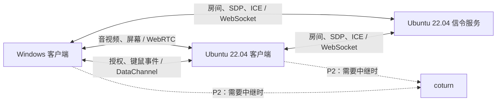
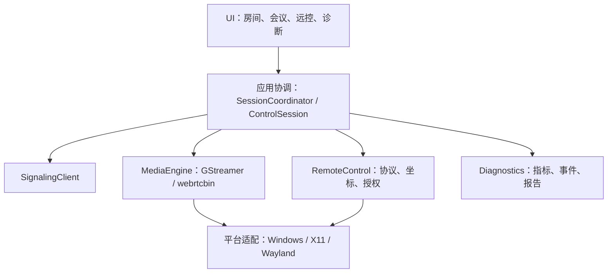

# MeetScope：跨平台音视频会议与远程协助工作台

> 文档版本：v1.0 · 2026-09-28  
> 目标平台：Windows 11 x64、Ubuntu 22.04 LTS x64  
> 文档性质：项目需求与推荐实施方案。文中的性能数字为验收目标，尚未完成程序开发或实测。

**推荐方案一览：** 分层模块化架构与显式状态机；C++17 + Qt Widgets / QOpenGLWidget + GStreamer / WebRTC；独立 C++ / Qt WebSockets 信令服务。Windows 使用 MSVC2022 x64，Ubuntu 22.04 使用 GCC 11。先完成局域网双人会议和 Windows ↔ Linux/X11 远控，再扩展 Wayland 与公网。

## 1. 项目定位与目标

开发一套以 C++ 为核心的桌面应用，让 Windows 与 Ubuntu 用户进行双人音视频通话、共享屏幕和相互远程协助，并展示真实的连接质量、故障与恢复过程。

核心演示场景：

1. Windows 和 Ubuntu 加入同一个房间，进行音视频沟通。
2. Ubuntu 用户共享桌面，Windows 用户申请远程控制。
3. Ubuntu 用户同意后，Windows 用户操作远端普通桌面应用。
4. Ubuntu 用户收回控制权，再切换为 Ubuntu 控制 Windows。
5. 在专用测试网络中制造弱网或断网，观察诊断数据与恢复过程。
6. 导出本次会话的事件记录和测试报告。

作品的重点是业务流程完整、跨平台接口清楚、线程和资源管理可靠、故障可以复现。使用成熟媒体库完成基础传输，把个人开发的深度集中在会话管理、远控协议、平台适配、诊断与测试。

### 与目标岗位的对应关系

| 岗位要求 | 项目中的证明材料 |
| --- | --- |
| 音视频业务与 UI 开发 | 入会、退会、设备选择、通话、共享、远程协助的实际演示 |
| C++、多线程、网络编程 | 状态机、异步回调、媒体工作线程、输入协议、断线处理 |
| 公共组件与跨平台接口 | 两端共用业务代码，平台差异集中在采集与输入模块 |
| 自测框架与持续集成 | 状态、协议、资源生命周期测试，双平台构建和测试报告 |
| 优化与重构能力 | 有界帧缓存、事件合并、恢复耗时及优化前后的实测比较 |

## 2. 设计前提与范围

### 2.1 已确定的需求

- 桌面客户端以 C++ 和 Qt 6 开发。
- Linux 基线为 **Ubuntu 22.04 LTS x64**。
- Windows 与 Linux 都能作为控制端或被控端。
- 包含音视频、屏幕共享、远程协助、质量诊断和自动测试。

### 2.2 本方案采用的实施假设

- Windows 首个验收环境为 Windows 11 x64。
- 一个房间最多两人，一次只有一个屏幕共享方和一个远程控制方。
- 首个版本在局域网运行；跨公网连接属于后续阶段。
- Ubuntu 首个远控验收环境是 GNOME 的 X11 会话，即登录界面的“Ubuntu on Xorg”。
- 两端都有用户登录到可见桌面，远控由被控方现场同意。
- 第一版单路视频在“摄像头”和“屏幕”之间切换，语音保持通话。摄像头与屏幕同时发送两路视频在后续扩展。

### 2.3 功能分期

| 优先级 | 功能 | 完成条件 |
| --- | --- | --- |
| P0 | 双人房间、设备选择、音视频通话、入退会 | Windows / Ubuntu 22.04 真实互通 |
| P0 | 连接状态、基础日志、资源释放 | 异常状态明确，重复入退会后设备可再次使用 |
| P1 | 屏幕共享、Windows ↔ Linux/X11 远控 | 共享画面与真实键鼠操作形成闭环 |
| P1 | 控制申请、拒绝、同意、撤销 | 被控端实际停止接受已撤销的输入 |
| P1 | 质量面板、断网恢复、报告、自测与 CI | 真实数据、可复现故障、可查看测试结果 |
| P2 | Ubuntu 22.04 / GNOME Wayland 适配 | 本机 Portal 能力核验和双向远控测试通过 |
| P2 | 公网连接、TURN 中继 | 两个独立网络连接成功，强制中继测试通过 |
| P2 | 外放通话的回声消除、简单码率策略 | 按明确场景测量并验证效果 |
| P3 | 双路视频、多显示器、剪贴板文本同步 | 在已有稳定版本基础上逐项验收 |

首版边界：无账号平台、多人 SFU、无人值守远控、登录屏幕控制、文件传输、AI 纪要或移动端。中文输入法、复杂键盘布局以及 Windows 提权窗口的控制另行评估。

## 3. 推荐架构

采用 **模块化桌面客户端 + 独立轻量信令服务 + WebRTC 点对点媒体及数据传输**。

客户端各模块在一个进程内运行；信令服务是一个独立进程，部署在 Ubuntu 22.04。第一版不引入微服务或通用插件系统。仅在实际存在平台差异、第三方边界或测试替身的位置设置接口。

### 3.1 系统拓扑



- 信令服务管理房间、成员和协商消息；不处理视频编解码，也不转发正常的媒体流。
- 局域网内优先建立直接连接；公网无法直连时，P2 使用 TURN 中继。
- DataChannel 承载远控消息，不用 WebSocket 连续发送截图。
- SDP 和 ICE 是建立媒体连接的协商信息，需要通过信令交换。WebRTC 没有替应用实现房间或信令业务。[WebRTC 官方说明](https://webrtc.org/getting-started/peer-connections)

### 3.2 客户端分层



| 模块 | 职责 | 主要边界 |
| --- | --- | --- |
| UI | 显示状态、画面、质量曲线；收集用户意图 | 不直接调用系统输入 API 或拼装媒体管线 |
| SessionCoordinator | 入退会、协商、恢复、关闭过程 | 是会议业务状态的唯一写入者 |
| SignalingClient | 房间消息、SDP/ICE、心跳、重连 | 不把 WebSocket 连通直接当成通话成功 |
| MediaEngine | 设备、采集、编解码、WebRTC、数据通道、媒体统计 | 对外暴露项目类型，封装 GStreamer 对象及回调 |
| RemoteControl | 控制申请、授权、输入编码、坐标转换、按键状态 | 被控端负责最终决定是否执行输入 |
| Platform | 屏幕采集和输入执行的平台差异 | Windows、X11、Wayland 分别实现 |
| Diagnostics | 指标采样、异常时间线、报告导出 | 不在每帧或每次鼠标移动时写磁盘 |

必要接口按职责限定为媒体引擎边界、屏幕采集策略和输入执行器。业务消息使用值类型；GObject、GstBuffer 等第三方指针不流入 UI。无需为每个类建立抽象基类。

### 3.3 架构取舍

| 选择 | 推荐理由 | 对实施的影响 |
| --- | --- | --- |
| Qt Widgets + QOpenGLWidget | 业务代码集中在 C++，桌面控件与输入处理直接 | 用统一配色、间距和图标打磨界面；无需同时学习 QML 集成 |
| GStreamer / webrtcbin | 采集、编码、RTP、ICE 和统计可在同一媒体体系接入 | 需要掌握 GLib 回调、管线、设备插件和部署 |
| 双人 P2P | 范围适合个人作品，连接路径容易演示与排查 | 多人会议以后引入 SFU，并单独设计服务器体系 |
| C++ / Qt WebSockets 信令服务 | 复用语言和测试工具，服务代码规模较小 | 一个进程即可实现双人房间和消息路由 |
| JSON 协议与 JSONL 报告 | 易读、方便抓包和面试讲解 | 先限制消息大小与发送频率，实测后再决定是否换二进制 |

GStreamer `webrtcbin` 提供协商及媒体连接能力；编码参数、业务恢复和产品层弱网策略仍需应用负责，不能把库的基础能力写成个人自研成果。[webrtcbin 文档](https://gstreamer.freedesktop.org/documentation/webrtc/)

## 4. 技术栈与版本基线

| 类别 | 推荐基线 | 用途 |
| --- | --- | --- |
| 语言 | C++17 | RAII、值类型、线程与公共业务模块 |
| Qt | **Qt 6.8.3**，两端保持相同版本 | Core、Gui、Widgets、OpenGL、OpenGLWidgets、Network、WebSockets、Test |
| Windows 编译器 | **MSVC 2022 / v143 / x64** | 与 Qt 的 MSVC2022 64-bit 套件配套 |
| Linux 编译器 | GCC / G++ 11.x | Ubuntu 22.04 原生工具链 |
| 媒体 | **GStreamer 1.26.11** | 作为可复现的首个集成基线，两端保持一致 |
| 视频编码 | VP8，软件编码起步 | 优先完成跨平台互通；硬件编码以后测量再接入 |
| 音频编码 | Opus | 实时语音 |
| 连接与输入传输 | webrtcbin + DataChannel | 音视频、屏幕与控制消息 |
| 信令 | Qt WebSockets + JSON | 房间、SDP、ICE、错误与心跳 |
| 构建 | CMake 3.28.x + Ninja 1.11.x | 双平台构建与 CTest |
| GStreamer 源码构建 | Meson 1.5.x + Python 3.10 | Ubuntu 22.04 独立构建媒体依赖 |
| 单元与集成测试 | Qt Test + CTest | 状态、协议、坐标、回调和资源生命周期 |
| 配置 / 报告 | QSettings / JSON / JSONL | 设备偏好、事件流和报告 |
| Linux 平台接口 | X11 / XTest；P2 增加 Qt DBus、Portal、PipeWire | 屏幕采集与输入执行 |
| 公网中继 | coturn，P2 安装时锁定版本 | TURN 服务 |

以上是工程版本选择，不是“全部最新版”。Qt 6.8.3 源码和 GStreamer 1.26.11 Windows 安装包均有官方归档；GStreamer 1.26 已被新系列取代。依赖补丁更新后需重新验证互通、插件和部署，不在开发中途单独升级一端。[Qt 源码归档](https://download.qt.io/archive/qt/6.8/6.8.3/single/)、[GStreamer 1.26 说明](https://gstreamer.freedesktop.org/releases/1.26/)

Qt 6.8 的支持表列出 Ubuntu 22.04 / GCC 11 与 Windows / MSVC 2022。Linux 是否能运行某个预编译包还取决于其构建环境；本方案固定在 Ubuntu 22.04 本机或同版本构建机编译 Qt，避免把“系统受支持”当作“所有下载包都兼容”。[Qt 平台支持表](https://doc.qt.io/qt-6.8/supported-platforms.html)

首版不额外引入独立 FFmpeg SDK、数据库、Electron 或 Qt Multimedia 采集链。音视频设备由 GStreamer 管理，避免两个框架同时争用设备。Qt Quick 可在未来明确需要界面升级时评估。

## 5. 开发与运行环境

### 5.1 硬件和网络

- 至少一台 Windows 与一台 Ubuntu 机器，或双系统设备组合；摄像头、麦克风和耳机可用。
- 建议每端至少 4 核 CPU、16 GB 内存；源码构建较耗空间，预留约 30 GB，并按构建产物调整。
- 初始测试使用耳机，避免把外放回声问题和网络问题混在一起。
- 首次互通使用同一局域网，记录有线 / Wi-Fi、设备型号和网络路径。
- 虚拟机适合构建及逻辑测试；摄像头、桌面采集、DPI、输入及延迟的最终验证用真实桌面设备。

### 5.2 Windows 11 x64

安装项：

1. Visual Studio 2022 或 Build Tools 2022，选择“使用 C++ 的桌面开发”。
2. MSVC v143 x64/x86 生成工具与 Windows SDK。
3. Qt 6.8.3 的 **MSVC 2022 64-bit** 套件及 Qt WebSockets。
4. Qt Creator、CMake、Ninja；用 Qt Creator 调试时安装 CDB / Debugging Tools for Windows。
5. GStreamer 1.26.11 的 **MSVC x86_64 Runtime 和 Development**，两者安装到同一个目录。
6. Git。

GStreamer 安装包名称：

```text
gstreamer-1.0-msvc-x86_64-1.26.11.msi
gstreamer-1.0-devel-msvc-x86_64-1.26.11.msi
```

官方安装指导要求同时安装运行时和开发文件。[Windows 安装说明](https://gstreamer.freedesktop.org/documentation/installing/on-windows.html)、[1.26.11 MSVC 安装包](https://gstreamer.freedesktop.org/data/pkg/windows/1.26.11/msvc/)

建议路径示例，实际路径由安装记录确定：

```text
C:\Qt\6.8.3\msvc2022_64
C:\gstreamer\1.0\msvc_x86_64
```

- 在 Qt Creator 选择 MSVC2022 64-bit Kit。
- CMake 使用 `CMAKE_PREFIX_PATH` 指向 Qt，项目定义的 `GST_ROOT` 指向媒体 SDK。
- Windows 在项目的一个 CMake 查找文件中处理 GStreamer 头文件、库和导入目标；Linux 使用 pkg-config，业务代码不感知差异。
- 编译与运行必须使用同一套 GStreamer，避免加载其他程序带来的 DLL 或插件。
- 交付构建使用 Release 与 `/MD`。库分配的媒体对象按库 API 释放，不跨运行库直接 `free/delete`。

`GST_ROOT` 是未来工程需实现的项目参数，不是 GStreamer 自动识别的通用 CMake 参数。

### 5.3 Ubuntu 22.04 LTS x64 / X11

基线：GCC 11.x、glibc 由 Ubuntu 22.04 系统维护、GNOME / X11、Qt 6.8.3、GStreamer 1.26.11。安装前记录系统补丁和依赖包版本。

Ubuntu Jammy 默认仓库的 GStreamer 为 1.20 系列。本方案不能只运行 `apt install libgstreamer1.0-dev` 就宣称得到 1.26.11。[Ubuntu 官方包信息](https://packages.ubuntu.com/jammy/libgstreamer1.0-dev)

**推荐路线：Qt 和 GStreamer 安装到当前用户的独立前缀，保留系统自带库。** Qt 从源码编译；GStreamer 使用 1.26.11 的 monorepo 与 Meson 构建。GLib、X11、音频等底层依赖使用 22.04 包，缺失或版本不满足的媒体依赖在独立构建中解决。[Qt 源码构建](https://doc.qt.io/qt-6.8/linux-building.html)、[GStreamer Meson 构建](https://gstreamer.freedesktop.org/documentation/installing/building-from-source-using-meson.html)

建议前缀：

```text
~/.local/opt/meetscope/qt-6.8.3
~/.local/opt/meetscope/gstreamer-1.26.11
~/.local/opt/meetscope/build-tools
```

基础开发依赖示例，供后续在 Ubuntu 上执行；本次仅编写方案，没有执行安装：

```bash
sudo apt update
sudo apt install \
  build-essential gcc-11 g++-11 git pkg-config curl \
  python3 python3-venv python3-pip bison flex \
  libgl1-mesa-dev libegl1-mesa-dev libdbus-1-dev libssl-dev \
  libfontconfig1-dev libfreetype6-dev libharfbuzz-dev \
  libpng-dev libjpeg-dev libpcre2-dev zlib1g-dev \
  libx11-dev libx11-xcb-dev libxext-dev libxfixes-dev libxdamage-dev \
  libxtst-dev libxkbcommon-dev libxkbcommon-x11-dev \
  libxcb1-dev libxcb-cursor-dev libxcb-glx0-dev libxcb-icccm4-dev \
  libxcb-image0-dev libxcb-keysyms1-dev libxcb-randr0-dev \
  libxcb-render-util0-dev libxcb-shape0-dev libxcb-shm0-dev \
  libxcb-sync-dev libxcb-xfixes0-dev libxcb-xinerama0-dev libxcb-xkb-dev \
  libglib2.0-dev libvpx-dev libopus-dev libsrtp2-dev libnice-dev \
  libasound2-dev libpulse-dev libudev-dev
```

这份列表覆盖首版主要依赖，不替代源码配置检查。尤其应检查 `libnice` 等依赖的最低版本；Meson 的 WebRTC 支持必须明确启用，不能因依赖缺失而静默跳过。CMake 3.28.x 和 Meson 1.5.x 放在独立工具环境，不能假设 22.04 的默认工具版本满足本基线。

Qt 构建范围先选 `qtbase`、`qtwebsockets`，包含 Widgets、OpenGL 和 Qt Test。P2 Wayland 原生运行时再加入 `qtwayland` 与其构建依赖。Qt 的 XCB 依赖按配置结果检查。[Qt X11 依赖说明](https://doc.qt.io/qt-6.8/linux-requirements.html)

GStreamer 构建需启用 base / good / bad 和 WebRTC，确保 VP8、Opus、RTP、DTLS、SRTP、ICE、appsink、appsrc、X11 与 PulseAudio 插件可用。首版 Qt 视频渲染由项目实现，不依赖 Qt5/Qt6 QML 视频插件。构建参数及补丁记录进依赖清单。[1.26.11 构建选项](https://raw.githubusercontent.com/GStreamer/gstreamer/1.26.11/meson_options.txt)

编译与运行通过项目专用启动环境选择 `PATH`、`PKG_CONFIG_PATH`、`LD_LIBRARY_PATH` 和插件路径。独立前缀的插件扫描器、插件与核心库必须配套；必要时设置 `GST_PLUGIN_SYSTEM_PATH_1_0` 指向该前缀，并使用独立的插件注册缓存。不要把系统 1.20 插件目录与 1.26 SDK 混成一个运行环境。

### 5.4 环境验收清单

在正式编写业务前，保存两端的版本输出和测试结果。

```bash
# Ubuntu：在项目依赖环境中运行
lsb_release -ds
g++ --version
ldd --version
cmake --version
ninja --version
meson --version
printenv XDG_SESSION_TYPE
pkg-config --modversion gstreamer-1.0 gstreamer-webrtc-1.0
gst-inspect-1.0 --version
gst-inspect-1.0 webrtcbin
gst-inspect-1.0 vp8enc
gst-inspect-1.0 opusenc
gst-inspect-1.0 nicesrc
gst-inspect-1.0 dtlssrtpenc
gst-inspect-1.0 ximagesrc
gst-inspect-1.0 pulsesrc
gst-inspect-1.0 appsink
gst-inspect-1.0 appsrc
```

Windows 在 VS 2022 x64 开发环境中检查 `cl`、CMake、Ninja、Qt Kit 和上述公共媒体插件；屏幕检查项改为 `d3d11screencapturesrc`，音频源采用可用的 WASAPI 插件。

环境验收必须包括：摄像头预览、麦克风录放、桌面采集、VP8/Opus 编解码以及两个进程之间的 WebRTC 测试源互通。安装器成功退出不等于验收通过。

## 6. 音视频与屏幕传输设计

### 6.1 基础媒体链路

```text
发送视频：摄像头或桌面 → 格式/尺寸转换 → VP8 编码 → RTP → webrtcbin
接收视频：webrtcbin → RTP 解包 → VP8 解码 → appsink → 有界帧缓存 → Qt 渲染
发送音频：麦克风 → 重采样 → Opus 编码 → RTP → webrtcbin
接收音频：webrtcbin → RTP 解包 → Opus 解码 → 系统音频输出
```

- 首个摄像头目标：720p、30 FPS；屏幕优先 1080p、15 FPS，源尺寸不匹配时缩放。
- 参数是配置目标，UI 显示实际编码尺寸、帧率和码率，不能把配置值显示成实测值。
- GStreamer 处理媒体时钟、流内部同步和基础网络传输；应用负责状态、设备错误、视频源切换和恢复策略。
- 屏幕 / 摄像头切换由媒体线程完成。需要重新协商时交给固定的协商发起方，避免两端同时发 offer。
- 先使用耳机验证语音链路。P2 再结合 `webrtcdsp` 和播放参考信号评估回声消除；仅接入编码器不意味着完成 AEC。[音频处理文档](https://gstreamer.freedesktop.org/documentation/webrtcdsp/webrtcdsp.html)

### 6.2 屏幕采集

| 平台 | 首选实现 | 项目自己的工作 |
| --- | --- | --- |
| Windows | GStreamer `d3d11screencapturesrc`，先使用 DXGI 采集路径 | 屏幕描述、源生命周期、光标表现、屏幕变化事件 |
| Ubuntu / X11 | GStreamer `ximagesrc` | 会话识别、画面尺寸、光标、线程初始化及源管理 |
| Ubuntu / Wayland（P2） | ScreenCast / RemoteDesktop Portal + PipeWire | 用户授权会话、流标识、FD 生命周期与输入映射 |

优先复用已有采集插件，初版不再重复实现完整的 DXGI 采集器。必须实测光标是否随画面正确传输，避免远控能操作却看不清位置。[Windows 采集插件](https://gstreamer.freedesktop.org/documentation/d3d11/d3d11screencapturesrc.html)、[X11 采集插件](https://gstreamer.freedesktop.org/documentation/ximagesrc/index.html)

### 6.3 渲染与帧缓存

- 首版把 appsink 帧转换成固定像素格式，由 `QOpenGLWidget` 上传纹理并显示；允许 CPU 拷贝，先验证正确性。
- 每路应用帧缓存最多 2 帧，消费不及时则丢弃旧帧，保留最新完整帧；上游 queue 也需设置明确上限。
- UI 按固定刷新节奏读取最新帧，避免每帧都排入一个 Qt 事件造成积压。
- 帧的引用和映射生命周期明确；异步使用时不能引用已经 unmap 或 unref 的内存。
- 零拷贝、GPU 互操作与硬件编码在测量瓶颈后增加，记录收益与兼容性成本。

## 7. 远程控制设计

### 7.1 角色与授权流程

同一个客户端具备控制和被控能力。一次控制会话只能有一个被控端和一个控制端；切换方向前先关闭旧控制会话。

```text
观看共享画面 → 请求控制 → 被控端同意 → 发送键鼠事件 → 本地撤销或会话结束
```

- 申请、同意、拒绝、撤销使用可靠有序 DataChannel。
- 被控方界面持续显示控制者，并提供本地“收回控制”按钮及快捷键。
- 被控端维护当前授权，逐条检查输入；本地撤销先立即失效授权，再通知对端。
- 会话结束、屏幕切换、网络断开或重建连接都撤销控制。恢复通话后重新申请。
- 只释放本程序注入且仍处于按下状态的按键 / 按钮；不改变本地用户自身的输入状态。

### 7.2 平台输入

| 平台 | API 路线 | 首版限制 |
| --- | --- | --- |
| Windows | `SendInput` | 普通用户桌面及相同或更低完整性级别的窗口 |
| Linux / X11 | XTest | 已登录的 X11 桌面；不把 XWayland 运行成功当作原生 Wayland 支持 |
| Linux / Wayland（P2） | RemoteDesktop Portal 的可用 `Notify*` 接口 | 先核验 Ubuntu 22.04 当前 GNOME / Portal 后端能力 |

Windows 输入受 UIPI 限制，普通权限客户端不能保证控制管理员窗口；首版不通过服务或驱动绕开该限制。[微软 SendInput 说明](https://learn.microsoft.com/en-us/windows/win32/api/winuser/nf-winuser-sendinput)

X11 使用独立输入连接；涉及跨线程访问 Xlib 时，在任何 Xlib 使用前完成线程初始化并遵守连接的线程归属。[XTest 文档](https://www.x.org/releases/X11R7.5/doc/man/man3/XTestFakeKeyEvent.3.html)

### 7.3 输入协议

首版只用一条可靠有序控制通道，鼠标移动在发送前合并并限频为最多 30 次/秒。按钮、按键、授权及撤销事件不随移动事件合并。检查通道积压；严重积压时停止新的控制输入并提示用户，必要时被控端本地撤销。

消息字段：

| 字段 | 作用 |
| --- | --- |
| protocolVersion | 协议版本 |
| sessionId | 当前会议会话标识 |
| controllerId | 发送方身份，必须与已建立的会话绑定 |
| controlEpoch | 被控端生成的当前授权代次，旧授权消息失效 |
| seq | 单调递增序号，拒绝重复或旧消息 |
| screenId / screenGeneration | 当前共享屏幕及其版本 |
| type | move、buttonDown、buttonUp、wheel、keyDown、keyUp 等 |
| payload | 坐标、按键、按钮或滚轮数据 |

按键使用项目定义的物理按键编码，在接收端映射 Windows / X11 键码；首版验证英文字母、数字、方向键和常用组合键。文本输入、输入法及不同键盘布局不混入同一种物理按键协议。

鼠标按钮事件同时携带点击坐标和屏幕代次，接收端先定位再执行按钮事件，保证移动事件合并后点击位置仍然正确。

连接中断时不缓存键鼠事件用于重连后补发。重建连接生成新会话代次，旧事件不可执行。GStreamer 提供 DataChannel 收发接口，具体协议和授权策略由项目实现。[DataChannel API](https://gstreamer.freedesktop.org/documentation/webrtclib/gstwebrtc-datachannel.html)

### 7.4 坐标与缩放

- 以实际显示图像矩形计算归一化坐标 `u、v`，范围为 0～1；点击黑边直接忽略。
- Windows / X11 将归一化坐标映射到采集画面的像素坐标，再转换为对应系统输入坐标。
- Wayland 使用 Portal 返回的流和逻辑坐标，不能直接套用物理像素尺寸。
- 屏幕尺寸或 DPI 变化后，更新 screenGeneration、暂停控制并重新确认映射。
- 第一版只选择一个显示器作为共享与控制对象。

### 7.5 Ubuntu 22.04 Wayland 的单独验收

Wayland 是 P2，需要先通过 DBus introspection 和能力查询确认 ScreenCast / RemoteDesktop 接口及实际后端。使用 RemoteDesktop 会话关联屏幕流，处理用户确认、会话关闭与拒绝，不假设新版 Portal 的 EIS/libei 功能已存在于 22.04。

本机缺失能力时明确报告该组合尚未支持，继续保留 X11 版本。运行 Qt 程序的 Wayland 窗口，与采集和控制整个 Wayland 桌面，是不同的验收项。[Portal RemoteDesktop 文档](https://flatpak.github.io/xdg-desktop-portal/docs/doc-org.freedesktop.portal.RemoteDesktop.html)

## 8. 会话状态、线程与资源管理

### 8.1 状态机

会议状态：

```text
Idle → Joining → Negotiating → Connected
Connected → Recovering → Negotiating → Connected
任意活动状态 → Leaving → Idle
不可恢复错误 → Failed → 用户重试或退出
```

屏幕共享状态与控制授权状态分别管理，不把它们与会议状态组合成大量枚举值。

- 指定房间创建方作为首次协商发起方；源切换或恢复时仍由该方协调协商。
- 分别显示“信令连接”“媒体连接”和“控制授权”，三者不能互相替代。
- 超时、取消入会、重复按钮、连接途中退会及晚到回调均有确定处理。
- 首版恢复采用有上限的重新协商 / 重建媒体连接，不要求立即实现原生 ICE restart。
- 对暂时的信令掉线与实际媒体断开分别判断；恢复过程中撤销远控，保留可用语音仅在状态和授权允许时进行。

### 8.2 线程模型

| 执行位置 | 职责 |
| --- | --- |
| Qt 主线程 | UI、业务协调、Qt WebSocket 异步消息、低频指标展示 |
| 媒体控制线程 | 自有 GLib MainContext / MainLoop，管线创建、修改、停止和协商命令 |
| GStreamer 内部线程 | 采集、编解码、RTP、appsink 等流回调 |
| 输入工作线程 | 平台输入执行和注入按键状态，按消息顺序执行 |

- 媒体操作通过 MainContext 投递，避免多个线程同时修改管线。
- 流回调只完成必要的数据处理和事件转交，不直接更新 QWidget。
- 控制权限检查与输入执行在同一输入工作线程串行化；撤销有确认机制，UI 不能仅发送一个请求就宣称被控端已经停止执行。
- 报告在低频缓冲后写入，不在媒体线程同步落盘。出现写入瓶颈再增加专用写入线程。

### 8.3 关闭顺序与资源所有权

1. 停止接收新业务操作，进入 Leaving。
2. 在输入线程失效授权，释放本程序持有的注入按键，并停止输入接收。
3. 停止帧投递及统计定时器，解除第三方回调连接。
4. 媒体线程停止管线，关闭 DataChannel，释放 Gst/GObject 与设备资源。
5. 退出并回收工作线程，处理信令退出和最终报告，再回到 Idle 或关闭窗口。

每次会话携带代次，晚到回调必须检查代次。RAII 包装 Gst 引用和系统句柄；Qt 对象遵守线程归属。退出等待不得无限阻塞 UI；超时需要留下明确诊断信息。

## 9. 信令、连接与部署

### 9.1 信令服务

使用 `QCoreApplication + QWebSocketServer`，房间状态保存在内存，一个房间最多两人。

首版消息包括：createRoom、joinRoom、leaveRoom、peerJoined、peerLeft、offer、answer、iceCandidate、heartbeat、error。

- 服务器生成房间 ID、加入凭据和会话代次，发送方身份绑定当前连接。
- 服务器校验房间成员、目标成员、消息类型及大小，不能让客户端任意转发到其他房间。
- 退出和心跳超时清理成员；服务重启后旧房间失效，UI 提示重新创建或加入。
- 第一版不增加数据库或账号体系。
- 本机及受控局域网开发可以使用 ws；正式演示包支持 wss，使用受信任证书，不通过忽略证书错误连接。
- 远控授权在两端协议和被控端实际执行处验证，房间加入凭据不能直接授予控制权。

### 9.2 公网扩展（P2）

部署 coturn，明确配置认证、监听端口和中继端口范围。公网测试分别验证直接连接和强制中继，记录 ICE candidate pair 及实际连接类型。仅安装 TURN 服务不能证明跨公网互通。[coturn 项目](https://github.com/coturn/coturn)

### 9.3 交付与部署

- Windows：用 windeployqt 配置 Qt 运行库；另外部署 GStreamer 核心库、实际使用的插件、插件扫描器和其依赖。Qt 部署工具不会自动完成媒体 SDK 的全部部署。
- Ubuntu：在 22.04 构建与验收。提供带启动脚本的便携目录，明确哪些库随包携带、哪些是系统依赖；构建较新的 Linux 系统不能证明可向下兼容 22.04。
- 信令服务：Ubuntu 22.04 可使用 systemd 管理，配置文件中声明监听地址、端口、证书和日志位置。
- 每份发行包带依赖版本、插件清单和第三方许可说明；清洁环境验证双击 / 启动脚本、入会及真实设备行为。

## 10. 诊断、弱网和报告

### 10.1 指标面板

默认每秒采样和显示一次，指标包括：

| 指标 | 数据来源或定义 |
| --- | --- |
| 实际发送 / 接收码率 | 同一统计对象字节差值 / 单调时钟采样间隔；声明是否含协议开销 |
| 丢包率 | 相同接收流累计丢包与接收计数的区间变化，重建统计对象时重置计算 |
| RTT / 抖动 | 可用的 WebRTC 统计，统一显示单位 |
| 解码 / 渲染帧率 | 库统计与项目计数分别标注 |
| 应用丢帧 / 帧缓存长度 | 项目的渲染缓存计数 |
| 连接状态与路径 | 信令、媒体状态及可用的 ICE 信息 |
| 恢复耗时 | 本端发现中断到本端重新收到有效媒体的单调时钟差值 |
| CPU / 内存 | 平台进程指标，报告写清 CPU 归一化口径及内存指标名称 |

RTT 标为网络往返时间，不当作视频端到端延迟。缺失的统计显示“不可用”，不填 0。统计名称和字段随版本核验，不假设最新版网页中的每个字段都存在于 1.26.11。[WebRTC 统计定义](https://www.w3.org/TR/webrtc-stats/)

### 10.2 弱网测试

- 使用专用 Linux 测试网关或网络命名空间，借助 netem 控制限速、延迟和丢包。
- 确认真实媒体包经过受影响的路径；只断开 WebSocket 不代表已测试媒体断网。
- 客户端显示场景名称和测试时间线。自动切换场景按钮在测试工具可用后接入；首版允许外部测试脚本切换。
- 测试工具只管理专用测试接口，不覆盖生产网络规则；测试结束有明确恢复步骤。
- 记录影响方向、带宽、延迟、丢包参数和实际路径，不能仅写“弱网模式”。

建议场景：正常局域网；限制到 1 Mbps 并增加 100 ms 单向延迟；独立的 2% 随机丢包；媒体路径中断 5 秒后恢复。分别测试，避免多个因素叠加后无法解释结果。

### 10.3 业务层弱网策略（P2）

在固定网络场景下，尝试从 720p/30 FPS 降到 360p/15 FPS，并调整 VP8 目标码率；持续恢复良好后再升级。阈值、观察窗口和恢复窗口在实测后确定，避免频繁振荡。音频优先，视频帧队列有上限。

报告区分 WebRTC 库的传输行为和项目实现的策略，并在相同网络条件下比较策略开启 / 关闭的数据。

### 10.4 报告格式

每次会话导出：

- `summary.json`：版本、平台、设备、显示会话、网络路径、测试场景、持续时间、恢复结果。
- `events.jsonl`：入退会、协商、授权、撤销、故障、恢复、设备和媒体错误。
- `metrics.csv`：按秒记录的原始指标，带单位、统计对象和缺失值。
- `report.md`：便于阅读的结果、环境和已知限制。

日志不保存用户实际输入文本，也不写入房间凭据。摘要不能替代原始测量数据。

## 11. 目录和构建规划

以下是未来程序仓库的建议结构，本次只创建方案文档。

```text
MeetScope/
├── CMakeLists.txt
├── CMakePresets.json
├── README.md
├── cmake/
│   └── FindGStreamer.cmake
├── apps/
│   ├── client/
│   └── signaling-server/
├── src/
│   ├── session/
│   ├── signaling/
│   ├── media/
│   ├── remote-control/
│   ├── diagnostics/
│   └── platform/
│       ├── windows/
│       └── linux/
├── resources/
├── tests/
│   ├── unit/
│   └── integration/
├── tools/
│   ├── environment/
│   └── network-test/
├── packaging/
└── docs/
```

- 客户端和服务端各一个可执行目标，公共协议按需要复用。
- 业务代码中不散布平台宏；平台选择集中在 CMake 和 platform 模块。
- Windows 与 Linux 使用独立构建目录，Preset 记录 Qt / SDK 前缀、编译器和构建类型。
- 版本清单记录确切工具版本、源码 tag、下载包校验值及启用的媒体插件。
- CTest 作为统一测试入口；CI 只使用已经验收并缓存的依赖基线。

## 12. 测试与验收标准

### 12.1 自动化测试范围

| 测试类型 | 重点 |
| --- | --- |
| 状态测试 | 正常入退会、取消、超时、重复操作、连接中退会、旧回调 |
| 协议测试 | 未授权输入、旧 controlEpoch、重复序号、错误字段、过大消息 |
| 坐标测试 | 缩放、黑边、边缘点、DPI / 尺寸变化、错误屏幕代次 |
| 资源测试 | 连续连接、关闭时回调、帧引用、线程退出、输入释放 |
| 信令集成 | 第三人被拒绝、对端退出、心跳超时、服务器重启 |
| 媒体集成 | 两个进程使用 videotestsrc / audiotestsrc，验证接收媒体及统计 |

CI 中用输入执行器替身检查协议行为，不在 CI 主机桌面随意注入真实输入；实际 Windows / X11 注入由专用测试机和明确测试窗口验收。

Linux 使用单独 ASan / UBSan 构建检查项目代码；必要时再用 TSan 检查自身并发逻辑。预编译依赖中的问题和第三方噪声单独归因，不能把未插桩的库宣称为已完整检查。

### 12.2 双平台 CI

- Windows：VS 2022 v143 x64，完成 Release 构建及 CTest。
- Linux：构建任务固定在 Ubuntu 22.04 环境，使用 GCC 11，不以 `ubuntu-latest` 替代基线。
- GUI 逻辑测试可以使用 offscreen / Xvfb；这些结果不能代表真实屏幕采集、键鼠或 Wayland 通过。
- 媒体自动测试使用可重复的测试源。设备、输入、DPI 与实际部署保留人工验收项。
- CI 输出 JUnit / CTest 结果和构建产物，不在测试失败时只输出“编译成功”。

### 12.3 首版验收目标

| 编号 | 场景 | 通过标准 |
| --- | --- | --- |
| A01 | Windows ↔ Ubuntu 22.04/X11 双人通话 | 持续 30 分钟无崩溃，双向音视频可用，UI 可操作 |
| A02 | 连续入会与退会 | 两端各 20 次，设备再次可用，无遗留工作线程或持续增长的项目缓存 |
| A03 | 两个方向远控 | 每个方向连续使用 10 分钟，点击、滚轮、英文输入、组合键可用 |
| A04 | 缩放与黑边 | 规定的 20 个测试点全部定位正确；黑边点击不执行 |
| A05 | 收回控制 | 本地撤销确认后，后续及旧代次输入不执行 |
| A06 | 按键期间断网 | 被控端检测中断后释放本程序注入的按键；重连不补发旧输入 |
| A07 | 媒体中断 5 秒后恢复 | 固定局域网场景重复 10 次；目标为路径恢复后 10 秒内重新收到媒体 |
| A08 | 有界视频缓存 | 应用缓存不超过 2 帧；显示慢时丢旧帧，无持续排队增长 |
| A09 | 诊断与报告 | 指标来自真实采样，缺失值明确，能关联事件、故障和恢复 |
| A10 | 干净环境部署 | 按交付步骤启动成功，真实通话、共享与远控通过 |

A07 是明确条件下的设计目标，不承诺所有公网网络的恢复时间。未达到目标必须报告实际结果、失败次数和原因。

视频端到端延迟另做专项测量：发送画面包含可读计时图案，用外部相机同时拍摄源画面与接收画面，按差值估算；报告相机帧率、测量误差、样本数和 P50 / P95。跨机器直接相减本地时间戳必须先处理时钟同步，不能直接作为结论。

## 13. 实施里程碑

| 阶段 | 必须交付 | 进入下一阶段的条件 |
| --- | --- | --- |
| M0：依赖与互通验证 | 两端版本清单、设备预览、测试源 WebRTC 互通 | 编码、ICE、音频、渲染和部署路径已验证 |
| M1：会议闭环 | 客户端、信令服务、音视频、状态与退会 | A01、A02 通过 |
| M2：屏幕与远控 | 视频源切换、授权、输入协议、Windows/X11 平台适配 | A03～A06、A08 通过 |
| M3：诊断与工程交付 | 弱网场景、恢复、报告、CI、安装包 | A07、A09、A10 通过，形成首个求职展示版本 |
| M4：选择性扩展 | Wayland、公网、AEC、弱网策略 | 每项有独立环境、测试和效果报告 |

M0 必须先做，避免界面完成后才发现插件或平台集成失败。功能逐项加入，不能用一次大规模重写替代小步验证。工期在 M0 完成后按每天可投入时间评估。

## 14. 面试展示材料

### 三分钟演示脚本

1. 两台真实设备入会，展示双方声音和视频。
2. Ubuntu 共享桌面，Windows 申请控制，在远端测试窗口点击、滚动和输入。
3. Ubuntu 收回控制，验证 Windows 后续操作已失效；切换控制方向。
4. 切换专用测试网络场景，展示真实质量变化和一次断网恢复。
5. 打开报告，说明恢复耗时、一次异常和对应自动测试。

### 配套材料

- 双平台可运行发行包、构建与启动说明。
- 两张架构图、协议说明、依赖版本清单和已知限制。
- 三分钟视频以及可重复的现场演示步骤。
- 测试报告及原始数据；展示一个优化前后使用相同场景的比较。
- 个人实现范围说明：明确成熟库提供的能力，与自己完成的状态、线程、协议、平台适配及测试。

面试讲解优先围绕四个问题：退会后晚到回调如何处理；缩放后点击如何映射；断线如何防止按键卡住；弱网恢复如何测量。项目名称、界面与指标都服务于这些可验证的能力。
