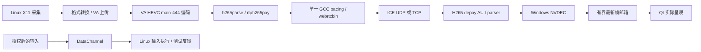

# Windows 控制 Linux：1080p / 60 fps 详细实现方案

日期：2026-10-10  
状态：待实施方案；不是稳定 60 fps 的验收报告  
代码基线：`5d31206`，分支 `ZJ-desk`，原工作区 `F:\projects\ZJdesk`  
适用范围：Windows 控制 Ubuntu X11 桌面，优先解决 Edge 打开、关闭、最小化、还原时的卡顿，以及画质、帧率和鼠标反馈波动。

## 1. 结论与实施边界

当前实施结果见 [实施进度与实测边界](1080p60-implementation-progress.md)：P1 分段观测已实现并完成双端相关回归，P2 仅完成部分独立候选实验，尚未切换产品 codec 或通过稳定 60 fps 验收。

两台电脑具备继续实现高质量 1080p / 60 fps 的硬件基础。当前需要优先解决的是 Windows VP9 4:4:4 软件解码的余量、发送链路积压、接收及显示调度，以及双 Wi-Fi 链路的长尾抖动。没有证据要求先购买新电脑，也没有证据支持仅修改一个码率或缓冲参数就能完成目标。

推荐路线：**建立真实桌面基准与完整观测 → 验证 HEVC 4:4:4 画质及实时性能 → 接入可协商的硬编硬解 → 修复传输及关键帧恢复 → 按证据优化显示 → 有线和现有 Wi-Fi 分别验收。**

HEVC 4:4:4 是优先验证的候选路线：Linux VA-API 编码与 Windows NVIDIA 解码已经通过一次离线互通试验，但实时采集、RTP、拥塞控制、RGB 画质和 Qt 显示尚未组合验收。它不能直接视为已实现的解决方案。

“完全消除卡顿”必须限定为规定设备、网络、负载和测试时长内达到指标。普通 Windows / Linux 和共享 Wi-Fi 无法承诺任意环境、无限时长下零丢帧、零停顿。方案允许异常时明确降级或报错，但降级后的运行不能算作稳定 1080p60 验收通过。

本方案不扩展跨公网功能，不重写远控协议，不增加通用编解码插件框架，不改动无关 UI。保留既有授权、撤销、输入顺序和会话隔离规则。产品实现遵循 [架构约定](architecture.md)、[维护交接](handoff.md) 和 [路线图](roadmap.md)。

## 2. 已知证据与现状

### 2.1 两端条件

以下是 2026-10-10 的检查快照，实施前须重新核对；内存、负载、地址、无线速率和进程状态可能变化。

| 维度 | Windows 控制端 | Linux 被控端 | 对方案的意义 |
| --- | --- | --- | --- |
| 设备 | HP Victus，i7-11800H，8 核 16 线程 | HP EliteBook 640 G10，i7-1355U，10 核 12 线程 | CPU 有基础能力，仍需压力期间的长尾统计 |
| 内存 | 16 GB，当时可用约 2.4 GiB | 约 32 GB，当时可用约 25 GiB | Windows 余量偏小；当时无换页证据，不能直接归因内存不足 |
| GPU | Intel UHD + RTX 3060 Laptop | Intel i915 / iHD 22.3.1 | 需要按实际 codec/profile 验证，不能只看“支持硬解” |
| 当前媒体路径 | 固定 `vp9dec` 软件解码 VP9 profile 1 | VA-API VP9 4:4:4 硬编码 | 当前链路并非两端硬件编解码 |
| HEVC 候选 | `nvh265dec` 已离线输出 main-444 / Y444 | `vah265lpenc` 已离线输出 main-444 | 具备候选互通能力，未完成实时远控验证 |
| 显示 | 1920×1080 @ 144 Hz，由 Intel 驱动 | X11，HDMI-1 1920×1080 @ 60 Hz | 60→144 的固定刷新节奏需要对照，不能解释近 1 秒停顿 |
| 软件 | Qt 6.8.3，GStreamer 1.26.11 | Ubuntu 22.04.5，内核 6.8.0-138，GStreamer 1.26.11 | 避免混入系统旧版 GStreamer 插件 |
| 电源 | 接电，HP 推荐方案 | 接电，performance profile，Intel pstate active / EPP performance | 尚无必须修改电源策略的证据 |
| 网络 | AX201，5 GHz，公司 Wi-Fi，信道 48 | 公司 5 GHz Wi-Fi，信道 153 | 同 SSID 不代表同 AP 或同一无线链路 |
| 网络路径 | 与 Linux 不同子网 | 到 Windows 经 `10.11.47.254` | 需要核对实际媒体候选、路由与回程 |

Windows Intel / NVIDIA 的 VP9 硬件解码 caps 本次均未包含 profile 1；不能通过把 `vp9dec` 改成某个 VP9 硬解元素就保证保留 4:4:4。Linux 当前 SDK 缺少 `h265parse`，这是 HEVC 产品化前必须补齐的依赖。

### 2.2 已实施优化及其边界

当前基线已包含以下措施，下一阶段应在此基础上修改，避免重复实现：

- DataChannel 有界 RTT 探测及延迟增长反馈；该指标是往返延迟，不是视频帧龄。
- 媒体工作队列前合并连续位置更新；键盘、按键、滚轮、形状和权限事件保持顺序屏障。
- `frameSwapped` 统计实际视频呈现，独立光标更新不增加视频帧数。
- 可选 GCC / TWCC / 单一 pacing；拥塞时在编码前丢弃完整原始帧。
- 编码器属性仅在变化时更新，避免重复设置造成关键帧风暴。
- 媒体失败后的迟到停止消息竞态修复；失败时仍立即撤销控制权限。

当前 `ZJDESK_WEBRTC_GCC=tcp` 是候选 GCC + ICE-TCP 模式；未设置或 `0` 为原基线。`1` 允许 UDP / TCP，但真实 GNOME 的 UDP 首帧曾失败，因此不能直接升为默认。

### 2.3 性能基线

| 项目 | 已测结果 | 解释边界 |
| --- | --- | --- |
| Edge 压力 | 600.445 秒；打开/关闭各 68 次，最小化/还原各 204 次，调整大小 612 次 | Linux 使用 Xephyr / Openbox，桌面渲染为 llvmpipe；不能代替真实 GNOME 验收 |
| 实际呈现帧率 | 压力平均 52.729 fps，随后画质阶段平均 44.942 fps | 分辨率保持 1080p，但目标曾降到 50 / 45 / 40；未达稳定 60 |
| 呈现间隔 | 共 34,406 个间隔，p95 39.843 ms，最大 907.258 ms，10 次超过 200 ms | 不应只报告其中接近 60 fps 的窗口 |
| 文字细节 | 1800 个单像素列，RGB 平均误差 0.721，最大 4 | 说明该测试画质良好；不能推导新 codec 已满足同样标准 |
| 输入反馈 | 压力后光标确认 p95 30.864 ms；拖拽到解码画面反馈 p95 73.053 ms | 不是压力期间的并发输入测试，也不是物理屏幕扫描延迟 |
| TCP 队列 | 一秒一次采样观察到 Send-Q 最大 1,242,227 字节 | 采样从压力约 2.2 分钟后开始，不能作为全程真实峰值 |
| 停顿定位 | 最差窗口编码仍连续；解码输出间隔约 906.81 ms，呈现约 907.26 ms | 下游传输/恢复存在直接证据，不能只归因显示或编码 |
| 另一停顿窗口 | 呈现约 496 ms，解码输出约 107 ms | 接收线程或显示调度也需要独立观测 |
| 真实 GNOME 短测 | 三轮启停通过；Windows 解码窗口均值约 16.13 / 20.42 / 16.53 ms，单帧最大约 98.02 ms | 是软件解码余量不足的风险证据，不能据此直接计算整条流水线 FPS |
| 网络短测 | 20 次 ICMP，0 丢包，最小/平均/最大约 6 / 60 / 163 ms | 当时无本项目 Windows 视频流；不是网络全局空闲或长期零丢包证明 |

基础 core / signaling / media 回归曾在两端通过。Linux 全量 GUI 曾为 **16 通过、1 失败、3 跳过**，失败项为 `workspaceFitsSmallWindowAndLongNames`。本轮未改相关布局，也未证明它是原版本必然失败；后续不得写成全量 GUI 已通过。

本地原始资料：[可行性评估](../build/analysis/feasibility-20261010/assessment.md)、[上一阶段优化记录](../build/analysis/interaction-20261010/optimization-results.md)。`build/` 是本地生成物，不进入源码管理；独立分发本方案时应另附需要的测试报告。

## 3. 可验证的成功标准

### 3.1 稳态性能验收

以下数值是本项目拟采用的工程门槛，不是行业统一标准；首轮基准之后如需修订，必须说明理由并留存旧标准，不能在失败后临时放宽。

| 指标 | 通过条件 | 测量方法 |
| --- | --- | --- |
| 环境 | Linux 真实 GNOME/X11、Windows 真实桌面，Release 部署包 | 记录会话、渲染器、GPU、显示参数、二进制哈希 |
| 时长 | 首帧后单列预热 10 秒，再连续 30 分钟工作负载 | 预热和连接耗时另报；稳态中的卡顿不得删除 |
| 分辨率与目标 | 全程 1920×1080，目标 60 fps | 任一降分辨率或降目标档位记为该轮不通过 |
| 实际有效新帧 | 动态负载段平均 ≥59 fps；至少 99% 的固定 1 秒窗口 ≥58 fps | 用新视频帧的呈现统计；固定窗口边界，禁止挑选区间 |
| 帧间隔 | 新视频呈现间隔 p99 ≤33.3 ms；稳态无 >100 ms 停顿 | 全程直方图及异常窗口；另列 >50 / >100 / >200 ms 次数 |
| 输入到画面 | 同时施加压力时，输入到匹配画面反馈 p95 ≤100 ms | Windows 同一单调时钟计时；识别测试画面中的输入编号 |
| 画质 | 保留现有 RGB 平均误差 `<2`、最大通道误差 `≤24`，通过细字、彩线和色块测试 | 引用 `tests/ui/tst_window.cpp` 当前常量；不降低门槛换取帧率 |
| 新鲜度 | 无旧帧持续堆积；能够关联异常窗口的源更新与接收反馈 | 用测试帧编号/反馈编号识别追赶旧帧；RTT 不充当帧龄 |
| 稳定性 | 无崩溃、错误授权、卡键、持续花屏；正常停止/重开通过 | 两端事件、状态和功能断言共同判断 |

自然静止桌面可以省帧，不按动态段的帧率门槛判断。动态段使用持续变化的测试标识并覆盖真实 Edge 操作，不能通过反复交换同一张旧图、仅更新本地光标或人为插入重复帧获得 60 fps。

初始分段调优预算如下，用于定位余量，最终仍以整条链路验收为准：

| 阶段 | 初始目标 | 注意事项 |
| --- | --- | --- |
| 采集/转换提交、编码、解码 | 各阶段持续吞吐 ≥60 fps，关键计算段 p95 尽量 ≤8 ms | 16.67 ms 是帧周期；流水线阶段可能重叠，不能把各段均值相加倒数作为 FPS |
| 编码前最新帧队列 | 正常负载不持续排队，容量 1 帧 | 只限制这一层不能限制 libnice/TCP |
| 解码输出到应用呈现 | p95 尽量 ≤20 ms，并定位所有 >50 ms 的事件 | 显示刷新、线程投递和跨 GPU 复制分别计时 |
| 网络/抖动缓冲 | 以有线基准选择能恢复丢包且满足输入反馈的最小值 | 不预先把某个缓冲值视为适合全部网络 |

这些分段预算是调优方向，不是新增的通过声明；分段 p95 也不能相加得到端到端 p95。Windows 内存余量、长时间温度/降频、实际无线可用容量和跨 GPU 复制仍属于待测条件。

上述呈现和反馈指标属于应用层观测。Qt `frameSwapped` 不是物理显示扫描完成；如需要对外承诺 input-to-photon，另做高速相机或等效光学测量。[Qt 6.8 QOpenGLWidget 说明](https://doc.qt.io/qt-6.8/qopenglwidget.html)

### 3.2 连接、异常与恢复

- 首帧单独验收：先沿用现有跨机测试的 15 秒边界，记录 p50/p95/max，不把放宽超时当作修复。
- 每个候选先完成至少 10 次真实 GNOME 启停，再进入长测。
- 注入短时拥塞或丢包后，恢复必须有界；初始工程目标为链路恢复后 2 秒内重新获得有效画面，另测至少 20 次并报告最差值。
- 异常测试允许短时降级，不纳入正常网络的稳定 60 fps 通过统计；必须单列结果。
- 断开、撤销、失败必须释放按键；重连或重建媒体流不得自动恢复授权。

## 4. 总体实现设计

### 4.1 候选媒体路径



第一版保留现有 QImage / VideoSurface 接口，先证明硬解后的实时收益。硬解到系统内存的下载、RGB 转换和再次上传仍需计时；只有这些步骤成为主瓶颈时，才进一步接入 GPU 纹理互通。

完整路径不能标称“零拷贝”：Windows 解码 GPU 是 NVIDIA，当前显示 GPU 是 Intel，跨 GPU 互通成本和兼容性尚未验证。

### 4.2 模块职责

| 模块 | 计划职责 | 限制 |
| --- | --- | --- |
| `MediaEnvironment` / `ScreenShare` | 探测候选插件、caps、真实编解码能力，建立选定流水线 | Gst 对象及驱动调用留在媒体模块；探测不得阻塞 UI |
| `SessionCoordinator` | 接收能力、选择本次 codec、维护 streamId / epoch / 权限 | 是会话状态唯一写入口 |
| 协议及信令服务 | 校验可选能力和选定 codec 元数据，继续路由协商 | 不替客户端判断 GPU 能力 |
| `ShareQuality` | 根据有效观测调整预算、明确降级 | 不把 CQP 预算描述成实际硬限码率 |
| `VideoSurface` | 显示最新帧、记录真实新帧交换和调度耗时 | 不直接调用 GStreamer、网络或系统输入 |
| 测试工具 | 固定负载、反馈编号、报告、进程清理 | 只操作测试创建的 Edge 实例及窗口 |

## 5. 分阶段实施

### P0：冻结基准，建立可复现实验

**目的：** 把编码、传输、显示和环境差异分开，避免同时改多个变量后无法解释结果。

1. 在原工作区核对 HEAD、未提交改动、两端部署哈希和 SDK 版本，保存基线包及启动参数。
2. 为每次实验分配唯一目录 `build/analysis/1080p60-<日期>/<run-id>/`，不复用上轮 JSON 或截图。
3. 核对实际 GNOME 的 DISPLAY / XAUTHORITY、Windows GPU/刷新率、后台负载、温度/频率（可获得时）和内存换页。
4. 用测试专用 Edge 配置与可识别 PID，固定打开/关闭、最小化/还原、拖拽、滚动及动态标识负载；保留用户实际最小化操作的人工复核。
5. 先跑当前 VP9 + TCP 的真实桌面短测，再做有线对照。有线基准优先两端接同一千兆交换机；插线和接入条件须由现场提供。
6. 测空载与媒体负载下 RTT、抖动、重传及端到端有效吞吐；如缺少吞吐工具，先列明缺项，安装作为独立环境变更处理。

当前内容曾出现约 20～40 Mbps 量级的接收窗口，初始规划可用持续 80～100 Mbps、低抖动链路作为容量余量目标，但它不是所有 1080p60 内容的统一最低带宽。以真实负载峰值、关键帧和测得容量调整预算。

有线环境可先以负载 RTT p95 ≤10 ms、p99 ≤20 ms、无持续排队作为低延迟基准目标；网络未满足时如实报告，不将其误写成 codec 的硬性协议要求。无线 PHY 速率和 NetworkManager 的 RATE 不作为吞吐验收。

**交付：** 设备/网络快照、基线报告、可重复负载脚本及所有运行参数。  
**进入下一阶段：** 至少完成一次真实桌面的全链路短测；无法提供有线时，可以继续测软件候选，但不能声称已排除网络影响。

### P1：补齐分段观测和并发输入测量

**涉及：** `screen_share.cpp/.h`、`video_surface.cpp/.h`、必要的统计转发及 UI 测试。

1. 为每个 stream/epoch 的本地视频帧增加序号，记录采集入口、编码输入/输出、解码输入/输出、邮箱发布、GUI 接收、paint 与 frameSwapped 时刻。
2. 用 Gst PTS 与本地帧序号关联编码/解码事件，明确重排及丢帧；不能假定自定义 GstMeta 会自动跨 RTP 传输。
3. 单机分段耗时采用单调时钟。跨机帧龄若没有时钟映射、漂移估计和误差上界，标为不可用；NTP 时间戳或 RTT/2 不能直接作为准确单向耗时。
4. 首版跨机反馈使用安全测试窗口：输入序号进入 Linux 测试图案，Windows 识别对应解码画面；开始与结束都使用 Windows 单调时钟。另关联该帧的实际呈现，分别报告“到解码”和“到呈现”。
5. 采集线程、媒体 worker、GUI 线程记录事件处理长任务及定时器迟到；分别辨别“没有新解码帧”和“有帧但迟迟未交换”。
6. 新增实际 decoder 名称、硬解是否启用、协商 profile、输出内存类型、fallback 原因、像素格式及色彩信息。不能用已有 `hardwareEncoder` 代替硬解状态。
7. 分别记录原始队列、GCC pacedBytes、输入缓冲、编码帧大小、关键帧频率、解码错误、PLI/NACK/RTX 和帧交换间隔。
8. 用有界内存直方图计算 p50/p95/p99/max，每秒汇总；异常窗口写有限环形记录。GStreamer streaming 回调不做同步磁盘写入或全量逐帧 JSON 序列化。

**TCP 观测前提：** 当前 `nice_agent_get_selected_socket()` 不能当作 ICE-TCP 内部 socket 的公开获取接口。不能据此直接添加 SIOCOUTQ/TCP_INFO，也不能猜 fd、扫描进程句柄或依赖 libnice 私有结构。

先核查固定 libnice 版本的公开背压/可靠传输接口，验证能否覆盖下游队列。Linux `ss` 的外部采样用于诊断，不作为跨平台产品控制闭环。若没有可靠公开入口，先用已知队列、反馈延迟和帧反馈停滞检测，并在报告中明确：**尚不能证明内核/库内队列具有硬上限**。必要时另立最小 libnice 上游补丁验证，不在本阶段扩展自研传输层。

**回归：** 序号跨 epoch 隔离、统计复位、百分位计算、静止/光标不虚增视频帧、已释放 frame buffer 不再访问。  
**完成门槛：** 一次 >100 ms 停顿能够归属到可观测阶段或明确标为“未观测下游”，而不是根据总 FPS 猜测。

### P2：独立验证 HEVC 4:4:4 实时、画质及依赖

**目的：** 在接入会话前证明候选 codec 值得继续投入。

已有烟测：300 帧 1920×1080 SMPTE，Linux 编码 main-444，Windows `nvh265dec` 输出 300 帧 Y444 / CUDAMemory 并 EOS。非实时吞吐结果不等于桌面实时帧率，也不代表文字画质达标。

1. 补齐 Linux **同一 GStreamer 1.26.11 SDK** 的 `videoparsersbad` / `h265parse`，核对其动态依赖；保留原 SDK 可回退，不复制系统旧版本插件混用。
2. 用固定 SDK、独立 registry 执行 inspect 和短 encode/decode；保存 factory、pad caps、实际协商 profile 和输出内存类型。
3. 从相同内容生成 VP9 与 HEVC 对照：单像素彩线、细字、灰阶、红蓝边缘、渐变、动态大面积窗口和真实 X11 内容。生成相同输入的离线样本用于精确画质比较，再做 live 节奏验证。
4. 对 HEVC 分别测 CQP 和受控码率模式。QP 数值不能与 VP9 横向等价；按画质门槛和码率分布选择参数，不能重演“严格 CBR 降到低画质”的路线。
5. 核对驱动实际支持的 rate-control、B 帧、关键帧周期及低延迟属性。候选从无 B 帧、有限 GOP 开始；属性名/范围以本机 1.26.11 inspect 为准。
6. 记录 RGB↔YUV 的 range、matrix、色彩信息和实际解码 RGB，避免转换链一端 full、一端 limited。必须通过现有 RGB 标准后才能选定配置。
7. 若受控码率模式依赖 HuC 或驱动能力，先检查错误及支持状态；不自动修改内核参数或更新整套驱动。
8. 分别测 NVDEC 纯解码、下载及 RGB 转换、Qt 呈现，识别硬解之后的复制开销。

**候选管线示意，尚不是可直接复制执行的最终命令：**

```text
Linux:  X11 -> convert/upload -> vah265lpenc -> h265parse
        -> video/x-h265,profile=main-444,stream-format=byte-stream,alignment=au
Windows: h265parse -> nvh265dec -> [显式选择已验证的输出内存/转换]
         -> RGB -> 原有最新帧邮箱
```

`nvh265dec` 官方文档列出 main-444 / Y444；实际 CUDA、D3D11、GL 互通仍取决于当前插件、设备和上下文。[NVDEC 元素说明](https://gstreamer.freedesktop.org/documentation/nvcodec/nvh265dec.html)

**完成门槛：** live 模式持续供给 60 fps，编解码无持续队列增长，现有画质测试通过，CPU/复制成本较 VP9 有可复现收益。任一失败先停止产品默认切换；报告具体失败阶段，不静默转 4:2:0 或软件 HEVC。

### P3：最小 codec 协商与 HEVC RTP 产品接入

**涉及：** `MediaEnvironment`、`ScreenShare`、`SessionCoordinator`、`room_server.cpp` 及协议/媒体回归。

当前接收端在收到 `share start` 时就创建 VP9 管线，先于 SDP。因此不能在 DataChannel 中协商 codec：DataChannel 要在 SDP/连接建立后才可用，会形成时序依赖。

**选定设计：复用现有信令中的 capabilities，启动前确定本次 codec。** 不增加通用注册器，仅支持 `vp9-444` 与 `hevc-444` 两个内部枚举值：

1. 在现有 `control capabilities` 信令中增加可选的 `screenSendCodecs` / `screenReceiveCodecs` 数组；与 `control` 权限能力分开处理。数组有长度限制、只接受已知值。
2. 发送和接收能力分别由媒体模块探测并交给 SessionCoordinator。插件存在只是第一步，HEVC 候选启用需通过 caps 和真实初始化短测；探测失败不影响 VP9 基线可用性。
3. 使用一个诊断开关限制 HEVC 候选暴露；建议名称 `ZJDESK_SCREEN_CODEC=hevc-444`，**该开关尚未实现**。候选阶段双端显式启用；不再叠加多组质量或传输开关。
4. SessionCoordinator 根据本地发送能力和对方接收能力的交集选择 codec；能力尚未到达或旧端未提供字段时，走 VP9。默认依然 VP9，待 P6 通过后再评审默认策略。
5. 在 `share start` 增加可选 `codec` 字段。缺失等价 VP9；未知值、未支持值、与本次能力不符的值必须拒绝，不能先创建错误管线。
6. 选定 codec 属于本次 streamId，启动后不可热改。接收端先校验，再修改会话状态并建立匹配管线；后续 offer 的 codec 必须匹配，恶意或过期消息不能切换当前流。
7. ScreenShare 使用局部枚举分支选择 encoder、parser、payloader、depayloader、decoder 及 RTP caps。将现有硬编码 VP9 的 `codec-preferences`、TWCC answer 处理一起改为使用本次选定 codec。
8. RTX 的 apt、payload type 和 SDP fmtp 从实际协商验证；不得将 VP9 profile 编号套到 HEVC profile，或假定所有 codec 的 PT 都为 96。HEVC 的 profile 标识以实际生成 SDP 和对端解析为准。
9. 显式 HEVC 失败时停止本次流并给出阶段/原因，保留用户重新选择基线的能力；不在活动授权期间隐式重建或恢复控制。自动重试/回退不作为首版必要功能。
10. 服务端仅增加可选字段的格式/枚举校验，保留旧消息兼容；成员切换、退房和新 stream 清空对方能力缓存，防止复用旧能力。

**RTP 初始配置：** `encoding-name=H265`、90000 Hz、AU 对齐；候选 `rtph265pay aggregate-mode=zero-latency config-interval=-1`。参数集由一处负责插入，避免 parser/payloader 重复注入。官方将 zero-latency 推荐用于 WebRTC，`config-interval=-1` 随 IDR 发送 VPS/SPS/PPS。[H265 payloader](https://gstreamer.freedesktop.org/documentation/rtp/rtph265pay.html)

接收端候选 `rtph265depay request-keyframe=true wait-for-keyframe=true`，并保证其输出 `alignment=au`；wait-for-keyframe 依赖 AU 输出。当前 1.26.11 不使用文档中 1.28.6 才新增的 `max-fragmentation-unit-size`。[H265 depayloader](https://gstreamer.freedesktop.org/documentation/rtp/rtph265depay.html)

**测试：** 新旧端 VP9、双新端 HEVC、字段缺失/未知/超长、能力未到达、插件缺失、codec 与 SDP 不符、旧 stream 消息、同时分享、停止/重开及授权撤销。  
**完成门槛：** 真实 GNOME 连续 10 次 HEVC 首帧/启停通过，短时动态远控和画质通过；旧端 VP9 回归通过。尚不宣布稳定 60 fps。

### P4：发送背压、UDP 首帧与恢复

#### P4-A：发送与码率控制

1. 保留单一 GCC pacing，不叠加独立 `clocksync`、DTS pacing 或另一套速率节流。
2. 编码前原始帧队列保持最新帧、有界容量；压力下丢完整原始帧。禁止任意丢弃编码参考帧或 RTP 分片来清空队列。
3. 区分目标码率、实际编码码率、RTP 发送码率和物理链路流量；编码预算以安全可用吞吐及关键帧峰值为依据。
4. P2 若证实有保持画质的受控码率模式，才将其纳入反馈闭环；若仅 CQP 可用，则继续承认预算不是线速硬上限。
5. 初始队列水位可按约 25 / 50 / 100 ms 数据量分级观测、收紧和停止积压，具体值由有线基准确定。`8×bytes/bitrate` 只是排队时间估计，不是真实帧龄。
6. 原始帧暂停后，已经进入 libnice/TCP 的旧数据仍需发送；P1 未证明有下游背压能力时，不得宣称实现了完整队列上限。
7. 大关键帧单独统计序列化时间与频率；PLI 合并/限频，避免“重复请求关键帧→大帧更多→拥塞更重”。
8. 反馈明确区分计算不足和链路积压。保留失败保护性降级，但稳定 60 fps 验收只接受未降档的运行。

TCP 的可靠性存在队头等待代价；把抖动缓冲加大不能同时解决低延迟与链路堵塞。[WebRTC 传输 RFC 8835](https://www.rfc-editor.org/rfc/rfc8835.html)

#### P4-B：UDP 首帧与恢复

1. 保留 TCP 基线，对真实 GNOME 的 UDP 首帧失败做单独复现，不用嵌套桌面的 UDP 短测替代。
2. 按阶段记录 ICE pair、DTLS、首个 RTP、参数集、首个完整 AU、首个 IDR、首个解码帧与首个呈现；定位当前约 35.85 秒失败停在哪一步。
3. 检查 MTU/分片、RTP 时间戳、RTX apt、NACK/PLI 是否双向到达，以及参数集/关键帧是否在接收端准备后可恢复。
4. VP9 与 HEVC 分别测丢包恢复；不假定 VP9 已验证的 RTX/FEC 配置可以原样用于 HEVC。
5. 在受控测试链路注入丢包、短抖动、带宽骤降，量化恢复时间和错误帧；只作用于测试流，保持当前 Codex/Clash 和管理连接可用。
6. 对接收侧现有 200 ms 默认抖动缓冲，使用已有 30 / 50 / 100 / 150 / 200 ms 诊断档位逐一对照实际反馈、重传有效率和错误帧。每轮只改一个值；不能先假定降到 30 ms 就能解决卡顿，也不能忽略缓冲对 ≤100 ms 输入反馈目标的影响。
7. UDP 只有通过真实桌面首帧、恢复和长测后才可成为优先候选；否则保留 TCP 兼容路径并说明其限制。

**完成门槛：** 队列及反馈延迟不持续增长；首帧和故障恢复通过；在相同网络和负载下，>100 ms 停顿数量及 p99 明显改善，且画质和授权回归不退步。

### P5：接收、复制和显示优化

**前提：** 用 P1 证明解码输出、CPU 转换、GUI 投递或交换中的哪一段占主要长尾，再修改该段。

1. 保留容量为 1 的最新帧邮箱，GUI 落后时覆盖旧帧；避免每个采集帧都排一个不可合并的 UI 任务。
2. 测量 appsink→映射→RGB 转换→邮箱→GUI→paint→swap；硬解统计不能遗漏下载及跨 GPU 拷贝。
3. 核查媒体 worker 的同步 Gst stats/bus 查询及 GUI 中长任务；必要时降低诊断频率，将非显示工作移出关键路径。
4. NVDEC 低延迟属性先核对本机版本并做 A/B，再考虑 `max-display-delay` 等配置；`num-output-surfaces=1` 的 CUDA 路径包含复制，不把设置数字当作零拷贝证明。
5. 第一版沿用 QImage。若转换/上传成为主瓶颈，再仅针对 VideoSurface 设计显式 GPU 帧所有权、线程/上下文同步和释放顺序；不得把裸 Gst 指针交给 UI 或引入通用渲染框架。
6. 同设备对照 Windows 144 Hz 与可支持的 120/60 Hz 或合适 VRR 设置，区分呈现节奏与长停顿。更改显示设置需现场明确配合，不自动改用户桌面。
7. 独立光标仍使用现有低延迟同步，不能让它掩盖实际窗口拖拽反馈延迟。

**回归：** 原比例/缩放、全屏/Esc、窗口尺寸变化、停止后无旧帧、GL context 销毁、按键释放、光标形状与呈现统计。  
**完成门槛：** 目标阶段耗时和长尾下降；若硬解+现有显示已满足 P6，不继续做 GPU 互通改造。

### P6：30 分钟验收与默认策略

按阶段筛选，避免未经筛选就跑完整笛卡尔组合：

| 轮次 | 环境/候选 | 目的 | 时长 |
| --- | --- | --- | --- |
| A | 真实桌面，有线，当前 VP9 + TCP | 可比较基线 | 先 3 分钟，再保留一轮 30 分钟基准 |
| B | 同条件，HEVC 4:4:4 + TCP | 隔离编解码收益 | 3 分钟门槛通过后长测 |
| C | 同条件，通过 P4 的 HEVC + UDP | 隔离传输收益 | 10 次启停/异常测试后长测 |
| D | 最佳已通过候选，现有公司双 Wi-Fi | 判断实际使用环境是否满足 | 与有线同负载的 30 分钟测试 |
| E | Sunshine + Moonlight，同机同网络同负载 | 可选外部实现参照 | 独立安装评估后执行，不替代 ZJdesk 验收 |

最终候选至少重复 **3 轮可比较的 30 分钟测试**，全部原始结果保留，不能只发布最好一次。若有线通过而 Wi-Fi 不通过，结论写为“软件路线在有线条件通过，当前 Wi-Fi 未满足”，给出实际网络改善要求。

长测负载按固定种子/时间表交替执行 Edge 启停、最小化/还原、窗口拖拽、滚动、动态测试区域；同时采样输入反馈和已知像素区域。不能先跑压力，再只在压力结束后测鼠标延迟和画质。

画质区域和反馈标识由测试窗口提供，记录受遮挡/不可测区间；正常负载下不可测比例须在报告中体现，不能删除失败采样。测试生成内容与实际用户网页内容隔离。

**长测基础设施必须同步修改：** 当前 UI 测试的 `ZJDESK_PERFORMANCE_DURATION_MS` 上限为 600000 ms，不能只设置 1800000 就声称跑了 30 分钟。还需协调 Linux fixture deadline、两端辅助进程期限、`QTEST_FUNCTION_TIMEOUT` 和 CTest `desktop` 的现有 90 秒 timeout。

建议把长测作为单独 opt-in 测试入口，不拉长日常全部 GUI 测试。总超时覆盖 30 分钟压力、画质、恢复/重入、清理及余量；实际运行时长写入报告并断言达到目标。

**发布门槛：** 第 3 节全部通过，双端相关回归通过，部署包功能通过，所有已知失败明确处理或单列。切换默认 codec/传输策略前更新架构、交接、验证文档；未通过则保留基线默认与候选开关。

## 6. 文件级改动清单

以下是实施时的预期范围，不代表这些文件已经修改；每阶段仅修改必要文件。

| 文件 | 最小改动 | 验证 |
| --- | --- | --- |
| [screen_share.cpp](../src/media/screen_share.cpp) | 分段计时、两种 codec 分支、匹配 SDP/RTP、硬解及背压观测 | 本地媒体、跨机首帧/恢复/动态测试 |
| [screen_share.h](../src/media/screen_share.h) | 本次 codec 选择及必要统计字段；保持数据有界 | 序号/epoch、统计转发、生命周期 |
| [media_environment.cpp](../src/media/media_environment.cpp) | HEVC 可选依赖及能力探测入口 | 缺插件仍可 VP9，错误原因准确 |
| [session_coordinator.cpp](../src/session/session_coordinator.cpp) / 对应头文件 | 启动前选择 codec、能力缓存和 stream 验证 | 旧端兼容、权限、同时分享、退房 |
| [room_server.cpp](../src/signaling/room_server.cpp) | 可选数组/codec 字段格式与边界校验 | 非法/超长/缺失字段及旧消息 |
| [message.cpp](../src/protocol/message.cpp) | 只有协议层确需公共枚举/格式检查时才修改 | 保留既有版本与消息大小约束 |
| [share_quality.cpp](../src/media/share_quality.cpp) / 对应头文件 | 接入经过验证的反馈，区分预算和实测 | 拥塞响应、恢复滞回、无帧率虚报 |
| [video_surface.cpp](../apps/client/video_surface.cpp) / 对应头文件 | GUI/呈现计时，按证据优化投递及复制 | 真实 OpenGL、尺寸/全屏/销毁 |
| [main_window.cpp](../apps/client/main_window.cpp) | 仅在需要时转发/显示实际统计 | 不引入网络、Gst 或系统输入调用 |
| [CMakeLists.txt](../CMakeLists.txt) | 可选长测入口、必要部署校验 | 日常 timeout 不被统一扩大 |
| [FindGStreamer.cmake](../cmake/FindGStreamer.cmake) | 仅新增真实需要的 SDK 链接项；运行时插件不盲目变为编译依赖 | 两端构建与干净部署 |
| [tst_core.cpp](../tests/unit/tst_core.cpp) | codec/统计/反馈的核心回归，按实际职责添加 | 失效信号、滞回、边界 |
| [tst_media.cpp](../tests/integration/tst_media.cpp) | HEVC SDP/RTP、硬解探测、首帧、恢复、停止竞态 | 固定 SDK 的真实媒体流水线 |
| [tst_window.cpp](../tests/ui/tst_window.cpp) | 并发压力/输入/画质、呈现、长测期限 | 两端真实桌面 |
| 待新增 `tests/scripts/` 最小辅助脚本 | 固定负载、run-id、两端清理和报告汇总 | 不把本地 build 临时脚本当作可复现交付 |
| [validation.md](validation.md)、architecture、handoff、roadmap | 实现后同步真实行为、参数和验收结果 | 文档不把候选写为已完成 |

不增加 WebRTC 外的自研传输栈，不把两个 codec 分支抽象为通用插件系统，不顺带修改布局、主题、会议转写或摄像头流程。

## 7. 构建、部署与回归执行

### 7.1 现有入口

Windows 在原工作区运行，基础验证使用维护约定入口：

```powershell
Set-Location F:\projects\ZJdesk
git status --short
git rev-parse --show-toplevel
git worktree list
.\build.ps1 -Preset windows-release -Deploy
```

Linux 在既有工作区运行：

```bash
cd /home/orbbec/ZJdesk/zjdesk
bash ./build.sh --preset linux-release --deploy
```

GUI 和跨机测试必须在真实桌面会话中执行；仅 SSH、offscreen、Xvfb 或 Xephyr 结果不能代替真实 GNOME/OpenGL 性能验收。现有 GUI 入口按 [开发文档](development.md) 使用，长测入口在 P6 实现后补充精确命令及参数。

Linux `DISPLAY=:1`、`XAUTHORITY=/run/user/1000/gdm/Xauthority` 是先前现场值，实施时重新确认。启动仍走 Windows `run.ps1` / Linux `run.sh`，报告工作目录、参数、会话环境与实际连接结果。

### 7.2 依赖和部署

- GStreamer 两端保持固定 1.26.11；HEVC 是可选能力，缺失不能使整个媒体环境不可用。
- Windows 当前 CMake 已复制 SDK DLL、插件目录及许可证；应验证实际部署目录包含 nvcodec/parser 及其依赖，不以开发机能运行代替部署验证。
- Linux 补 parser 后验证 RPATH/动态依赖，使用部署环境的 scanner 和 registry；能力诊断可用独立 registry，避免误读旧缓存。
- NVIDIA 驱动由系统提供，不随应用复制驱动 DLL 作为“修复”。驱动升级只有在版本缺陷证据充分时单独评估和回退。
- 如后续对外分发 HEVC 产品，核查适用的专利授权及依赖许可证；参考 Sunshine/Moonlight 的架构不意味着可以直接复制其代码或忽略许可证。

### 7.3 必须保留的功能回归

| 类别 | 必测内容 |
| --- | --- |
| 会话 | 入会/离开、双方同时分享、停止/重开、旧消息、peer 变化、媒体失败后迟到 stop |
| 权限 | 请求、拒绝、允许、撤销、断网、重连不自动授权、失败释放按键 |
| 输入 | 连续位置合并；按钮/键盘/滚轮顺序不变；拖拽末尾位置、Ctrl/Shift 释放 |
| 兼容 | 旧端 VP9、新端候选关闭、插件/硬件缺失、能力与 SDP 不一致 |
| 图像 | 1080p、细字和彩线、动态色块、色彩范围、窗口缩放、无持续花屏 |
| 呈现 | 光标不虚增视频帧、隐藏/恢复、全屏/Esc、最新帧覆盖、销毁安全 |
| 网络 | 实际地址与 transport、UDP/TCP 首帧、关键帧恢复、受控拥塞、无双重 pacing |

先执行相关回归再长测。Linux 已知布局失败必须独立复现并报告；如确需修复另做最小变更，不把它隐藏在性能优化中。

## 8. 结果报告格式

每轮至少包含：

1. run-id、时间、两端 commit/二进制 SHA-256、构建类型、SDK/plugin/驱动版本、启动环境与候选参数。
2. 真正选定的 codec/profile、硬编/硬解、GPU 和输出内存类型、ICE transport、local/remote address、信令路径。
3. 工作负载时长和次数、动态段/静态段/预热边界、输入反馈样本量、画质有效/遮挡样本量。
4. 目标/编码/接收/交付/呈现 FPS；固定窗口达标比例；分辨率和降档事件。
5. 各段耗时及帧间隔 p50/p95/p99/max，>50/100/200 ms 次数，最差窗口两端对齐记录。
6. RTT/excess、GCC 队列、可取得的下游背压、编码帧/关键帧大小、重传、丢包、恢复时间。
7. RGB 误差、错误帧/不可测帧、CPU/GPU/内存/温度可取得项；未知项不得填 0。
8. 回归结果、清理结果、实际通过/失败的门槛和下一步判断。

直接 WebSocket 曾间歇出现 HTTP 200，来源尚未定位；旧长测曾临时使用 SSH 信令隧道，而媒体/输入仍走 LAN。新报告必须披露信令是否直连或经隧道，不能把不同启动条件混为同一轮。不要修改现用 Clash/Codex、Tailscale、系统路由来获得“纯 LAN”；通过测试绑定和地址断言确认媒体路径。

日志只记录统计、测试生成编号和故障原因，不记录用户实际按键文本、网页内容或完整 SDP。诊断截图使用测试内容并留在本地生成目录。

## 9. 风险、停止条件与回退

| 风险/观察结果 | 决策 | 回退方式 |
| --- | --- | --- |
| HEVC main-444 初始化或画质不通过 | 停在 P2，保留错误与 caps 证据 | 不启用 HEVC；继续 VP9 基线 |
| 硬解后 RGB/跨 GPU 复制成为主耗时 | 进入 P5 的定点优化 | 保留 QImage 路径，不提前重写 UI |
| 有线通过、Wi-Fi 不通过 | 优先改善接入、回程/拥塞或使用有线 | 不用降低画质门槛冒充达标 |
| UDP ICE/DTLS 已通但首帧/恢复失败 | 继续修复 RTP/关键帧时序 | 保留已验证 TCP 候选 |
| GCC 队列空但下游积压 | 明确观测盲区，核查公开背压能力 | 不宣称有硬上限；保留失败保护 |
| 限码率后文字或彩线退化 | 淘汰该参数组合 | 恢复上一组通过画质的参数 |
| 新统计使媒体线程变慢 | 降低写出频率，移除同步 I/O | 关闭候选诊断，保留必要计数 |
| 权限、卡键、停止竞态回归 | 阻止候选发布，优先修复 | 恢复基线包；不绕过权限测试 |
| 缺长测、未知插件或真实 GUI 未测 | 只报告阶段完成 | 默认策略不切换 |

每阶段形成独立、可回退的源码变更和匹配部署包，记录开关及 SDK 改动。回退时先正常停止测试控制、释放输入，再恢复包和环境；不得用重连恢复先前授权。临时测试进程、隧道、环境变量和网络注入在结束时清理，不关闭与测试无关的远控/用户应用。

## 10. 实施里程碑

| 里程碑 | 依赖 | 可交付结果 | 进入后续阶段的证据 |
| --- | --- | --- | --- |
| M0：可信基准 | 无 | P0 快照和固定负载 | 真实桌面基线完成，网络未知项明确 |
| M1：观测闭环 | M0 | P1 统计及并发反馈工具 | 停顿可定位，测量不明显扰动性能 |
| M2：codec 候选合格 | M0；使用 M1 测量 | P2 同内容画质/实时报告 | HEVC 保留画质并有可重复收益 |
| M3：产品 HEVC 候选 | M1、M2 | P3 协商和 RTP/硬解路径 | 10 次真实启停、旧端/权限回归通过 |
| M4：传输与显示收敛 | M3 | P4；按证据实施 P5 | 首帧、恢复、队列及长尾短测通过 |
| M5：最终验收 | M4 | P6 三轮长测及环境边界 | 第 3 节达标后才评审默认策略 |

最先做的是 P0/P1 和 P2 的依赖、质量验证；不要先改默认 codec、强制 UDP 或提高 GCC 下限。若 P2 失败，停止 HEVC 产品接入并调整路线；若有线最终仍不达标，依据分段耗时继续定位，不能仅建议更换网络。

### 实施完成检查表

- [ ] 真实 GNOME + Windows 基准与可复现负载完成。
- [ ] 并发压力下输入反馈、画质和分段耗时可测。
- [ ] HEVC 4:4:4 的实时性能、RGB 门槛及可选依赖通过。
- [ ] 启动前 codec 协商、旧端兼容和失效边界通过。
- [ ] UDP 首帧/恢复或 TCP 有限能力边界有明确报告。
- [ ] 接收/显示优化由测量证据支持，无权限或生命周期回归。
- [ ] 三轮真实桌面 30 分钟候选验收通过。
- [ ] 现有 Wi-Fi 独立验收，未满足项与使用条件明确。
- [ ] 双端部署、相关功能回归及全部已知失败报告完成。
- [ ] 实现文档更新后再决定默认策略；无未经验证的稳定 60 fps 宣称。

## 11. 外部方案与参考资料

Sunshine + Moonlight 可作为同机同网参照，借鉴硬件编解码、低延迟和网络诊断路径。它们尚未在本项目现场安装或验收，不能写成已证明优于当前实现。外部方案若也在相同 Wi-Fi 下长停顿，支持继续排查网络；若外部通过而 ZJdesk 不通过，则继续定位本项目实现。两者必须尽量对齐 codec、采样格式、分辨率、负载和画质，4:2:0 与 4:4:4 结果分列。

- [GStreamer vah265lpenc](https://gstreamer.freedesktop.org/documentation/va/vah265lpenc.html)：编码器属性参考，具体能力以固定 SDK 的本机 inspect 为准。
- [GStreamer rtpgccbwe](https://gstreamer.freedesktop.org/documentation/rsrtp/rtpgccbwe.html)：GCC/TWCC 及 pacing 接入参考。
- [Intel media-driver](https://github.com/intel/media-driver)：VA-API 驱动能力和问题追踪。
- [NVIDIA NVDEC 编程指南](https://docs.nvidia.com/video-technologies/video-codec-sdk/13.0/nvdec-video-decoder-api-prog-guide/index.html)：按 codec/profile 区分硬解能力。
- [Sunshine 官方文档](https://docs.lizardbyte.dev/projects/sunshine/latest/)：Linux 采集、硬件编码及部署参考。
- [Moonlight 官方设置指南](https://github.com/moonlight-stream/moonlight-docs/wiki/Setup-Guide)：网络与客户端设置；其建议优先有线主机及 5 GHz Wi-Fi 可用于设计对照条件。

本方案中的项目事实以本地源码与本次设备/试验记录为依据；外部文档只支持对应机制和候选设计，不替代两台实机的验收。
