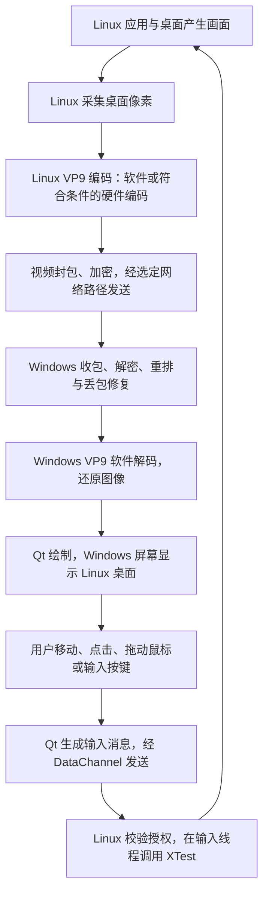

# Linux 被控到 Windows 主控的远控全链路

整理日期：2026-11-17。源码基线：`ZJ-desk` 分支、提交 `5bcd349`。

本文以“Windows 上操作 ZJdesk，控制 Linux X11 桌面”为场景，解释首次连接、首帧显示、键鼠操作、操作后的画面反馈，以及编解码和网络路径。内容来自当前源码；没有在本次整理中重新运行双机测试。实际安装包如果不是这一版本，行为需要另行核对。

## 1. 先记住这一条闭环

**Linux 产生桌面画面 → Linux 采集并编码 → 网络传到 Windows → Windows 解码并显示 → 用户操作鼠标键盘 → 输入事件传到 Linux → Linux 执行操作并更新桌面 → 再次采集、编码、传输、解码、显示。**

其中有两种主要数据：

- **画面数据：Linux → Windows。** 数据量大，需要视频编码、分包和解码。
- **输入数据：Windows → Linux。** 内容是坐标、按钮、按键等小消息，不需要视频编码或视频解码。

建立连接时，还会经过信令服务交换配对、授权和连接协商消息。信令服务不会把每一帧画面转发给 Windows。



可以把它想成：Windows 不断接收 Linux 桌面的“视频直播”，同时通过另一条消息通道操作 Linux。操作发生后，直播中的桌面内容随之改变。

## 2. 从点击“远程控制”到第一帧出现

### 2.1 先选择能连接的地址

当前项目可以保存对端的局域网地址和 Tailscale 地址。自动连接时先通过稳定的 Tailscale 地址获取当前设备和网卡信息，再探测局域网候选；局域网可用时优先使用，否则走 Tailscale。只有局域网的环境也可以手动配置地址。

这里解决的是“Windows 应该连接 Linux 的哪个地址”，尚未开始把桌面显示出来。

### 2.2 通过信令服务完成配对和控制请求

两端通过 WebSocket 与信令服务通信，默认服务端口为 TCP `8765`。典型启动方式由 Linux 提供共用信令服务，Linux 本机客户端也连接该服务。

```text
Windows 客户端 ── WebSocket ── 信令服务 ── WebSocket ── Linux 客户端
                  交换配对、控制请求、共享通知、SDP 和 ICE
```

Windows 发起 IP 配对与控制请求。Linux 根据设置等待用户点击“允许”，或者自动允许；当前并非每次都强制手动确认。IP 匹配用于配对，不等于账户身份认证。

### 2.3 Linux 启动屏幕共享，双方协商媒体连接

Linux 的 `SessionCoordinator::grantControl()` 授权后，如果还没有屏幕共享，就调用 `startScreenShare()`。Linux 通知对端共享开始，双方创建 `ScreenShare` 管线。

双方通过信令交换：

| 内容 | 用通俗的话说明 | 本项目中的作用 |
|---|---|---|
| SDP offer / answer | 双方能收发什么、怎样组织这次媒体会话 | 协商 VP9 视频、传输参数等 |
| ICE candidate | 双方提供的可尝试连接地址和传输方式 | 探测、选出媒体与数据连接的候选路径 |
| DTLS 握手 | 为这次连接建立加密所需的安全上下文 | 保护 DataChannel，并为视频的 SRTP 建立密钥 |

这些过程会异步交错进行。例如 ICE 消息可能早于远端 SDP 设置完成，代码会暂存后再处理，不能把它理解为所有消息严格一条接一条执行。

### 2.4 数据通道打开后，放行视频发送与控制授权

Linux 发送端创建名为 `zjdesk-control` 的 WebRTC DataChannel。当前代码在通道准备好之前，会拦截编码器输出，避免建连阶段的视频挤占连接资源或积压；通道打开后放行，并请求关键帧。

Linux 同时通过通道告知 Windows 当前有效的控制授权。Windows 进入可控制状态后，才发送输入消息。

**编码管线可以在通道完全准备好之前已经运行。“开始编码”“开始成功发送”“Windows 收到首帧”“Windows 完成绘制”是不同时间点。** 控制授权就绪与第一帧呈现也不是同一个事件。

## 3. Linux 画面怎样显示到 Windows

### 3.1 Linux：先有桌面像素，再进行编码

```text
Linux 应用程序更新窗口
    ↓
X11 桌面形成当前画面
    ↓
ximagesrc 采集桌面像素
    ↓
videoconvert / videorate / videoscale / capsfilter
转换像素格式，按目标帧率取帧，调整尺寸
    ↓
VP9 编码器：把原始像素压缩成 VP9 数据
    ↓
rtpvp9pay：把压缩数据切分、装入 RTP 包
    ↓
webrtcbin：管理实时传输、加密、反馈与连接
    ↓
发往 Windows
```

采集、转换和编码不是同一件事。采集得到“屏幕现在长什么样”，编码再把它压缩成适合网络传输的数据。Linux 当前支持 X11 桌面，此路径不支持 Wayland。

编码会利用画面内部及前后帧的相似性，通常不会每帧都发送一张独立的完整截图。因此接收端丢掉某些压缩数据后，后续帧可能需要等待补包或关键帧才能恢复。

### 3.2 网络：传输的是压缩并分包后的数据

视频逻辑上是：

```text
VP9 压缩帧 → RTP 分包 → SRTP 加密保护 → ICE 选定的传输路径
```

VP9 负责“压缩画面”，RTP 负责“组织实时视频包”，SRTP 负责“保护这些包”，ICE 负责“找可用连接路径”。这些协议与算法各有分工。

本项目已配置 NACK 重传反馈和 ULP/RED FEC，FEC 参数为 `20`。这证明代码请求启用相应能力；实际是否协商成功、线上产生多少修复数据，需要查看协商和运行计数，不能直接说每次会话固定增加 20% 带宽。

### 3.3 Windows：先收齐可解码数据，再还原像素并显示

```text
网络收到数据
    ↓
WebRTC 传输与安全层处理、SRTP 解密
    ↓
RTP 抖动缓冲：重排数据、处理丢包修复与播放时序
    ↓
rtpvp9depay：从 RTP 中取出 VP9 压缩数据
    ↓
vp9dec：CPU 软件解码，还原原始图像
    ↓
videoconvert：转换为 RGB
    ↓
appsink：向应用交付图像，跨网普通模式还参与时钟同步
    ↓
ScreenShare 工作线程取帧 → 最新帧邮箱 → 主线程 frameReady
    ↓
MainWindow 转交 VideoSurface → QImage → QPainter / QOpenGLWidget 绘制
    ↓
Windows 桌面与显示系统呈现到显示器
```

“最新帧邮箱”会用新解码图像覆盖尚未显示的旧图像，减少应用层追着旧帧绘制的问题。它不能直接清除上游网络缓冲或尚未解码的 VP9 参考帧积压。

`frameSwapped` 能说明界面完成了一次交换呈现，但不等于已经测到显示器像素真正亮起的时间。

## 4. 软编、硬编、软解、硬解，分别何时执行

### 4.1 四个名称分别表示什么

| 名称 | 在哪一阶段执行 | 谁主要完成视频压缩或还原 | 通俗理解 |
|---|---|---|---|
| 软件编码 | 发送端拿到原始图像之后、视频发送之前 | CPU 运行编码算法 | 通用工人把原料加工成便于运输的包装 |
| 硬件编码 | 同样在原始图像之后、视频发送之前 | GPU / 芯片中的专用视频编码单元，CPU 负责提交与管理 | 专用机器完成同一道包装工序 |
| 软件解码 | 接收端拿到可解码的压缩数据之后、绘制之前 | CPU 运行解码算法 | 通用工人把包装里的内容还原出来 |
| 硬件解码 | 同样在压缩数据到达之后、绘制之前 | GPU / 芯片中的专用视频解码单元，CPU 负责提交与管理 | 专用机器完成还原工序 |

**软编和硬编是“编码阶段”的不同实现；软解和硬解是“解码阶段”的不同实现。它们不会天然组成“软编 → 硬编 → 软解 → 硬解”四道连续工序。**

通常只需要选一种编码实现，再由接收端选一种兼容的解码实现。例如“硬件编码 → 软件解码”完全可以正常工作，因为双方交换的是 VP9 标准码流，而不是某种只能由同一硬件读取的数据。

### 4.2 连接启动时：先选择编码实现

Linux 的 `selectEncoder()` 在构建发送管线时执行：

1. 先默认选择软件编码。
2. 如果属于跨网或保守低带宽模式，直接保留软件 VP9 编码。
3. 对符合条件的 Linux 非低带宽路径，检查 `vavp9lpenc` 插件，并实际探测是否能编码；自动档还检查尺寸切换能力。
4. 探测通过后才使用 VA-API VP9 硬件编码；插件缺失或探测失败时使用软件编码。

这是“选择和初始化机器”，不是已经把后续所有桌面画面编码好了。也不能据此认为运行途中任何硬件错误都能无缝切换回软件。

### 4.3 开始传输后：每帧依次经过编码和解码

对于一帧能够成功显示的画面，先后依赖关系是：

```text
① Linux 桌面产生这帧内容
    ↓
② 采集、尺寸与像素格式处理
    ↓
③ Linux 软件编码 或 Linux 硬件编码
    ↓
④ 压缩帧分包、加密、网络传输
    ↓
⑤ Windows 收包、解密、重排/修复、取出压缩帧
    ↓
⑥ Windows 软件解码〔当前实现〕
    ↓
⑦ 图像交给 Qt 绘制与显示
```

编码器可以边产出数据边交给后续管线，接收端也会按包和帧持续处理；上述顺序表达数据依赖，并不是要求整段视频先全部编码完再发送。

### 4.4 当前项目到底用了哪几项

| 场景 | Linux 编码端 | Windows 解码端 | 一帧的核心顺序 |
|---|---|---|---|
| 普通局域网，硬件探测通过 | `vavp9lpenc`，VA-API 硬件 VP9 编码 | `vp9dec`，软件解码 | 采集 → 硬编 → 网络 → 软解 → 绘制 |
| 普通局域网，硬件插件或探测不满足 | `vp9enc`，CPU 软件 VP9 编码 | `vp9dec`，软件解码 | 采集 → 软编 → 网络 → 软解 → 绘制 |
| 被判定为 WAN / Tailscale 的跨网路径 | `vp9enc`，软件 VP9，I420 / profile 0 | `vp9dec`，软件解码 | 采集 → 软编 → 网络 → 软解 → 绘制 |
| 显式保守低带宽模式 | `vp9enc`，软件 VP9，I420 / profile 0 | `vp9dec`，软件解码 | 采集 → 软编 → 网络 → 软解 → 绘制 |

普通非低带宽路径使用 VP9 profile 1，软件编码使用 Y444；可选硬件分支使用 VUYA 输入。跨网路径使用 I420 / profile 0，降低色度数据和码率压力。

当前接收管线没有接入 Windows 硬件 VP9 解码器，因此这里的“硬件解码”是解释通用技术的位置，并非当前已经执行的步骤。如果未来接入兼容的硬解，它替换的是第⑥步的解码实现。

**Windows 用 GPU 绘制窗口，不等于视频已经由 GPU 硬件解码。Linux 桌面可能由 GPU 渲染，也不等于捕获的视频一定采用硬件编码。** 当前也不是全程 GPU 零拷贝路径。

### 4.5 用户没有操作时，也会持续编码与解码

屏幕共享进入运行状态后，采集管线按目标帧率持续工作。时钟、动画、窗口刷新等都可能产生画面变化；静止画面也会按管线节奏处理，编码器利用重复内容降低数据量。

鼠标点击不会直接调用一次“编码函数”。它先改变 Linux 应用状态，随后被某次桌面采集取得，再进入编码和回传。当前没有针对每条输入立即插队截图的通用机制。

因此，输入到达后还可能等待下一次采集。例如稳定 30 fps 时帧周期约为 33.3 ms，操作恰好错过本次采集，就可能等待接近一个周期；这是解释采样等待的例子，不是保证每次恰好增加 33.3 ms。

### 4.6 同一帧有顺序，多帧可以并行

对于同一帧，必须先编码才能在另一端解码。但系统不会等待第 1 帧显示结束才开始采集第 2 帧。

```text
某一时刻可能同时发生：
Linux 正在采集第 N 帧
Linux 编码线程正在处理第 N-1 帧
网络正在传输更早的帧数据
Windows 正在解码和绘制此前到达的帧
```

这是流水线并行的示意，各阶段不保证刚好相差一帧。专用媒体线程、GStreamer 流线程、编码器内部线程和 Windows 界面线程各自调度；发生排队时，即使平均帧率较高，也可能看到较旧的画面。

## 5. Windows 的鼠标、键盘怎样影响 Linux

### 5.1 鼠标移动

```text
真实鼠标移动 → Windows 输入系统 → Qt mouseMoveEvent
    ↓
VideoSurface 排除画面黑边，把位置转换为 0～1 的相对坐标
    ↓
按 8 ms 节奏合并普通移动，保留最新位置
    ↓
SessionCoordinator 加入 action、授权 epoch 和递增 sequence
    ↓
ScreenShare → DataChannel → 网络
    ↓
Linux InputReceiver 检查当前授权和共享代次
    ↓
进入独立输入线程，再检查 generation 与 sequence
    ↓
InputInjector 将相对坐标还原到 Linux 桌面坐标
    ↓
XTestFakeMotionEvent → Linux X11 更新鼠标位置
```

例如画面中心会转换为约 `(0.5, 0.5)`，Linux 根据实际被控桌面的大小还原位置。因此 Windows 上把视频窗口缩小后，仍能点击对应的 Linux 桌面位置。

8 ms 是合并定时器配置，不是网络时延保证，也不是每秒一定完成 125 次远端操作。进入媒体工作线程前，代码还会合并尚未发送的普通位置更新。

### 5.2 鼠标点击、滚轮和拖动

点击是“移动到位置 → 按下按钮 → 松开按钮”。代码在按钮事件前先发送待处理的移动，保留操作顺序；Linux 先定位鼠标，再调用 `XTestFakeButtonEvent`。

拖动则是：

```text
左键按下 → 保持按下状态并连续移动 → 左键松开
    ↓
Linux 窗口管理器或应用处理拖动
    ↓
窗口位置发生变化 → 下一次桌面采集 → 编码 → 回传 → Windows 显示
```

拖动没有另一条专门变慢的输入通道。它显得慢，常常是因为用户需要连续看到“窗口真实位置”的变化，而这个结果必须走完整的视频回路。滚轮同样作为输入消息发送，由 Linux 输入后端转换成对应的滚动事件。

### 5.3 键盘输入

```text
键盘按下 / 松开 → Qt keyPressEvent / keyReleaseEvent
    ↓
发送按键编号、pressed、epoch、sequence
    ↓
DataChannel 传到 Linux → 授权校验 → 输入线程
    ↓
Qt 按键映射为 X11 KeySym / KeyCode
    ↓
XTestFakeKeyEvent
    ↓
Linux 当前获得焦点的应用处理按键
    ↓
文字或界面变化进入下一轮画面回传
```

当前传输的是按键事件，不能把它理解为 Windows 已经输入好的任意文本直接同步到 Linux。中文输入还涉及 Linux 输入法、键盘布局和当前按键映射，不能仅凭按键通道存在就断言所有输入法组合均兼容。

### 5.4 结束授权后，旧输入为什么不会继续执行

`epoch` 表示当前授权代次，`sequence` 表示事件序号；输入线程还会复查 `generation`。撤权时使当前授权与旧排队事件失效，并释放本程序保持按下的键鼠。失焦也会发送释放请求，避免留下“键一直按住”的状态。

对于这次 Windows 控制 Linux 的方向，真正执行远端键鼠的是 **Linux XTest**。Windows 的 `SendInput` 用于 Windows 作为被控端的另一种方向，不在本次 Linux 输入注入链上。

## 6. 输入怎样传输，为什么不需要视频编解码

| 通道 | 承载内容 | 主要协议层次 | 是否经过 VP9 |
|---|---|---|---|
| 信令通道 | 配对、请求、共享通知、SDP、ICE | JSON → WebSocket → TCP；默认部署没有启用信令 TLS | 否 |
| 视频通道 | Linux 桌面画面 | VP9 → RTP / SRTP → ICE 选定传输 | 是 |
| 控制通道 | 授权、鼠标、按键、光标及部分反馈 | JSON → WebRTC DataChannel → SCTP → DTLS → ICE 选定传输 | 否 |

ICE 的连通性检查会使用 STUN 格式的消息；这不等于项目配置了公网 STUN 服务。当前项目没有配置内置 STUN / TURN 服务器，也没有自建商业远控式的公网媒体中继体系。

当前 DataChannel 创建时没有另设可靠性选项。按所用 GStreamer 1.26.11 的 `webrtcbin` 创建默认值，它使用可靠、有序传输：丢失的数据会尝试重传，同一通道后续消息可能等待前面的数据恢复。**底层可用 UDP，不代表应用输入消息就是“丢了不管”。**

当前双人远控的文件剪贴板与控制消息共用该 DataChannel，文件按请求分块读取，已有节流机制。同通道竞争可能影响时延，但是否影响当前拖动，需要实测，不能直接当作已确认原因。

## 7. 不同网络环境下，包从哪里走

首先区分两层：**ZJdesk 选择局域网还是 Tailscale 地址；Tailscale 再决定它自己的公网直连或中继路径。** 这不是同一次选路。

### 7.1 同一个局域网

```text
Windows → 本地有线 / Wi-Fi / 交换机 / 路由器 → Linux
```

信令通常访问 Linux 的局域网地址与 TCP `8765`。视频和 DataChannel 使用 ICE 选出的连接，媒体端口不等于固定复用 `8765`；仅能连接信令端口不证明媒体也可达。

**当前 Linux 真实桌面发送路径有特殊处理：普通非低带宽且未启用 GCC 时，禁用 ICE-UDP、启用 ICE-TCP。** 因此不能简单说“局域网远控一定走 UDP”。这是代码为避免局域网关键帧 UDP 突发超过主机缓冲做的处理；显式 GCC 配置等条件可以改变分支，最终应以 selected ICE candidate pair 为准。

此路径通常使用普通画质策略，接收缓冲默认 `200 ms`，`appsink sync=false`；符合条件时 Linux 会尝试硬件编码。

### 7.2 不同局域网，通过 Tailscale 公网直连

```text
Windows ZJdesk
    ↓ 访问 Linux 的 Tailscale 地址
Windows Tailscale
    ↓ 加密隧道，经本地路由器 / NAT 和互联网直连
Linux Tailscale
    ↓ 还原应用的内层网络包
Linux ZJdesk
```

Tailscale 直连通常通过基于 WireGuard 的 UDP 隧道承载。对 ZJdesk 来说，对端仍表现为可访问的 Tailscale 地址；公网 NAT 穿透由 Tailscale 处理。

**内层的 WebRTC 传输方式与外层的 Tailscale 隧道是两件事。** 例如应用内层选到 TCP，不代表 Tailscale 公网直连外层就必然变为 TCP。

项目会根据已验证地址、网段和显式配置判定 WAN。Tailscale 地址通常进入 WAN 策略，使用软件 VP9 / I420、GCC 拥塞控制、较小 RTP MTU，普通 WAN 默认接收缓冲为 `400 ms`。直连远控使用 `appsink sync=false`，解码后立即交付画面。

### 7.3 Tailscale 直连失败，走 DERP 中继

```text
Windows → Windows Tailscale → 公网 DERP 中继 → Linux Tailscale → Linux
```

这里是 Tailscale 的中继，不是 ZJdesk 的信令服务器转发桌面。DERP 常见承载是 HTTPS / TCP，可能增加绕路、排队和队头阻塞影响；具体时延取决于节点位置与链路状况，不能写死一个额外毫秒数。

应用看到的仍可能是同一个 Tailscale 地址，所以主界面显示“Tailscale”不能单独证明公网底层正在直连。需结合 Tailscale 状态、探测和媒体连接统计确认。本文没有测定当前两台机器此刻的实际路径。

### 7.4 不用 Tailscale，直接连接公网

当前没有配置公共 STUN / TURN 服务，因此不能指望在任意两种 NAT、防火墙环境下都自动连通。若双方已有可互通路由、公网可达地址和允许的端口，可能建立连接；具体部署必须验证。

“WebSocket 信令连接成功”只表示能交换协商消息，不保证视频和 DataChannel 的候选连接能够建立。

### 7.5 路径对照

| 网络情况 | 实际主要路径 | 项目典型策略 | 需要单独确认的点 |
|---|---|---|---|
| 同一局域网 | 两端经本地网络互通 | 普通画质；Linux 可尝试硬编；默认接收缓冲 200 ms | Linux 默认分支可能使用 ICE-TCP |
| Tailscale 直连 | 两端 Tailscale 隧道经公网直达 | 通常判为 WAN；软件编码；默认接收缓冲 400 ms | 内层 ICE 方式与外层隧道分别检查 |
| Tailscale DERP | 隧道经中继服务器转发 | 应用通常仍按 WAN 处理 | 中继位置、排队、丢包恢复及实际带宽 |
| 无 VPN 的公网互连 | 取决于公网路由、NAT 和防火墙 | 不能保证自动连通 | 缺少已配置的公共 STUN / TURN |

显式保守模式、接收缓冲环境变量、GCC 配置等可覆盖部分默认行为，表格不代表所有运行参数组合。

## 8. 以拖动 Linux 窗口为例，走完一次反馈

1. Windows 已经收到并显示 Linux 桌面，采集和编解码持续运行。
2. 用户在窗口标题栏按下左键。Windows 生成位置与按钮消息，发送给 Linux。
3. Linux 验证授权，调用 XTest 注入鼠标定位和左键按下；窗口管理器开始处理拖动。
4. 用户继续移动鼠标。Windows 合并位置更新并发送，Linux 注入新的位置。
5. Linux 窗口管理器改变窗口位置，桌面产生新的像素内容。
6. Linux 下一次采集取得新画面，选定的 VP9 软件或硬件编码器压缩这帧。
7. 视频经 RTP / SRTP 和选定网络路径传到 Windows；Windows 处理到达顺序、丢包修复及播放时序。
8. Windows 使用 `vp9dec` 软件解码，经图像交接与 Qt 绘制，显示窗口的新位置。
9. 用户松开左键，松开消息到达 Linux 后结束拖动；最终桌面状态继续通过视频显示。

第 2～4 步传输的是输入消息，**不会执行 VP9 视频编码或视频解码**。第 6 步执行编码，第 8 步执行解码。鼠标移动与连续视频回传可以同时进行，不需要一来一回完全结束后才能发下一次移动。

## 9. 为什么光标很跟手，窗口却可能慢半拍

收到有效远端光标形状、并且指针位于视频区域时，Windows 使用本机系统光标立即跟随真实鼠标移动。这个显示不必等待 Linux 回传视频。

窗口位置没有这种本地预测。必须经过：

```text
输入发送 → 网络去程 → Linux 校验和注入 → 应用响应
→ 等待采集 → 编码 → 视频回程 → 缓冲/修复/解码 → Qt 呈现
```

因此“本机光标流畅”“Linux 已接受输入”“Windows 已看到操作结果”分别代表不同阶段。输入回执中的 `accepted` 和 `injectUs` 只反映注入处理，不证明 Linux 应用已经完成响应，也不证明对应新画面已经显示。

跨网普通模式的 `400 ms` 是接收端抖动缓冲目标配置。实际放行取决于 RTP 时间戳、到达情况和参考帧恢复，闭环耗时还包含输入、采集和呈现。

丢包修复、等待关键帧、编码处理不足、网络排队和应用层排队都可能进一步影响闭环。自动档已有基于 backlog 的排空策略，但“只保留最新解码图像”不等于所有上游积压都立即消失。

## 10. 源码与进一步阅读

| 环节 | 主要源码入口 |
|---|---|
| 控制请求、允许、启动共享、发送输入 | [session_coordinator.cpp](../src/session/session_coordinator.cpp)：`grantControl()`、`sendControlGrant()`、`sendRemoteInput()` |
| 采集、编码选择、收发管线与 RTP 修复 | [screen_share.cpp](../src/media/screen_share.cpp)：`selectEncoder()`、`encoderPipeline()`、`configureTransceiver()` |
| Windows 图像绘制与键鼠事件生成 | [video_surface.cpp](../apps/client/video_surface.cpp)：`pointerInput()`、`mouseMoveEvent()`、`keyPressEvent()` |
| 授权与序号校验、输入线程 | [input_receiver.cpp](../src/remote-control/input_receiver.cpp)：`authorize()`、`receive()`、`revoke()` |
| Linux XTest 与 Windows SendInput 后端 | [input_injector.cpp](../src/remote-control/input_injector.cpp)：`inject()`、`releaseAll()` |
| 设备地址获取与网络准备 | [network_setup.cpp](../src/session/network_setup.cpp) |
| 质量调整与积压排空 | [share_quality.cpp](../src/media/share_quality.cpp)：`observeBacklog()` |

补充说明见 [项目结构与核心技术](项目结构与核心技术.md)、[商业远控技术策略对比](远控软件与ZJdesk技术策略对比分析.md)、[跨网交互延迟改进计划](wan-1080p30-interactive-latency-plan-20261114.md)。DataChannel 默认选项核对依据为 [GStreamer 1.26.11 的 webrtcbin 创建实现](https://github.com/GStreamer/gstreamer/blob/1.26.11/subprojects/gst-plugins-bad/ext/webrtc/gstwebrtcbin.c#L7420)。

本文说明代码设计和执行依赖，没有进行新的编码硬件、真实输入到物理显示、迁网恢复或公网路径验收。
