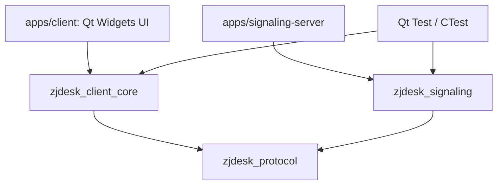
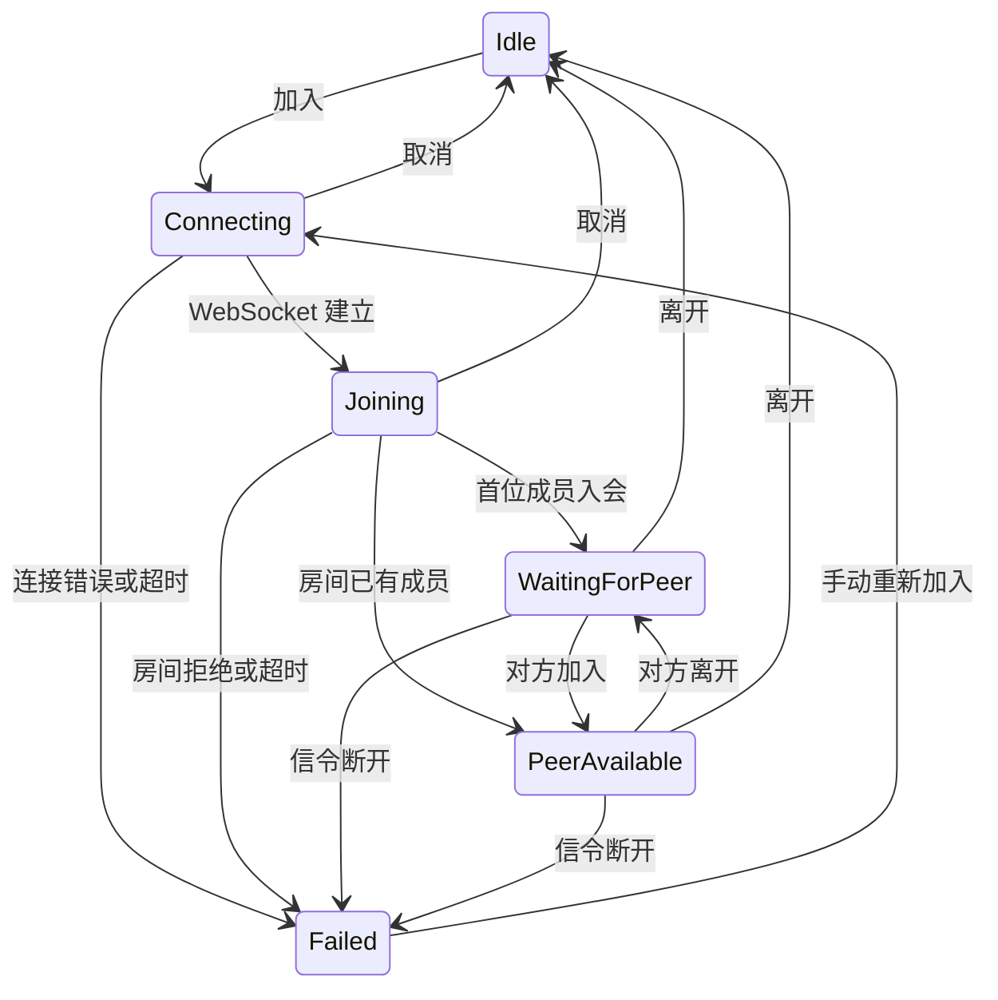

# 架构与扩展约定

当前采用模块化单进程客户端与独立信令服务。将功能按依赖边界拆成 CMake 目标，
便于分别编译、测试和替换实际的平台实现，不引入微服务或通用插件加载器。
本文件是随代码维护的当前设计；原始产品目标保留在 original-project-plan.md。

## 当前依赖

| 目录 / 目标 | 职责 | 约束 |
| --- | --- | --- |
| protocol / zjdesk_protocol | 信封编码、版本、输入校验 | 不依赖 UI、GStreamer 或服务状态 |
| signaling / zjdesk_signaling | 房间成员、双人限制、协商消息路由、心跳 | 不传输媒体和远控输入 |
| signaling / SignalingClient | WebSocket 生命周期与协议消息 | 不修改会议业务状态 |
| session / SessionCoordinator | 入退会、状态变更、成员和信令事件 | 是会议业务状态的唯一写入者 |
| diagnostics / EventLog | 有界事件记录、原子文件导出 | 不记录 SDP 内容或实际输入文本 |
| remote-control / ControlSession | 本地授权、控制代次、序号校验 | 当前没有传输或 OS 输入注入 |
| media / MediaEnvironment | 可选 SDK 初始化、插件检查与部署环境选择 | 不推断通话连接成功 |
| media / MediaEngine | 设备枚举、本地视频预览、音频测试与有界帧交接 | Gst 指针只在媒体模块，当前不发送媒体 |
| media / ScreenShare | 桌面采集、WebRTC 协商、VP8 编解码与有界帧交接 | 独立工作线程，不直接修改会话业务状态 |
| platform / PlatformInfo | 真实平台、架构、会话信息 | 系统输入与采集适配留到对应功能实现 |
| apps/client | 界面布局、显示状态、收集用户操作 | 不直接操作 socket、系统输入或 GStreamer 对象 |

客户端和信令服务是独立可执行文件。client_core 使用 Qt Gui 的 QImage，没有 Widgets 依赖，可以在无桌面的测试环境中验证。
当前模块较小，client_core 将业务模块放在同一静态库内；只在独立依赖、编译成本或复用需求出现时进一步拆库。

## 会话状态

`PeerAvailable` 仅表示双方已入会。屏幕共享另有 Stopped / Starting / Running / Stopping / Failed
状态；Running 必须同时收到实际画面和 WebRTC connected 事件，不能由 WebSocket 连接直接判定。

每次连接创建一个新的 QWebSocket，回调检查当前 socket 身份。
退出时先清空当前连接标识，再断开回调与 socket，防止旧连接回调影响新会话。
信令和业务状态运行在 Qt 主线程，媒体管线与设备枚举在专用 Qt 工作线程运行。
服务器定期 WebSocket ping / pong；客户端当前依赖底层 socket 断开事件，完整的双端故障检测与恢复在媒体阶段补齐。

## 协议

统一信封：`{"version":1,"type":"join","payload":{...}}`，UTF-8 总长度最多 64 KiB。
客户端类型为 `join`、`leave`、`share`、`offer`、`answer`、`ice`。
服务响应为 `joined`、`left`、`peer_joined`、`peer_left`、`error`。
服务端根据当前连接所属房间转发协商消息，并覆盖 `fromPeerId`，客户端不能自行指定另一个房间或发送者身份。
`share` 包含 action=start/stop 和 streamId，服务验证动作和标识格式。
共享 SDP 消息携带 sdp，ICE 携带 candidate / sdpMLineIndex；都携带 streamId。
接收端先校验成员身份和当前流标识，再解析 SDP 或 ICE；旧流事件被丢弃。
WebSocket 只传共享控制与协商信息，视频 RTP 由 WebRTC 的 ICE / DTLS / SRTP 通道传输。

远控消息将走 WebRTC DataChannel，不能复用信令转发持续发送画面或键鼠。
被控端本地确认后才能授权，每次授权生成新的 controlEpoch；
检查对端 ID、代次和单调递增序号后才接受输入。撤销或对方离开时立即清除授权。
未来的输入执行器还需要维护并释放本程序按下的键，当前授权门禁不代表真实远控已实现。

## 0.2 本地媒体与线程

为避免采集、枚举和关闭设备阻塞日常 UI，MediaEngine 通过 queued invokeMethod 将命令交给
MediaWorker。该线程用 Qt 定时器读取 GstBus 和 appsink，无需为当前预览建立 GLib MainLoop。
GStreamer 内部线程负责采集，工作线程只复制映射后的 RGB 帧，不向 UI 交付 GstBuffer 指针。

appsink 最多一帧并丢弃旧帧；互斥保护的交接槽最多一个深拷贝 QImage，两处合计最多两帧。
主线程每 33 ms 取最新帧，避免按采集帧率排队 Qt 信号；VideoSurface 在真实 OpenGL widget
中按比例绘制，并标明本地预览。采集 / 丢弃计数只表示本地交接，不能当作网络丢包或媒体 FPS。

SessionCoordinator 是预览和音频状态的唯一写入者，状态分别为 Stopped / Starting / Running /
Stopping / Failed，与房间状态独立。只有第一帧到达才显示预览运行；每次启动、停止携带独立
代次，取消后的旧状态与旧帧不影响新预览。离开房间或信令失败会停止本地媒体。
摄像头无帧启动超时为 8 秒；管线错误显示真实 GstBus 信息。
停止在媒体线程将管线设为 NULL 并释放引用，返回确认后允许重启；析构等待工作线程清理。
驱动自身在关闭时挂起的硬退出保护尚未实现，不把现有回归当作所有驱动的时间上限保证。

设备由 GstDeviceMonitor 枚举并保存设备引用，刷新后旧设备 ID 失效；预览中禁止刷新或换源。
SDK 的旧 ksvideosrc 在本机摄像头失败，当前排除该接口，使用枚举出的 Media Foundation 接口。
音频设备仅枚举；audiotestsrc 可接扬声器或测试用 fakesink，尚无麦克风录制与远端音频。

## 0.3 摄像头模式与屏幕共享

CameraMode 从设备 caps 的单个结构中固定宽高与帧率，按像素数、再按分数帧率比较；
不把不同模式的宽高和帧率拼成设备未公布的组合。raw 直接转换，JPEG 先解码，再转 RGB；
预览保留采集原始尺寸。UI 的运行详情读取首帧的真实 caps，帧率是协商值，尚非实时测量值。

用户将屏幕共享提前，语音通话仍待实现，因此共享是独立单向视频管线，摄像头预览保持本地。
ScreenShareWorker 在专用 Qt 线程管理管线、GstBus 和 appsink；发送侧桌面 tee 分为本地预览
和 VP8 / RTP / webrtcbin，接收侧 webrtcbin / VP8 解码进入有界 QImage 交接槽。
Windows 采集使用 d3d11screencapturesrc / d3d11download，Linux X11 使用 ximagesrc；
平台差异集中在媒体采集管线入口，UI 与协调层不包含平台 API，Wayland 暂不支持。

每次共享生成新 streamId；启停带独立 epoch，回调与帧都拒绝旧代次。
GStreamer 的 SDP promise 和 ICE 回调通过受生命周期保护的 queued invokeMethod 回到工作线程。
RTP pad 在 streaming 回调返回前同步连接预建的解码入口，避免未连接错误；不从回调修改 UI。
远端描述应用完成前缓存最多 256 个 ICE 事件；连接启动超时为 15 秒。
SessionCoordinator 决定共享角色及状态；双方同时开始时按 peerId 排序确定同一共享方。
停止、成员离开或信令失败均取消管线，清空画面；对方已离开时不会再发送停止消息。
全局信令和共享连接分别清理，避免把退出期间迟到的 peer_unavailable 当作本端退会。
共享目前仅采用局域网 host ICE，无 STUN / TURN、公网恢复或系统声音。

## 新增需求：转写与会议纪要

每端转写自己的麦克风音频，通过已加入房间的成员身份绑定 peerId / 昵称，记录发言时间和文本。
服务端须覆盖发送者身份，不能接受客户端伪造说话人。独立音轨无需用声纹猜测房间成员；
同一麦克风附近的多名说话人属于额外的说话人分离需求，当前未承诺。
最终按时间汇总发言，生成讨论内容、决策、待办与待确认事项；不补写转写中不存在的事实。
用户已确定先保持两人，不扩展房间人数；最新要求暂缓转写与纪要，目前没有功能实现。

## 增加功能的顺序

1. 在 roadmap 中写明用户行为、边界和验收条件。
2. 改公共协议或状态前，先加入失败场景与回归测试。
3. 实现业务或平台模块，再接入 UI；新类只为实际职责而建立。
4. 跑受影响测试和本版本完整 CTest，记录真实平台验证结果。
5. 同时更新 README 的“已实现 / 未实现”和本文件的模块依赖。

不为尚未出现的需求提前添加插件机制、服务定位器、全局事件总线、通用仓储层或数据库。
架构变更记录具体触发问题和依赖变化；若需要迁移，保留可以验证旧行为的测试。
