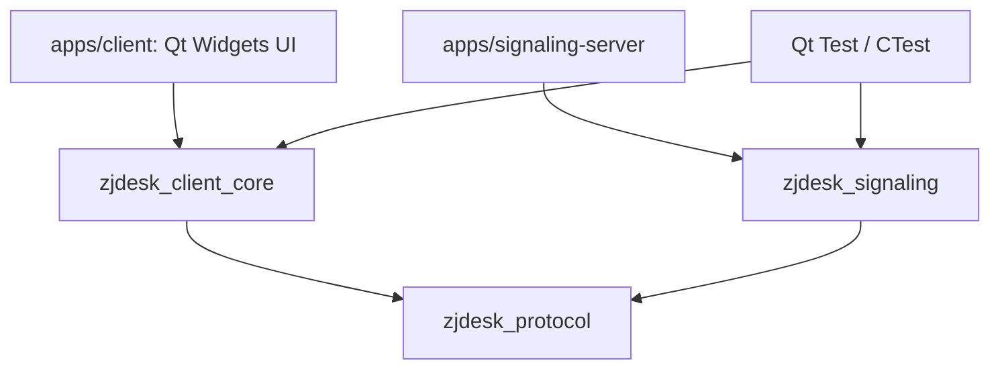
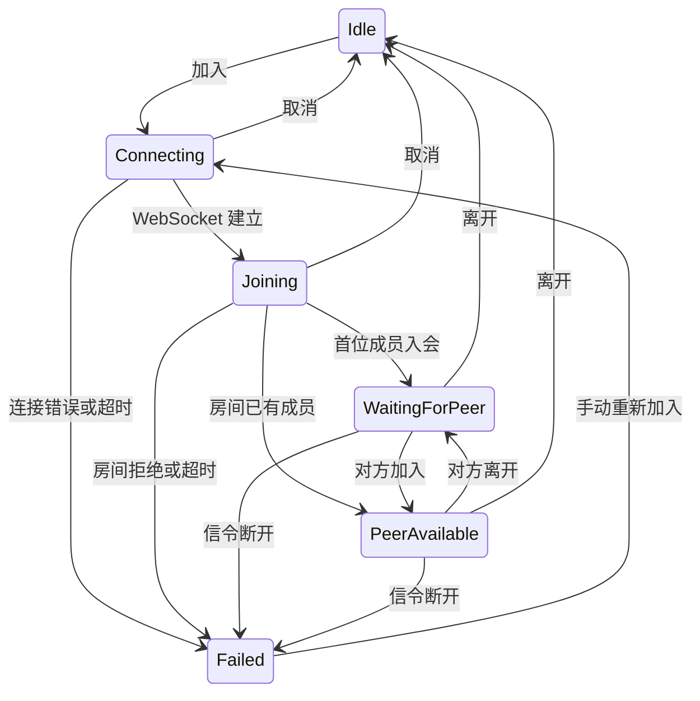

# 架构与扩展约定

当前采用模块化单进程客户端与独立信令服务。将功能按依赖边界拆成 CMake 目标，
便于分别编译、测试和替换实际的平台实现，不引入微服务或通用插件加载器。
本文件是随代码维护的当前设计；原始产品目标保留在 original-project-plan.md。

## 当前依赖

| 目录 / 目标 | 职责 | 约束 |
| --- | --- | --- |
| protocol / zjdesk_protocol | 信封编码、版本、输入校验 | 不依赖 UI、GStreamer 或服务状态 |
| signaling / zjdesk_signaling | 房间成员、双人限制、协商消息路由、心跳 | 不传输媒体和远控输入 |
| signaling / SignalingClient | WebSocket 生命周期与协议消息 | 不修改会议业务状态 |
| session / SessionCoordinator | 入退会、状态变更、成员和信令事件 | 是会议业务状态的唯一写入者 |
| diagnostics / EventLog | 有界事件记录、原子文件导出 | 不记录 SDP 内容或实际输入文本 |
| remote-control / ControlSession | 本地授权、控制代次、序号校验 | 由协调层处理请求、授权与撤销 |
| remote-control / InputInjector | Linux X11 / XTest 键鼠输入与释放 | 仅授权后调用；不依赖 UI Widgets |
| media / MediaEnvironment | 可选 SDK 初始化、插件检查与部署环境选择 | 不推断通话连接成功 |
| media / MediaEngine | 设备枚举、本地视频预览、音频测试与有界帧交接 | Gst 指针只在媒体模块，当前不发送媒体 |
| media / ScreenShare | 桌面采集、WebRTC 协商、VP9 编解码与有界帧交接 | 独立工作线程，不直接修改会话业务状态 |
| platform / PlatformInfo | 真实平台、架构、会话信息 | 系统输入与采集适配留到对应功能实现 |
| apps/client | 界面布局、显示状态、收集用户操作 | 不直接操作 socket、系统输入或 GStreamer 对象 |

客户端和信令服务是独立可执行文件。client_core 使用 Qt Gui 的 QImage，没有 Widgets 依赖，可以在无桌面的测试环境中验证。
当前模块较小，client_core 将业务模块放在同一静态库内；只在独立依赖、编译成本或复用需求出现时进一步拆库。

## 会话状态

`PeerAvailable` 仅表示双方已入会。屏幕共享另有 Stopped / Starting / Running / Stopping / Failed
状态；Running 必须同时收到实际画面和 WebRTC connected 事件，不能由 WebSocket 连接直接判定。

每次连接创建一个新的 QWebSocket，回调检查当前 socket 身份。
退出时先清空当前连接标识，再断开回调与 socket，防止旧连接回调影响新会话。
信令和业务状态运行在 Qt 主线程，媒体管线与设备枚举在专用 Qt 工作线程运行。
服务器定期 WebSocket ping / pong；客户端当前依赖底层 socket 断开事件，完整的双端故障检测与恢复在媒体阶段补齐。

## 协议

统一信封：`{"version":1,"type":"join","payload":{...}}`，UTF-8 总长度最多 64 KiB。
客户端类型为 `join`、`leave`、`share`、`offer`、`answer`、`ice`、`control`。
服务响应为 `joined`、`left`、`peer_joined`、`peer_left`、`error`。
服务端根据当前连接所属房间转发协商消息，并覆盖 `fromPeerId`，客户端不能自行指定另一个房间或发送者身份。
`share` 包含 action=start/stop 和 streamId，服务验证动作和标识格式。
0.3.1 增加 action=profile/stats：profile 携带档位 revision、尺寸、目标 fps；
stats 携带同一 revision 下的接收端有效 fps。服务校验字段范围并覆盖发送者身份。
0.4.3 的 profile 接受 5～240 的整数 fps，以支持不同刷新率及更细的帧率档位。
共享 SDP 消息携带 sdp，ICE 携带 candidate / sdpMLineIndex；都携带 streamId。
接收端先校验成员身份和当前流标识，再解析 SDP 或 ICE；旧流事件被丢弃。
WebSocket 只传共享控制与协商信息，视频 RTP 由 WebRTC 的 ICE / DTLS / SRTP 通道传输。

0.4.3 默认从主屏幕物理像素尺寸及 Qt 报告的刷新率开始，最高目标 240 fps。
ShareQuality 在相同分辨率下依次选择刷新率及低于它的 240 / 165 / 144 / 120 / 90 / 60 /
50 / 40 / 30 / 24 / 20 / 15 / 10 / 5 档位；原尺寸 5 fps 仍持续落后才按比例降低尺寸。
连续两次不足使用两次速度的均值选择可持续档位，单次不足不切换，连续 30 次稳定后试探恢复。
0.4.4 在低分辨率下优先试探上一分辨率的 5 fps，再提高帧率；不必先爬完低分辨率的帧率档位。
首轮留出 10 秒建立连接及稳定显示，切换档位后留出 4 秒，避免启动阶段的慢显示触发过早降档。
目标码率按像素数和 max(30, fps) / 15 计算，范围 2～40 Mbps；降低帧率不会继续压低文字画面码率。
0.4.4 改用 VP9 / Y444，量化值固定为 0，保留单像素彩色细线和字形细节。
RGB 转换显式使用完整范围的 BT.709；RTP 解包后的压缩 caps 同样传入颜色信息，避免解码器继承错误的默认范围。
这是 YUV 编码无损，RGB 色彩转换仍有少量舍入误差，实际带宽可超过目标码率；清晰度优先时 CPU 和带宽需求更高。
VP9 的 lag-in-frames 显式设为 0，避免默认缓存 25 帧在低帧率下影响延迟与恢复判断。
编码线程按 CPU 逻辑线程数选择；采样与交付定时器为 4 ms。NACK / RTX 和请求 / 等待关键帧仍保留。
0.4.5 的接收端 webrtcbin 缓冲默认 200 ms；`ZJDESK_WEBRTC_LATENCY_MS` 可在诊断时选择 30、50、100、150 或 200 ms。
每秒读取 WebRTC RTP 收发字节数、收包数、累计丢包和抖动；远控测试输入带一次性探针，Linux 注入后经 DataChannel 应答，Windows 同时测首次解码帧与 OpenGL 画面交换。
对照测试中小于 200 ms 的缓冲在连接初期产生长停顿或降分辨率，故未降低默认值；数据见 validation.md。
这些是目标参数和自适应规则，不表示每台电脑或网络都可达到屏幕刷新率；实际接收、显示帧率单独统计。

0.4.2 在房间信令中增加 control 的 capabilities / request / revoke，
允许在尚无桌面连接时请求控制，requestId 绑定当前请求，服务覆盖发送者身份。
信令服务拒绝 control 的 grant / input 动作；授权和键鼠仍走 WebRTC DataChannel。
被控端本地确认后才能授权，每次授权生成新的 controlEpoch；
检查对端 ID、代次和单调递增序号后才接受输入。撤销或对方离开时立即清除授权。
输入执行器维护本程序按下的键与鼠标按钮，失焦、撤销、停共享、退会和析构时释放。

## 0.4 Windows 控制 Linux X11

共享方创建有序可靠的 `zjdesk-control` DataChannel，接收方在 prepare-data-channel 中挂回调。
远端名称直到 DCEP 到达才赋值，因此在 on-open 与实际消息处校验名称，不能在准备阶段提前过滤。
GStreamer 回调通过已有生命周期 / 共享代次保护的队列回到媒体线程，再交给协调层。
DataChannel 的 GObject 引用跨队列持有，旧流回调不影响新连接；单条控制消息最多 4096 字节。

双方入会后通过信令交换控制能力，只有媒体与 XTest 可用的 Linux 端声明可以被控制。
请求先进入 Pending，不采集桌面；Linux 本地允许后，如果没有桌面连接，由协调层自动启动。
DataChannel 打开后发送带 requestId / controlEpoch 的授权；控制方丢弃已取消或旧请求的授权。
停止控制时结束本次自动启动的传输；手动启动的共享在控制结束后保留。
请求、待本地批准、控制中、被控制中分别是独立 RemoteState；请求与等待确认超时为 30 秒。
授权后每条输入携带字符串编码的 64 位控制代次与序号，ControlSession 拒绝旧授权及重放。
失去 DataChannel、停止共享或房间失败立即撤销；信令入会本身不会自动授权。

VideoSurface 按实际帧的等比显示区域生成归一化坐标，黑边不发送点击；鼠标移动最多约 60 次 / 秒。
键盘焦点离开画面时发送释放消息。InputInjector 将坐标映射到主屏幕物理像素，
通过 XTest 执行鼠标、滚轮、常用字母 / 数字 / 功能键 / 修饰键；UI 不调用 X11 API。
当前仅 Linux X11 被控；Windows 原生输入注入、Wayland、剪贴板及中文输入法同步留待后续需求。

画面放大在同一个 MainWindow 中隐藏普通面板并进入全屏，保留同一个 VideoSurface
和实际绘制统计，不重新创建画面控件或媒体管线。0.4.4 去掉外围边距与底部控件，
退出按钮覆盖在画面上；两端物理像素尺寸一致时按一对一绘制，普通窗口使用平滑缩放。
Esc 只在放大时作为本地退出快捷键，恢复进入前的窗口状态；切换前发送按键释放。

## 0.2 本地媒体与线程

为避免采集、枚举和关闭设备阻塞日常 UI，MediaEngine 通过 queued invokeMethod 将命令交给
MediaWorker。该线程用 Qt 定时器读取 GstBus 和 appsink，无需为当前预览建立 GLib MainLoop。
GStreamer 内部线程负责采集，工作线程只复制映射后的 RGB 帧，不向 UI 交付 GstBuffer 指针。

appsink 最多一帧并丢弃旧帧；互斥保护的交接槽最多一个深拷贝 QImage，两处合计最多两帧。
主线程每 33 ms 取最新帧，避免按采集帧率排队 Qt 信号；VideoSurface 在真实 OpenGL widget
中按比例绘制，并标明本地预览。采集 / 丢弃计数只表示本地交接，不能当作网络丢包或媒体 FPS。

SessionCoordinator 是预览和音频状态的唯一写入者，状态分别为 Stopped / Starting / Running /
Stopping / Failed，与房间状态独立。只有第一帧到达才显示预览运行；每次启动、停止携带独立
代次，取消后的旧状态与旧帧不影响新预览。离开房间或信令失败会停止本地媒体。
摄像头无帧启动超时为 8 秒；管线错误显示真实 GstBus 信息。
停止在媒体线程将管线设为 NULL 并释放引用，返回确认后允许重启；析构等待工作线程清理。
驱动自身在关闭时挂起的硬退出保护尚未实现，不把现有回归当作所有驱动的时间上限保证。

设备由 GstDeviceMonitor 枚举并保存设备引用，刷新后旧设备 ID 失效；预览中禁止刷新或换源。
SDK 的旧 ksvideosrc 在本机摄像头失败，当前排除该接口，使用枚举出的 Media Foundation 接口。
音频设备仅枚举；audiotestsrc 可接扬声器或测试用 fakesink，尚无麦克风录制与远端音频。

## 0.3 摄像头模式与屏幕共享

CameraMode 从设备 caps 的单个结构中固定宽高与帧率，按像素数、再按分数帧率比较；
不把不同模式的宽高和帧率拼成设备未公布的组合。raw 直接转换，JPEG 先解码，再转 RGB；
预览保留采集原始尺寸。UI 的运行详情读取首帧的真实 caps，帧率是协商值，尚非实时测量值。

用户将屏幕共享提前，语音通话仍待实现，因此共享是独立单向视频管线，摄像头预览保持本地。
ScreenShareWorker 在专用 Qt 线程管理管线、GstBus 和 appsink；发送侧桌面 tee 分为本地预览
和 VP9 / RTP / webrtcbin，接收侧 webrtcbin / VP9 解码进入有界 QImage 交接槽。
Windows 采集使用 d3d11screencapturesrc / d3d11download，Linux X11 使用 ximagesrc；
平台差异集中在媒体采集管线入口，UI 与协调层不包含平台 API，Wayland 暂不支持。

每次共享生成新 streamId；启停带独立 epoch，回调与帧都拒绝旧代次。
GStreamer 的 SDP promise 和 ICE 回调通过受生命周期保护的 queued invokeMethod 回到工作线程。
RTP pad 在 streaming 回调返回前同步连接预建的解码入口，避免未连接错误；不从回调修改 UI。
0.4.1 针对真实跨机花屏启用每个 RTP transceiver 的 do-nack，协商 NACK / RTX 重传。
发送侧 transceiver 可能已在 parse-launch 连接管线时创建，因此既配置已有实例，也处理 on-new-transceiver。
接收侧 rtpvp9depay 设置 request-keyframe / wait-for-keyframe，丢包后请求关键帧，
在完整关键帧到达前丢弃依赖旧参考帧的数据，避免继续显示损坏画面。
远端描述应用完成前缓存最多 256 个 ICE 事件；连接启动超时为 15 秒。
SessionCoordinator 决定共享角色及状态；双方同时开始时按 peerId 排序确定同一共享方。
停止、成员离开或信令失败均取消管线，清空画面；对方已离开时不会再发送停止消息。
全局信令和共享连接分别清理，避免把退出期间迟到的 peer_unavailable 当作本端退会。
共享目前仅采用局域网 host ICE，无 STUN / TURN、公网恢复或系统声音。

## 0.3.1 共享帧率与电脑适配

旧版固定 15 fps、每 33 ms 交付共享画面，无法评估较高帧率。
现在编码器 / 解码器 src pad 的 buffer probe 计数真实完成帧，每秒按单调时钟计算速度。
probe 仅增加原子计数，不复制帧、不排队 UI 事件；管线设为 NULL 后才清理对应计数器。
共享主线程用 PreciseTimer 每 4 ms 取最新帧，有界缓存保持不变；本地摄像头预览仍用原先节奏。
VideoSurface 对收到新帧后完成的 paintGL 计数，协调层传回媒体模块；接收、交付、实际绘制速度分别记录。
统计不进每秒事件日志，UI 只展示读数。帧率表示处理帧数，不等于画面内容每秒变化次数。

ShareQuality 是供媒体线程和单元测试使用的有限档位规则，没有新增设备数据库或通用策略系统。
档位从主屏幕原尺寸与刷新率开始，使用前述 0.4.3 / 0.4.4 规则，原尺寸降至 5 fps
仍持续不足才按比例缩小到 1920×1080、1280×720、640×360 范围；不放大，小尺寸取偶数。
首档留 10 秒、后续留 4 秒稳定期；编码或对方有效速度连续两次低于目标的 85% 才降档。
对方有效速度取解码、交付、可用时的实际绘制速度之最小值；反馈超过 5 秒不参与本次判断。
接收窗口处于后台、最小化或画面不可见时，协调层标记显示统计不可用，仍按真实编解码和交付速度反馈；
不把系统暂停重绘当作电脑性能不足。回到前台重建显示计数基线，避免后台时间拉低帧率。
连续 30 个统计窗口稳定后试探恢复；低分辨率以目标的 85% 判稳，优先恢复上一分辨率，
原分辨率以目标的 95% 判稳并试探更高帧率。这是迟滞规则，不是所有硬件的性能保证。

媒体线程修改 videoscale 后的 capsfilter 和编码目标码率，不关闭房间或重建 WebRTC 连接。
每次调整增加 revision 并通知对方；对方等待 2 秒再反馈，旧档反馈不参与新档决策。
首次参数取 Qt 主屏幕尺寸乘 devicePixelRatio；摄像头最高模式策略不变。
编码线程数为可用逻辑线程数的一半并限制在 1～8；目标码率为 2～40 Mbps，VP9 零量化的实际带宽可超过该值。
UI 无手动档位菜单，默认按钮使用自动模式；30 / 60 固定目标仅作为公开核心 API 的性能验证参数。
Ubuntu 本机及 Windows → Linux 功能与跨机性能验收见 validation.md；长时间性能与网络瓶颈仍待测量，
不能将这两台电脑和模拟慢显示回归称为所有电脑已适配验收。

## 新增需求：转写与会议纪要

每端转写自己的麦克风音频，通过已加入房间的成员身份绑定 peerId / 昵称，记录发言时间和文本。
服务端须覆盖发送者身份，不能接受客户端伪造说话人。独立音轨无需用声纹猜测房间成员；
同一麦克风附近的多名说话人属于额外的说话人分离需求，当前未承诺。
最终按时间汇总发言，生成讨论内容、决策、待办与待确认事项；不补写转写中不存在的事实。
用户已确定先保持两人，不扩展房间人数；最新要求暂缓转写与纪要，目前没有功能实现。

## 增加功能的顺序

1. 在 roadmap 中写明用户行为、边界和验收条件。
2. 改公共协议或状态前，先加入失败场景与回归测试。
3. 实现业务或平台模块，再接入 UI；新类只为实际职责而建立。
4. 跑受影响测试和本版本完整 CTest，记录真实平台验证结果。
5. 同时更新 README 的“已实现 / 未实现”和本文件的模块依赖。

不为尚未出现的需求提前添加插件机制、服务定位器、全局事件总线、通用仓储层或数据库。
架构变更记录具体触发问题和依赖变化；若需要迁移，保留可以验证旧行为的测试。
