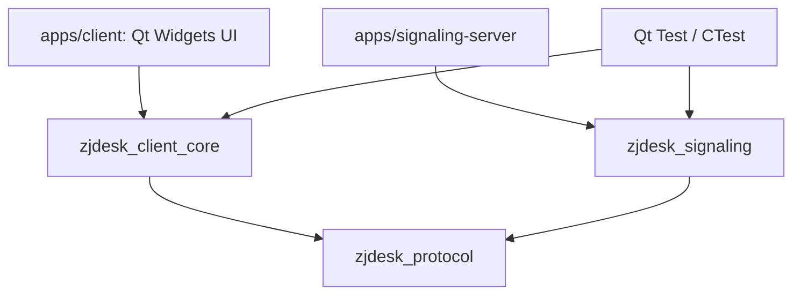
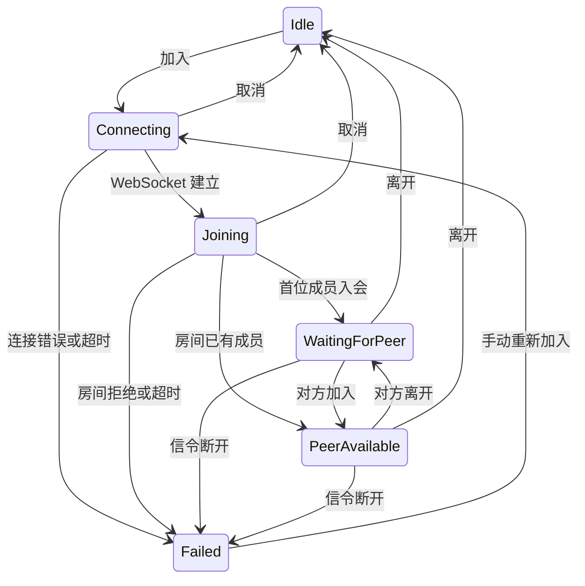

# 架构与扩展约定

当前采用模块化单进程客户端与独立信令服务。将功能按依赖边界拆成 CMake 目标，
便于分别编译、测试和替换实际的平台实现，不引入微服务或通用插件加载器。
本文件是随代码维护的当前设计；原始产品目标保留在 original-project-plan.md。

## 当前依赖

| 目录 / 目标 | 职责 | 约束 |
| --- | --- | --- |
| protocol / zjdesk_protocol | 信封编码、版本、输入校验 | 不依赖 UI、GStreamer 或服务状态 |
| signaling / zjdesk_signaling | 房间成员、双人限制、协商消息路由、心跳 | 不传输媒体和远控输入 |
| signaling / SignalingClient | WebSocket 生命周期与协议消息 | 不修改会议业务状态 |
| session / SessionCoordinator | 入退会、状态变更、成员和信令事件 | 是会议业务状态的唯一写入者 |
| diagnostics / EventLog | 有界事件记录、原子文件导出 | 不记录 SDP 内容或实际输入文本 |
| remote-control / ControlSession | 本地授权、控制代次、序号校验 | 当前没有传输或 OS 输入注入 |
| media / MediaEnvironment | 可选 SDK 初始化和插件探测 | 当前没有音视频管线 |
| platform / PlatformInfo | 真实平台、架构、会话信息 | 系统输入与采集适配留到对应功能实现 |
| apps/client | 界面布局、显示状态、收集用户操作 | 不直接操作 socket、系统输入或 GStreamer 对象 |

客户端和信令服务是独立可执行文件。client_core 无 Widgets 依赖，可以在无桌面的测试环境中验证。
当前模块较小，client_core 将业务模块放在同一静态库内；只在独立依赖、编译成本或复用需求出现时进一步拆库。

## 会话状态

`PeerAvailable` 仅表示双方已入会。接入媒体后新增 `Negotiating`、`Connected` 等实际媒体状态，
必须由媒体建立 / 中断事件推动，不能由 WebSocket 连接直接判定。

每次连接创建一个新的 QWebSocket，回调检查当前 socket 身份。
退出时先清空当前连接标识，再断开回调与 socket，防止旧连接回调影响新会话。
全部现有业务逻辑运行在 Qt 事件线程，当前没有为了“多线程”额外创建线程。
服务器定期 WebSocket ping / pong；客户端当前依赖底层 socket 断开事件，完整的双端故障检测与恢复在媒体阶段补齐。

## 协议

统一信封：`{"version":1,"type":"join","payload":{...}}`，UTF-8 总长度最多 64 KiB。
客户端类型为 `join`、`leave`、`offer`、`answer`、`ice`。
服务响应为 `joined`、`left`、`peer_joined`、`peer_left`、`error`。
服务端根据当前连接所属房间转发协商消息，并覆盖 `fromPeerId`，客户端不能自行指定另一个房间或发送者身份。
SDP / ICE 的具体业务字段在真实媒体接入时补上对应验证；目前服务只转发 JSON payload。

远控消息将走 WebRTC DataChannel，不能复用信令转发持续发送画面或键鼠。
被控端本地确认后才能授权，每次授权生成新的 controlEpoch；
检查对端 ID、代次和单调递增序号后才接受输入。撤销或对方离开时立即清除授权。
未来的输入执行器还需要维护并释放本程序按下的键，当前授权门禁不代表真实远控已实现。

## 媒体与平台的下一步

第一个真实媒体功能采用设备预览 / 测试源验证，再实现 WebRTC 双端互通。
届时定义 `MediaEngine` 的最小接口：启动、停止、协商事件、帧与真实统计。
GStreamer 对象只留在媒体模块内，GLib 回调通过 Qt queued signal 或 invokeMethod 回到协调层。
跨线程回调携带会话代次；先停止输入、取消回调，再停止管线和工作线程。

屏幕采集和输入执行到落地时才加入平台接口，通过 CMake 选择 Windows 或 Linux 实现。
Ubuntu 22.04 先验证 X11，再独立增加 Wayland；不在业务类内散布平台宏。

## 增加功能的顺序

1. 在 roadmap 中写明用户行为、边界和验收条件。
2. 改公共协议或状态前，先加入失败场景与回归测试。
3. 实现业务或平台模块，再接入 UI；新类只为实际职责而建立。
4. 跑受影响测试和本版本完整 CTest，记录真实平台验证结果。
5. 同时更新 README 的“已实现 / 未实现”和本文件的模块依赖。

不为尚未出现的需求提前添加插件机制、服务定位器、全局事件总线、通用仓储层或数据库。
架构变更记录具体触发问题和依赖变化；若需要迁移，保留可以验证旧行为的测试。
