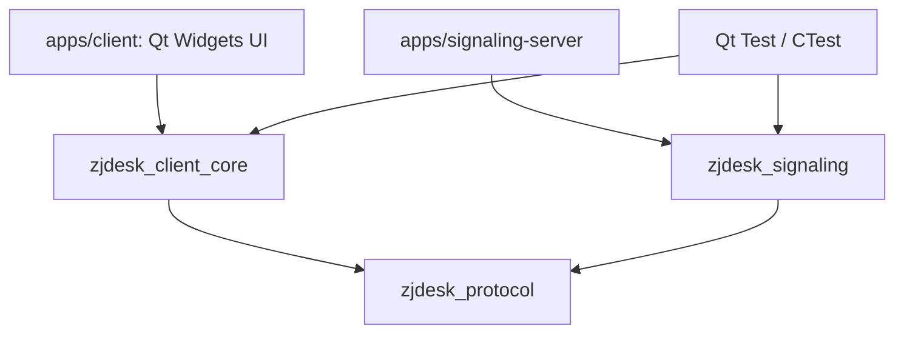
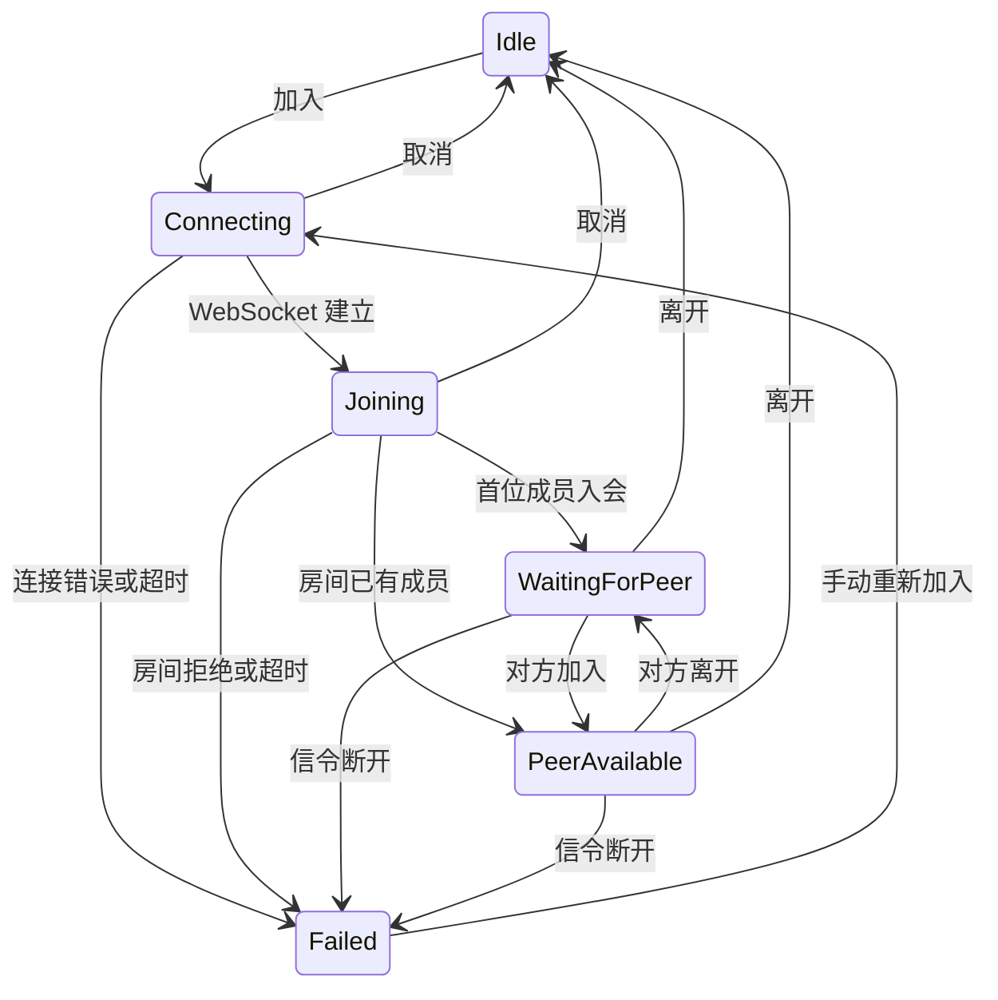

# 架构与扩展约定

协作和会议使用同一个 `SessionCoordinator`，连接或入房期间禁止同时加入另一房间。信令 `join` 携带 `roomType`，服务端按房间类型和原始房间码联合隔离；未携带类型的旧客户端按协作处理。会议客户端必须在 `joined` 响应中收到 `meeting` 类型确认，避免旧服务忽略类型后混入协作房间。会议禁用远控能力和请求；协作远控仍在本地授权后自动传输桌面。

会议使用独立 `ConferenceMedia` 工作线程与 WebRTC 管线，通过 `conference` 中继消息和
`sessionId` 区分会话，支持 `start`、`accept`、`stop`、`offer`、`answer` 和 `ice`。
服务校验消息、绑定实际发送者并检查转发后的消息长度；使用会议需要同步更新服务端。
`SessionCoordinator` 统一管理 Idle / Calling / Incoming / Connecting / Running / Failed，
协调层默认保留显式发起 / 接听接口；会议界面启用 `setConferenceAutoConnect(true)`，
双方加入会议房间后自动发起和接受协商，再创建双方 VP8 / Opus 双向媒体。协作房间不触发自动连接。
自动发起仅在成员进入可连接状态时进行，失败后等待离会重入，避免循环重试。交叉请求沿用双方 peerId 排序消解。
Running 要求 WebRTC connected
且实际收到远端视频与音频；房间状态、屏幕共享及远控保持独立。
会话代次屏蔽旧协商与帧，设备开启前等待预览和测试音释放；挂断、离开、断线、超时或媒体失败均清理设备。
本地与远端帧各使用一个最新帧槽交接，避免 UI 事件队列累积画面；设备异常只结束会议并保留可用的房间连接。
界面只操作协调层，媒体选择、静音和画面隐藏均在会议工作线程执行。使用与限制见 [视频会议](video-conference.md)。
界面从本机 `QSettings(IniFormat, UserScope, "ZJdesk", "meeting")` 读取三个入会默认开关，初始均开启，
通过 `setConferenceJoinDefaults` 交给协调层；每次新建媒体连接时取用，不改变当前通话。
媒体工作线程在管线进入 PLAYING 前应用静音和画面隐藏，远端通过当前会话的 `camera` 消息同步默认隐藏状态。

当前采用模块化单进程客户端与独立信令服务。将功能按依赖边界拆成 CMake 目标，
便于分别编译、测试和替换实际的平台实现，不引入微服务或通用插件加载器。
本文件是随代码维护的当前设计；原始产品目标保留在 original-project-plan.md。

## 当前依赖

屏幕统计通过 `media/frame_timing.h` 的有界累计直方图记录分段耗时，由 ScreenShare 经
SessionCoordinator 发布；VideoSurface 将 GUI 接收、绘制和 frameSwapped 统计经同一路径回传。
统计包含长停顿计数及实际解码器/输出格式，不引入 GUI 对 GStreamer 的调用。
当前产品仍为 VP9；HEVC 独立实验不代表产品协商或 RTP 路径已接入。
公网发送可以通过 `ZJDESK_WEBRTC_MAX_BITRATE` 配合 GCC 限定启动估计、拥塞控制上下限与编码目标；
配置只影响新流，未设置时保留既有行为。CQP 与底层中继缓存仍可能突发，不能将其视为硬性线速上限。
当前异网条件与配置边界见 [公网优化](wan-optimization-20261025.md)。
统计精度、验证边界及后续工作见 [1080p60 实施进度](1080p60-implementation-progress.md)。

| 目录 / 目标 | 职责 | 约束 |
| --- | --- | --- |
| protocol / zjdesk_protocol | 信封编码、版本、输入校验 | 不依赖 UI、GStreamer 或服务状态 |
| signaling / zjdesk_signaling | 房间成员、双人限制、协商消息路由、心跳 | 不传输媒体和远控输入 |
| signaling / SignalingClient | WebSocket 生命周期与协议消息 | 不修改会议业务状态 |
| session / SessionCoordinator | 入退会、状态变更、成员和信令事件 | 是会议业务状态的唯一写入者 |
| diagnostics / EventLog | 有界事件记录、原子文件导出 | 不记录 SDP 内容或实际输入文本 |
| remote-control / ControlSession | 本地授权、控制代次、序号校验 | 由协调层处理请求、授权与撤销 |
| remote-control / InputInjector | Linux X11 / XTest 键鼠输入与释放 | 仅授权后调用；不依赖 UI Widgets |
| media / MediaEnvironment | 可选 SDK 初始化、插件检查与部署环境选择 | 不推断通话连接成功 |
| media / MediaEngine | 设备枚举、内部采集回归、音频测试与有界帧交接 | Gst 指针只在媒体模块，当前不发送媒体 |
| media / ScreenShare | 桌面采集、WebRTC 协商、VP9 编解码与有界帧交接 | 独立工作线程，不直接修改会话业务状态 |
| platform / PlatformInfo | 真实平台、架构、会话信息 | 系统输入与采集适配留到对应功能实现 |
| platform / CameraPermission | Windows 桌面摄像头开关只读预检与系统设置入口 | 协调层持有预检状态，仅明确关闭时引导授权；未知不误报拒绝，实际访问由采集后端检查 |
| apps/client | 界面布局、显示状态、收集用户操作 | 不直接操作 socket、系统输入或 GStreamer 对象 |

客户端和信令服务是独立可执行文件。client_core 使用 Qt Gui 的 QImage，没有 Widgets 依赖，可以在无桌面的测试环境中验证。
当前模块较小，client_core 将业务模块放在同一静态库内；只在独立依赖、编译成本或复用需求出现时进一步拆库。

## 会话状态

`PeerAvailable` 仅表示双方已入会。屏幕共享另有 Stopped / Starting / Running / Stopping / Failed
状态；Running 必须同时收到实际画面和 WebRTC connected 事件，不能由 WebSocket 连接直接判定。
媒体统计及接收端零帧 / 丢包反馈从管线启动后产生，不再依赖 Running，避免首个关键帧丢失时无法反馈。

每次连接创建一个新的 QWebSocket，回调检查当前 socket 身份。
退出时先清空当前连接标识，再断开回调与 socket，防止旧连接回调影响新会话。
信令和业务状态运行在 Qt 主线程，媒体管线与设备枚举在专用 Qt 工作线程运行。
服务器定期 WebSocket ping / pong；客户端当前依赖底层 socket 断开事件，完整的双端故障检测与恢复在媒体阶段补齐。

## 协议

统一信封：`{"version":1,"type":"join","payload":{...}}`，UTF-8 总长度最多 64 KiB。
客户端类型为 `join`、`leave`、`share`、`offer`、`answer`、`ice`、`control`。
服务响应为 `joined`、`left`、`peer_joined`、`peer_left`、`error`。
服务端根据当前连接所属房间转发协商消息，并覆盖 `fromPeerId`，客户端不能自行指定另一个房间或发送者身份。
`share` 包含 action=start/stop 和 streamId，服务验证动作和标识格式。
0.3.1 增加 action=profile/stats：profile 携带档位 revision、尺寸、目标 fps；
stats 携带同一 revision 下的接收端有效 fps。服务校验字段范围并覆盖发送者身份。
0.4.3 的 profile 接受 5～240 的整数 fps，以支持不同刷新率及更细的帧率档位。
共享 SDP 消息携带 sdp，ICE 携带 candidate / sdpMLineIndex；都携带 streamId。
接收端先校验成员身份和当前流标识，再解析 SDP 或 ICE；旧流事件被丢弃。
WebSocket 只传共享控制与协商信息，视频 RTP 由 WebRTC 的 ICE / DTLS / SRTP 通道传输。

0.4.3 默认从主屏幕物理像素尺寸及 Qt 报告的刷新率开始，最高目标 240 fps。
当前 ShareQuality 在相同分辨率下依次选择刷新率及低于它的 240 / 165 / 144 / 120 / 90 / 60 /
50 / 45 / 40 / 30 / 24 档位；达到 24 fps 仍持续落后才按比例降低尺寸。
尺寸依次受 1920×1080、1600×900、1280×720、960×540、640×360 约束，不放大源画面；
仅最低尺寸保留 20 / 15 / 10 / 5 fps。连续两次不足只降低一档，连续 30 次稳定后试探恢复。
低分辨率下优先试探上一分辨率的最低帧率，再提高帧率；不必先爬完低分辨率的帧率档位。
首轮留出 10 秒建立连接及稳定显示，切换档位后留出 4 秒，避免启动阶段的慢显示触发过早降档。
目标码率按像素数和 max(30, fps) / 15 计算，范围 2～40 Mbps；降低帧率不会继续压低文字画面码率。
2026-10-09 按高画质优先、允许轻微有损的要求保留 VP9 profile 1 / 4:4:4，软件量化范围改为 0～8。
软件编码使用 CBR、300 ms 编码缓冲、5 秒关键帧间隔，限制关键帧预算，并将强制关键帧最小间隔设为 500 ms；
这些是编码器参数，不是网络线路的码率硬上限。接收端 NACK / RTX 及默认 200 ms 缓冲保留，
transceiver 增加 RED / ULPFEC，目标冗余 20%；协商回归同时验证 VP9、RTX、RED 与 ULPFEC。
现有及后续创建的 rtpsession 设置 `rtcp-fraction=64000.0`，这里大于 1 表示绝对 bits/s，
而非比例。自动预算在启动阶段可能仅为 3.2 kbps，实测曾抑制期限内的重复 NACK；
明确反馈预算后，日志中的 RTCP 确定性调度间隔约 16～25 ms。预算不是固定发送流量，
也不能保证无线网络上的重传一定在默认 200 ms 缓冲期限内到达。
属性单位见 [GStreamer rtpsession](https://gstreamer.freedesktop.org/documentation/rtpmanager/rtpsession.html)。
RGB 转换显式使用完整范围的 BT.709；RTP 解包后的压缩 caps 同样传入颜色信息，避免解码器继承错误的默认范围。
当前属于轻微有损，RGB 转换也存在舍入误差；原生像素细字和彩线由回归测量，不能再称为无损。
VP9 的 lag-in-frames 显式设为 0，避免默认缓存 25 帧在低帧率下影响延迟与恢复判断。

Linux 优先探测 `vavp9lpenc` 的 VP9 profile 1，自动模式还验证尺寸缩小；任一失败回退 `vp9enc`。
硬编使用 VUYA / CQP 8～16、hierarchical-level=1、gf-group-size=1，禁用未来参考帧等待。
硬编前固定 RGB，使转换器在尺寸变化时重新分配 VA 缓冲，避免当前 VA 插件内部上传池保留旧尺寸。
硬编仍需 CPU 色彩转换和上传；Windows profile 1 接收仍是 `vp9dec` 软件解码，并非端到端 GPU 零拷贝。
该硬编插件是可选依赖，当前 SDK 不具备时仍可使用软件链路。
部署时用与应用相同的 SDK / 插件环境检查 `gst-inspect-1.0 vavp9lpenc`；
需要启用 VA 插件及匹配的 libva 驱动，不能仅凭系统支持 VA-API 就判定 4:4:4 编码可用。

接收端 stats 额外反馈累计 RTP 收包 / 丢包，发送端只接受当前 epoch / revision。
有效窗口至少 100 包；连续两窗口丢包率 ≥2% 将预算降至 85%，连续 15 窗口低于 0.5% 才逐步恢复。
预算下限 2 Mbps；软件更新 target-bitrate，硬编在 CQP 8～16 内提高量化值。CQP 忽略 bitrate 属性，
不能把预算当作实际码率。另增加同一 DataChannel 的有界往返探针，以最近 60 秒最小 RTT 为基线；
连续两窗口额外延迟 ≥80 ms 也降低预算，额外延迟 >20 ms 不恢复码率、≥30 ms 不升档。
探针包含两端媒体线程调度与往返传输，不能当作视频帧年龄或跨机单程延迟。
未回过探针的旧客户端不触发延迟降码率；消息由媒体层消费，不进入控制授权状态机。

2026-10-10 增加 `ZJDESK_WEBRTC_GCC=1` 对照路径：TWCC 显式加入 offer，接收端只接受 offer 中的映射；
回归检查 answer 的扩展与 transport-cc，不能用“创建了 rtpgccbwe”代替实际协商。
`request-aux-sender` 接入单个 rtpgccbwe，使用它自己的异步 pacing；不改 DTS、不追加 clocksync。
GCC 初始 / 上限 40 Mbps；下限取启动 profile 的编码预算与 8 Mbps 中较小者（profile 预算最低 2 Mbps）。
这是当前局域网高画质对照的下限，不能作为低带宽跨网保证；旧 2 Mbps 下限在后续小流量阶段仍有长停顿。
编码预算取既有预算与估计的 80% 中较小者；CQP 仍限制在 8～16。
反馈回调只覆盖最新估计；媒体线程每 250 ms 检查一次，仅在实际参数变化时更新编码器，避免重复重配置产生关键帧。
发包调度队列大于当前估计 100 ms 数据量时，仅在编码前跳过完整原始帧，不丢编码参考帧或 RTP 分片。
统计记录估计、调度队列字节和编码前跳帧计数；设为 1 时不禁用 UDP，TCP 候选仍可用。
`ZJDESK_WEBRTC_GCC=tcp` 使用相同的 TWCC / pacing，但 Linux 桌面仍强制 ICE-TCP。
UDP 候选在隔离 Edge 桌面完整短测通过，在物理 GNOME 三轮首帧复验失败，不用于日常客户端。
这是按进程显式启用的路径，不改变默认 TCP；当前 LAN / Edge 长测与补验结果见 validation.md。

当前局域网跨机实测出现 Linux UDP SndbufErrors，FEC 单独不能避免发送突发丢包。
通过 libnice 的 selected-pair 通知，在媒体线程获取本会话的已选直连 UDP GSocket，
申请 1 MiB 收发缓冲并读回实际值；不修改系统 sysctl、其他 socket 或代理。
本机 Linux 受系统上限限制实际为 425984 字节，Windows 为 1048576 字节，不能把申请值当成生效值。
2026-10-09 首帧修复：Linux 真实桌面发送在收集候选前设置 NiceAgent `ice-udp=false`、`ice-tcp=true`，
默认采用 ICE-TCP 避开该主机 UDP 大帧突发。libnice 0.1.22 的非 reliable agent 在 TCP 拥塞时仍可能拒绝 RTP，
不能保证分片必达或完整背压。测试源及 Windows 发送仍保留原候选策略；这是明确的默认策略，
不是自动 UDP→TCP 回退。未加入阻塞 sleep；这条默认路径不启用 GCC，新的显式 pacing 对照见上节。
实际选中候选的 transport 进入 ShareStats 与画面状态；TCP 没有可取得的直连 UDP socket，
其 sendBufferBytes / receiveBufferBytes 报告 -1，不代表 TCP 连接失败。
物理 Linux 桌面跨机停止 / 重开三次与远控回归已验证；TCP 拥塞可能产生队头等待，稳定 60 fps 尚未验收。
TURN 仍未验收。候选属性依据 [libnice NiceAgent](https://libnice.freedesktop.org/libnice/NiceAgent.html)。
媒体构建额外链接 SDK 已有的 libnice / GIO；其它 ICE 实现未做适配。

ScreenShare 将只读映射的 GstBuffer 交给 QImage，最后一个图像引用释放时 unmap；
写图像触发 Qt 隐式共享分离，停止 / 重开后保留的图像仍持有自身缓冲。单槽邮箱只留最新图像。
这移除交接处的一次整帧复制，RGB 转换与 QPainter / OpenGL 上传仍存在。
ShareStats 记录编解码均值 / 最大耗时、最大输出间隔、编码帧 / 关键帧大小、邮箱覆盖、实际编码器与回退原因。
encoderQuantizer 读回编码器的 qp 配置属性，没有逐帧解析 VP9 码流中的量化值。
codec 耗时只覆盖编码器 / 解码器 sink 到 src，不包含采集、网络或完整呈现延迟。
编码线程按 CPU 逻辑线程数选择；采样与交付定时器为 4 ms。NACK / RTX 和请求 / 等待关键帧仍保留。
0.4.5 的接收端 webrtcbin 缓冲默认 200 ms；`ZJDESK_WEBRTC_LATENCY_MS` 可在诊断时选择 30、50、100、150 或 200 ms。
每秒读取 WebRTC RTP 收发字节数、收包数、累计丢包和抖动；远控测试输入带一次性探针，Linux 注入后经 DataChannel 应答，Windows 同时测首次解码帧与 OpenGL 画面交换。
对照测试中小于 200 ms 的缓冲在连接初期产生长停顿或降分辨率，故未降低默认值；数据见 validation.md。
这些是目标参数和自适应规则，不表示每台电脑或网络都可达到屏幕刷新率；实际接收、显示帧率单独统计。

0.4.2 在房间信令中增加 control 的 capabilities / request / revoke，
允许在尚无桌面连接时请求控制，requestId 绑定当前请求，服务覆盖发送者身份。
信令服务拒绝 control 的 grant / input 动作；授权和键鼠仍走 WebRTC DataChannel。
被控端本地确认后才能授权，每次授权生成新的 controlEpoch；
检查对端 ID、代次和单调递增序号后才接受输入。撤销或对方离开时立即清除授权。
输入执行器维护本程序按下的键与鼠标按钮，失焦、撤销、停共享、退会和析构时释放。

## 0.4 Windows 控制 Linux X11

共享方创建有序可靠的 `zjdesk-control` DataChannel，接收方在 prepare-data-channel 中挂回调。
远端名称直到 DCEP 到达才赋值，因此在 on-open 与实际消息处校验名称，不能在准备阶段提前过滤。
GStreamer 回调通过已有生命周期 / 共享代次保护的队列回到媒体线程，再交给协调层。
DataChannel 的 GObject 引用跨队列持有，旧流回调不影响新连接；单条控制消息最多 4096 字节。

双方入会后通过信令交换控制能力，只有媒体与 XTest 可用的 Linux 端声明可以被控制。
请求先进入 Pending，不采集桌面；Linux 本地允许后，如果没有桌面连接，由协调层自动启动。
DataChannel 打开后发送带 requestId / controlEpoch 的授权；控制方丢弃已取消或旧请求的授权。
停止控制时结束本次自动启动的传输；手动启动的共享在控制结束后保留。
请求、待本地批准、控制中、被控制中分别是独立 RemoteState；控制请求与本地允许后的连接等待为 60 秒，Linux 等待本地批准仍为 30 秒。
授权后每条输入携带字符串编码的 64 位控制代次与序号，ControlSession 拒绝旧授权及重放。
失去 DataChannel、停止共享或房间失败立即撤销；信令入会本身不会自动授权。

### Windows ↔ Linux 文件剪贴板

`SessionCoordinator` 持有两个 `FileClipboard`，分别处理 Linux → Windows 与 Windows → Linux，批次独立。
仅在远控授权及双方文件能力握手完成后激活，绑定当前 controlEpoch；反向额外通过 `fileClipboardReverse` / `file_ready.reverse` 协商，兼容旧对端的单向能力。
撤销、停止共享、断线或通道失效立即停止。UI 只展示协调层的文件状态，不直接访问剪贴板或文件传输。
通过 Qt 剪贴板读取 Windows 原生文件 URL 或 Linux 的 `text/uri-list` / `x-special/gnome-copied-files`，仅复制用户选中的本地普通文件和目录；
不会解释文本路径，剪切也只复制，不删除源文件。

文件消息通过 `_zjdeskFiles: true` 在现有可靠有序的 `zjdesk-control` DataChannel 上复用，媒体层将文件与输入消息分别分发。
普通控制消息仍限 4096 字节，文件 JSON 上限 32768 字节；每次读取 16384 字节，等待接收方请求下一块，避免文件数据无界排队。
文件与输入共享通道及带宽，低带宽网络中一个文件块仍可能增加输入延迟；反向文件消息使用 `reverse: true` 路由到独立批次，消息校验控制代次、批次、文件序号和偏移。
接收方先写独立临时目录，完整接收后一次发布本地文件 URL，在 Windows 由 Qt 提供原生 `CF_HDROP`，在 Linux 同时提供 GNOME 文件列表，因此文件管理器可直接粘贴。
发布的剪贴板带 `application/x-zjdesk-file-clipboard` 标记，发送方忽略此类导入内容，避免自动来回传输；用户在文件管理器重新复制时仍是新的操作。
完成文件保留到客户端退出，收回控制不删除已发布的文件；取消只清除未完成的缓存。本机复制新内容会取消正在接收的旧批次。
剪贴板被占用时显示失败，清理未发布的缓存，不报告已就绪。每批最多 4096 项，拒绝路径穿越、符号链接、Windows 保留名称、大小写重名和无效数据；
读写失败或 30 秒无响应终止本批。该功能需要双方升级，不启用文本或普通会议文件同步。

VideoSurface 按实际帧的等比显示区域生成归一化坐标，黑边不发送点击。
鼠标移动保留最新位置，由 8 ms 精确定时器合并发送，避免原 16 ms 限流直接丢弃末次位置；
定时器节奏不等于跨机实际更新率。按钮、滚轮与键盘事件先发送待处理移动，再发送离散事件，
保证拖拽顺序；失焦、停止控制或清空画面取消待发送移动并释放键鼠，避免旧位置延后执行。
仅在已授权控制且指针处于有效画面内隐藏控制端光标；黑边、停止控制或无画面时恢复本地光标。
新控制端确认支持独立光标后，Linux 使用 XFixes 读取实际光标形状、热点和主屏幕位置，
每 16 ms 检查变化，并在执行输入后立即检查；位置或形状有变化才经现有可靠 DataChannel 回传。
形状仅在变化时发送 PNG，限制为 128×128、2400 字节；接收端验证控制代次、递增序号、
归一化坐标、图像尺寸和热点后，在 VideoSurface 等比画面区域独立绘制，不计入视频呈现帧数。
得到有效形状后关闭 ximagesrc 内嵌光标，停止控制时恢复；旧控制端不确认支持、形状获取或编码失败时
保留或恢复采集光标。独立光标使用被控端真实状态，不预测本地位置，仍受网络往返和 TCP 排队影响；
窗口内容仍经视频返回。Linux 构建额外依赖 Xfixes。
InputInjector 将坐标映射到主屏幕物理像素，
通过 XTest 执行鼠标、滚轮、常用字母 / 数字 / 功能键 / 修饰键；UI 不调用 X11 API。
当前仅 Linux X11 被控；Windows 原生输入注入、Wayland、文本剪贴板及中文输入法同步留待后续需求。

画面放大在同一个 MainWindow 中隐藏普通面板并进入全屏，保留同一个 VideoSurface
和实际绘制统计，不重新创建画面控件或媒体管线。0.4.4 去掉外围边距与底部控件，
退出按钮覆盖在画面上；两端物理像素尺寸一致时按一对一绘制，普通窗口使用平滑缩放。
Esc 只在放大时作为本地退出快捷键，恢复进入前的窗口状态；切换前发送按键释放。

## 0.2 本地媒体与线程

独立本地预览的界面、按钮、预览帧到会议画面的连接及诊断统计已移除。MediaEngine 与协调层的内部采集接口保留用于媒体回归，用户不能从界面启动；会议本机画面仍由独立 ConferenceMedia 提供。

为避免采集、枚举和关闭设备阻塞日常 UI，MediaEngine 通过 queued invokeMethod 将命令交给
MediaWorker。该线程用 Qt 定时器读取 GstBus 和 appsink，无需为当前预览建立 GLib MainLoop。
GStreamer 内部线程负责采集，工作线程只复制映射后的 RGB 帧，不向 UI 交付 GstBuffer 指针。

appsink 最多一帧并丢弃旧帧；互斥保护的交接槽最多一个深拷贝 QImage，两处合计最多两帧。
交接槽从空变为有帧时才排队一次通知，主线程取走前只覆盖旧帧；取消原先每 33 ms 取帧的上限，避免高帧率源丢失交接机会，同时保持通知有界。
VideoSurface 在真实 OpenGL widget 中按比例绘制会议和共享画面。内部采集、交接与丢弃计数只表示本地管线，不能当作网络丢包或窗口呈现 FPS。会议本地 / 远端帧也使用一个合并的待处理通知。

SessionCoordinator 是预览和音频状态的唯一写入者，状态分别为 Stopped / Starting / Running /
Stopping / Failed，与房间状态独立。只有第一帧到达才显示预览运行；每次启动、停止携带独立
代次，取消后的旧状态与旧帧不影响新预览。离开房间或信令失败会停止本地媒体。
摄像头无帧启动超时为 8 秒；管线错误显示真实 GstBus 信息。
停止在媒体线程将管线设为 NULL 并释放引用，返回确认后允许重启；析构等待工作线程清理。
驱动自身在关闭时挂起的硬退出保护尚未实现，不把现有回归当作所有驱动的时间上限保证。

设备由 GstDeviceMonitor 枚举并保存设备引用，刷新后旧设备 ID 失效；预览中禁止刷新或换源。
SDK 的旧 ksvideosrc 在本机摄像头失败，当前排除该接口，使用枚举出的 Media Foundation 接口。
音频设备仅枚举；audiotestsrc 可接扬声器或测试用 fakesink，尚无麦克风录制与远端音频。

## 0.3 摄像头模式与屏幕共享

CameraMode 从设备 caps 的单个结构中固定宽高与帧率，按像素数、再按分数帧率比较；
不把不同模式的宽高和帧率拼成设备未公布的组合。raw 直接转换，JPEG 先解码，再转 RGB；
摄像头输入固定为最高原生模式，在其后通过 videorate drop-only、videoscale、videoconvert 和动态 capsfilter 调整输出；分数帧率保留，不把 60000/1001 提升成 60/1。
预览与会议复用 ShareQuality，以 1 秒观测窗口评估采集 / 本地交接或编码 / 本地交接速度；连续两个窗口低于目标 85% 才降档，连续 30 个稳定窗口后恢复。
摄像头清晰度优先，在同一分辨率内先降低到 15 fps，之后才降尺寸；恢复时优先尺寸。屏幕共享仍使用原来的 24 fps 分辨率降档门槛。
内部采集统计记录实时采集 / 交接帧率与目标帧率，供媒体回归读取；独立预览诊断已从界面移除。输出分辨率来自实际 caps，目标帧率不代表实际呈现帧率。会议 VP8 码率随输出档位变化，按 CPU 核心数使用 1–8 个编码线程；本次没有添加会议网络拥塞控制。

用户将屏幕共享提前，语音通话仍待实现，因此共享是独立单向视频管线，摄像头预览保持本地。
ScreenShareWorker 在专用 Qt 线程管理管线、GstBus 和 appsink；发送侧桌面 tee 分为本地预览
和 VP9 / RTP / webrtcbin，接收侧 webrtcbin / VP9 解码进入有界 QImage 交接槽。
Windows 采集使用 d3d11screencapturesrc / d3d11download，Linux X11 使用 ximagesrc；
平台差异集中在媒体采集管线入口，UI 与协调层不包含平台 API，Wayland 暂不支持。

每次共享生成新 streamId；启停带独立 epoch，回调与帧都拒绝旧代次。
媒体断开可能先于正常 stop 信令到达。失败时仍立即清理媒体和控制权限，协调层仅保留该失败流标识；
随后来自当前对端且标识匹配的 stop 可将失败收尾为已停止。错误标识不生效，开始新流或退出房间清除记录，
旧 stop 不能停止新共享。这不自动恢复传输，也不重新授予控制。
GStreamer 的 SDP promise 和 ICE 回调通过受生命周期保护的 queued invokeMethod 回到工作线程。
RTP pad 在 streaming 回调返回前同步连接预建的解码入口，避免未连接错误；不从回调修改 UI。
0.4.1 针对真实跨机花屏启用每个 RTP transceiver 的 do-nack，协商 NACK / RTX 重传。
发送侧 transceiver 可能已在 parse-launch 连接管线时创建，因此既配置已有实例，也处理 on-new-transceiver。
接收侧 rtpvp9depay 设置 request-keyframe / wait-for-keyframe，丢包后请求关键帧，
在完整关键帧到达前丢弃依赖旧参考帧的数据，避免继续显示损坏画面。
发送侧在 DataChannel 就绪前丢弃编码输出 buffer，仍传递 CAPS / 事件完成媒体协商，
避免旧 RTP 积压以及视频突发占用 ICE / DTLS / SCTP 建立阶段。通道就绪后请求新的关键帧，
丢弃它前面的增量帧，以当前完整画面开始发送；本地采集预览继续运行。
发送侧只有控制通道就绪后才进入 Running，避免未就绪时提前取消媒体启动期限。
远端描述应用完成前缓存最多 256 个 ICE 事件；连接启动超时为 45 秒，兼容高 RTT 中继握手等待。
SessionCoordinator 决定共享角色及状态；双方同时开始时按 peerId 排序确定同一共享方。
停止、成员离开或信令失败均取消管线，清空画面；对方已离开时不会再发送停止消息。
全局信令和共享连接分别清理，避免把退出期间迟到的 peer_unavailable 当作本端退会。
共享采用 host ICE，不过滤 Tailscale 的 100.64.0.0/10 地址，可经已连通的 Tailnet 跨局域网连接。
信令填写可达的 Tailscale 地址；媒体候选仍由 libnice 自动收集和协商，没有固定机器 IP。
信令地址与媒体选中网卡独立。为可重复验证局域网，`ZJDESK_WEBRTC_LOCAL_ADDRESS` 可将
本次进程的 ICE 候选绑定到一个已存在的本机地址；无效 / 非本机地址在启动采集前失败，
不回退到其他网卡而误报验证成功。未指定时行为不变。ShareStats 同时保存实际选中
localAddress / remoteAddress；跨机用例检查两端地址，不能只凭信令 URL 判定传输路径。
GCC / CBR / 严格节流候选未通过当前局域网画质与帧率检查，已撤回到忽略的 build 分析目录；
正式源码保留 CQP 策略，跨网络工作按用户要求暂停。
2026-10-10 的新 GCC 对照保留 CQP，纠正双端 TWCC 协商、重复 pacing 与过度跳帧；
与上述已撤回候选不同，是否通过分别记录，不能沿用旧候选结论。
媒体的 TCP / UDP 是 ICE 传输类型，不能据此推断 Tailscale 使用 direct 或 DERP relay。
尚无 STUN / TURN、独立公网 NAT 穿透、断线恢复或系统声音。

## 0.3.1 共享帧率与电脑适配

旧版固定 15 fps、每 33 ms 交付共享画面，无法评估较高帧率。
现在编码器 / 解码器 src pad 的 buffer probe 计数真实完成帧，每秒按单调时钟计算速度。
probe 增加计数并记录编解码耗时、输出间隔和帧大小，不复制帧、不排队 UI 事件；
管线设为 NULL 后才清理对应计数器。
共享主线程用 PreciseTimer 每 4 ms 取最新帧，有界缓存保持不变；本地摄像头预览与会议使用上述有界帧通知。
ScreenShare 向媒体线程交接连续鼠标位置 / 无新形状的光标消息时，尚未消费的同代位置只保留最新一条；
按钮、按键、释放、授权、形状和代次变化形成顺序屏障。已经交给 SCTP / TCP 的消息不能在这里撤回。
VideoSurface 对新帧完成 frameSwapped 后计数，并记录新视频帧之间的最大交换间隔；
单独更新光标不增加视频计数，清空画面会清除待交换状态。这是窗口合成交换时刻，不是物理扫描输出时间。
接收、交付、呈现分别记录；档位 / 编码参数变化与长间隔 / 高额外延迟写入有界 screen-performance 日志。
帧率表示处理帧数，不等于画面内容每秒变化次数。

ShareQuality 是供媒体线程和单元测试使用的有限档位规则，没有新增设备数据库或通用策略系统。
档位从主屏幕原尺寸与刷新率开始，使用前述 24 fps 下限与逐档尺寸规则；
不放大源画面，小尺寸取偶数，仅最低尺寸继续降低至 20 / 15 / 10 / 5 fps。
首档留 10 秒、后续留 4 秒稳定期；编码或对方有效速度连续两次低于目标的 85% 才降档。
对方有效速度取解码、交付、可用时的实际绘制速度之最小值；反馈超过 5 秒不参与本次判断。
接收窗口处于后台、最小化或画面不可见时，协调层标记显示统计不可用，仍按真实编解码和交付速度反馈；
不把系统暂停重绘当作电脑性能不足。回到前台重建显示计数基线，避免后台时间拉低帧率。
连续 30 个统计窗口稳定后试探恢复；低分辨率以目标的 85% 判稳，优先恢复上一分辨率，
原分辨率以目标的 95% 判稳并试探更高帧率。这是迟滞规则，不是所有硬件的性能保证。

媒体线程修改 videoscale 后的 capsfilter 和编码目标码率，不关闭房间或重建 WebRTC 连接。
每次调整增加 revision 并通知对方；对方等待 2 秒再反馈，旧档反馈不参与新档决策。
首次参数取 Qt 主屏幕尺寸乘 devicePixelRatio；摄像头最高模式策略不变。
软件编码线程数为可用逻辑线程数的一半并限制在 1～8；目标预算为 2～40 Mbps，
当前轻微有损编码的实际瞬时带宽仍可超过预算，硬编 CQP 尤其不能视作线路码率硬上限。
UI 无手动档位菜单，默认按钮使用自动模式；30 / 60 固定目标仅作为公开核心 API 的性能验证参数。
Ubuntu 本机及 Windows → Linux 功能与跨机性能验收见 validation.md；长时间性能与网络瓶颈仍待测量，
不能将这两台电脑和模拟慢显示回归称为所有电脑已适配验收。

## 新增需求：转写与会议纪要

每端转写自己的麦克风音频，通过已加入房间的成员身份绑定 peerId / 昵称，记录发言时间和文本。
服务端须覆盖发送者身份，不能接受客户端伪造说话人。独立音轨无需用声纹猜测房间成员；
同一麦克风附近的多名说话人属于额外的说话人分离需求，当前未承诺。
最终按时间汇总发言，生成讨论内容、决策、待办与待确认事项；不补写转写中不存在的事实。
用户已确定先保持两人，不扩展房间人数；最新要求暂缓转写与纪要，目前没有功能实现。

## 增加功能的顺序

1. 在 roadmap 中写明用户行为、边界和验收条件。
2. 改公共协议或状态前，先加入失败场景与回归测试。
3. 实现业务或平台模块，再接入 UI；新类只为实际职责而建立。
4. 跑受影响测试和本版本完整 CTest，记录真实平台验证结果。
5. 同时更新 README 的“已实现 / 未实现”和本文件的模块依赖。

不为尚未出现的需求提前添加插件机制、服务定位器、全局事件总线、通用仓储层或数据库。
架构变更记录具体触发问题和依赖变化；若需要迁移，保留可以验证旧行为的测试。
