# ZJdesk 项目结构、框架与核心技术

> 整理日期：2026-11-16。基于当前工作目录 `F:\projects\ZJdesk`，分支 `ZJ-desk`，代码提交 `5bcd349`。项目版本为 `0.4.5`，以根目录 `CMakeLists.txt` 为准。
>
> 本文依据当前源码、构建配置及项目文档整理。“已实现”表示存在相应代码，不等于所有硬件、网络和双机场景均已通过验收。本次仅核对并编写文档，未重新执行构建、测试或真实双机操作。

> 技术缩写、媒体管线元素和性能指标的解释见第 10 章“技术术语与概念速查”。术语定义不代表本项目已经实现对应能力。

## 1. 项目定位

ZJdesk 是使用 **C++17 + Qt 6 + GStreamer / WebRTC** 开发的跨平台桌面协作工作台，目标平台为 Windows 11 x64 和 Ubuntu 22.04 x64（X11）。

当前主要能力：

- **双人远程协助**：对端发现与连接、主屏幕传输、远控授权、键盘鼠标操作、光标同步及文件 / 文件夹剪贴板传输。
- **最多四人视频会议**：摄像头、麦克风、扬声器选择，多成员音视频连接、音频混音和画面显示。
- **会议屏幕协作**：同一时间一人共享主屏幕，多人同步标注，共享者可批准或切换一位成员控制桌面。
- **网络与诊断**：局域网 / Tailscale 线路探测和选择、设备历史、会话恢复意图、真实媒体指标和 JSONL 事件导出。

客户端是原生桌面程序；信令服务是独立的 C++ / Qt 控制台程序。项目不依赖浏览器前端，也没有独立数据库服务。

## 2. 项目目录结构

以下为主要源码及工程入口，省略生成物和大部分历史验证文档。

```text
ZJdesk/
├── apps/                              # 可执行程序入口与客户端界面
│   ├── client/
│   │   ├── main.cpp                   # QApplication、参数与启动配置
│   │   ├── main_window.{h,cpp}        # 协作空间、会议、设置与诊断界面
│   │   ├── video_surface.{h,cpp}      # OpenGL 视频显示、画面输入与全屏
│   │   ├── annotation_layer.{h,cpp}   # 共享画面与桌面标注层
│   │   └── ipv4_address_edit.{h,cpp}  # IPv4 / 别名输入控件
│   └── signaling-server/
│       └── main.cpp                   # 独立信令服务入口
├── src/                               # 客户端与服务端的功能模块
│   ├── protocol/                      # JSON 消息信封、校验、标注协议
│   │   ├── message.{h,cpp}
│   │   └── annotation.{h,cpp}
│   ├── signaling/                     # WebSocket 服务及客户端
│   │   ├── room_server.{h,cpp}        # 房间、成员、配对与消息路由
│   │   └── signaling_client.{h,cpp}   # 信令连接生命周期
│   ├── session/                       # 会话协调与网络连接
│   │   ├── session_coordinator.{h,cpp}
│   │   ├── meeting_share.cpp          # 会议共享、标注与控制协同
│   │   ├── network_setup.{h,cpp}      # 网卡、地址与基础连通性验证
│   │   └── peer_connection.{h,cpp}    # 对端配置、探测和线路选择
│   ├── media/                         # 采集、编解码、WebRTC 与统计
│   │   ├── media_environment.{h,cpp}  # GStreamer 环境与插件检测
│   │   ├── media_engine.{h,cpp}       # 设备枚举、内部预览与音频测试
│   │   ├── conference_media.{h,cpp}   # 双人音视频及多人会议媒体
│   │   ├── screen_share.{h,cpp}       # 桌面采集、共享与 DataChannel
│   │   ├── camera_mode.{h,cpp}        # 摄像头模式选择
│   │   ├── share_quality.{h,cpp}      # 画质档位、降档恢复与积压处理
│   │   ├── congestion_budget.h       # 拥塞预算
│   │   ├── frame_timing.h            # 帧阶段耗时统计
│   │   └── test_frame_marker.h        # 测试用画面标记
│   ├── remote-control/                # 授权、输入注入与文件剪贴板
│   │   ├── control_session.{h,cpp}
│   │   ├── input_receiver.{h,cpp}
│   │   ├── input_injector.{h,cpp}
│   │   ├── input_injector_win_p.h
│   │   └── file_clipboard.{h,cpp}
│   ├── diagnostics/event_log.{h,cpp}  # 有界日志及 JSONL 导出
│   ├── platform/                      # 平台信息与摄像头权限
│   └── build_info.h.in                # 构建时生成版本信息
├── resources/styles.qss               # Qt Widgets 样式
├── cmake/                             # GStreamer 查找与 Windows 运行权限处理
├── tests/
│   ├── unit/                          # 核心、文件、网络及对端连接测试
│   ├── integration/                   # 信令与媒体集成测试
│   ├── ui/                            # 原生 Qt 界面测试
│   ├── manual/                        # 远控、会议与延迟探针
│   ├── scripts/                       # 启动、同步、权限及性能分析脚本
│   └── packaging/                     # Windows 打包启动器测试
├── tools/                             # Windows / Linux IP 查询工具
├── packaging/                         # 图标、Windows 启动器与 AppImage 资源
├── docs/                              # 架构、交接、路线、操作及验收记录
├── CMakeLists.txt                      # 版本、依赖、目标、安装及测试定义
├── CMakePresets.json                   # 双平台 Debug / Release 配置
├── build.ps1 / build.sh                # Windows / Linux 构建与测试入口
├── run.ps1 / run.sh                    # 本机启动入口
├── start-both.ps1                      # SSH 同步、构建和启动双端
├── select-network.ps1                  # 双端启动时选择网络地址
├── snapshot-source.ps1 / sync-source.sh # 源码快照及增量同步
├── package-release.ps1                 # 双平台打包调度
├── package-windows.ps1 / package-linux.sh
├── 直接启动.bat / 构建启动.bat / 打包可执行程序.bat
├── README.md
└── AGENTS.md                           # 项目维护与验证约定
```

`build/`、`dist/`、`output/` 和 `可执行程序/` 是构建、部署、验证或发布产物目录，已列入忽略规则，不属于源码模块。根目录的个人 IDE 配置和临时日志也不应当作为工程结构的一部分。

## 3. 软件框架与模块依赖

### 3.1 总体设计

项目采用**模块化单进程客户端 + 独立信令服务 + 对等 WebRTC 连接**。客户端通过 CMake 静态库组织职责，运行时借助 Qt 对象、信号槽和工作线程协作。

核心约束是：**UI 提交用户意图，`SessionCoordinator` 统一修改会话业务状态**。界面不直接建立媒体管线、网络连接或调用系统输入注入。

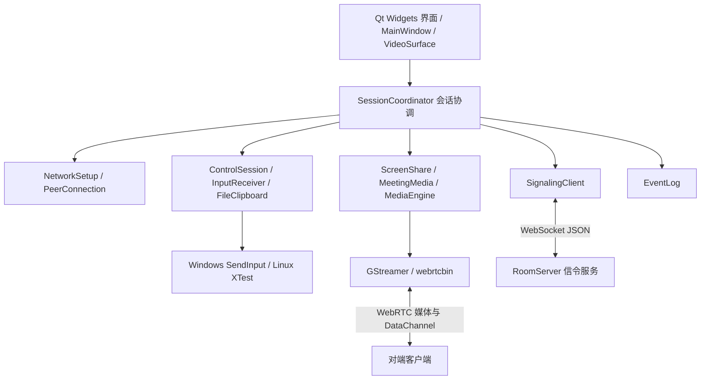

图示表达职责关系；源码中客户端核心也链接信令库，以支持客户端内托管 `RoomServer`。

### 3.2 CMake 目标

| 目标 | 类型 | 主要内容与依赖 |
| --- | --- | --- |
| `zjdesk_protocol` | 静态库 | 消息及标注协议；依赖 `Qt6::Core` |
| `zjdesk_signaling` | 静态库 | `RoomServer`；依赖协议库、Qt Network / WebSockets |
| `zjdesk_client_core` | 静态库 | 会话、信令客户端、网络、媒体、远控、诊断与平台适配；链接协议库及信令库 |
| `zjdesk` | 桌面可执行程序 | Qt Widgets 界面，依赖客户端核心及 OpenGLWidgets |
| `zjdesk-server` | 控制台可执行程序 | 独立信令服务，依赖信令库 |
| `zjdesk-*-tests` | 测试可执行程序 | Qt Test 回归，由 CTest 调度 |
| `zjdesk-*-probe` | 手动验证程序 | 会议、远控和闭环延迟测量；按构建条件生成 |

### 3.3 线程与状态管理

- UI 和会话业务状态由 Qt 主线程处理；媒体采集、管线和设备相关工作放在专用工作线程。
- `PeerConnection` 使用独立 `QThread` 运行线路探测；`InputReceiver` 在独立输入线程验证并执行输入。
- 通过 Qt 信号槽、互斥保护的帧交接区及有界通知交付数据，避免慢 UI 导致视频事件无限积压。
- 会话、共享流和授权分别使用状态、标识及代次隔离；退出、切换成员或重新授权后拒绝旧消息。
- 入房成功与媒体就绪分别判断。WebSocket 已连接不能直接认定画面、音频或远控可用。

## 4. 核心技术栈

### 4.1 两类功能共用的基础技术

本节只列共用基础。视频会议的摄像头 / 语音链路与远程控制的桌面 / 输入链路分别说明，具体差异见 4.2。

| 领域 | 技术 / 基线 | 项目用途 |
| --- | --- | --- |
| 语言 | C++17 | 客户端、信令服务和核心功能 |
| 应用框架 | Qt 6.8 基线，现有脚本使用 Qt 6.8.3 | 对象模型、事件循环、跨平台应用支持 |
| 桌面 UI | Qt Widgets、QSS | 工作台、会议、设置和诊断界面 |
| 图像显示 | `QOpenGLWidget`、`QImage`、Qt 绘制 | 视频显示、等比坐标映射、全屏与实际呈现统计 |
| 网络与信令 | Qt Network、Qt WebSockets、JSON | 房间、成员、配对、协商、标注和线路探测 |
| 媒体框架 | GStreamer 1.26.11 | 设备枚举、采集、转换、编解码、播放和统计 |
| 实时传输 | GStreamer `webrtcbin`、libnice、RTP / RTCP、DataChannel | ICE 协商、媒体及远控 / 文件数据连接 |
| 本地配置 | `QSettings` / INI | 对端设备、地址缓存、连接与会议偏好 |
| 诊断 | JSONL、Qt 文件接口、帧统计 | 有界事件、导出、帧率、码率和延迟观察 |
| 构建与测试 | CMake ≥ 3.28、Ninja、Qt Test、CTest | 双平台配置、编译、回归与报告 |
| 辅助工具 | PowerShell、Bash、Python，Windows 打包另用 C# | 启动、同步、打包、探针分析与自解压启动器 |

GStreamer 在 CMake 中是可选依赖，`ZJDESK_ENABLE_GSTREAMER` 默认 `OFF`；完整远控、屏幕共享及会议需启用并部署所需插件。WebRTC 由原生 GStreamer 管线提供。

### 4.2 视频会议与远程控制：技术差异对照

下表中“视频会议”指摄像头和麦克风组成的会议音视频链路，“远程控制”指双人远程协助中的桌面画面回传及键鼠操作。会议附加的屏幕共享 / 控制在 4.3 单独说明。

| 技术点 | 视频会议：摄像头 / 语音 | 远程控制：桌面 / 键鼠 |
| --- | --- | --- |
| 核心目标 | 多人同时看见、听见对方，维护各成员音视频状态 | 看见对端桌面，经授权操作对端系统并获得画面反馈 |
| 核心媒体类 | `MeetingMedia`；`ConferenceMedia` 提供双人音视频能力 | `ScreenShare` 负责桌面媒体和数据通道；`ControlSession` 负责控制授权 |
| 采集对象 | 摄像头、麦克风；支持设备选择和开关 | 主显示器；Windows 使用 `d3d11screencapturesrc`，Linux X11 使用 `ximagesrc` |
| 视频编码 | VP8，使用 `vp8enc` | VP9；局域网优先 profile 1 / 4:4:4，WAN 使用 profile 0 / 4:2:0；默认软件编码，Linux 可选 VA-API |
| 音频处理 | Opus 编码；多路远端语音经 `audiomixer` 混合后播放 | 桌面 `ScreenShare` 链路不承载麦克风或系统声音；双人音视频由独立会议媒体模块提供 |
| 连接拓扑 | 最多四人全互联；每人与其余最多三人分别建立 WebRTC 媒体连接，无 SFU | 双人桌面共享与控制；桌面视频从共享端发送，控制事件从控制端返回 |
| 采集与编码复用 | 摄像头、麦克风各采集一次，再面向各成员分别编码发送 | 双人协助只有一个观看者；会议共享时每位观看者有独立 `ScreenShare`，桌面采集和编码会重复 |
| 主要传输内容 | 摄像头 VP8 视频和 Opus 语音通过 WebRTC 传输 | VP9 桌面视频通过 WebRTC 传输；键鼠、光标及文件消息通过 DataChannel 传输 |
| 交互事件与权限 | 成员入退会、摄像头 / 麦克风开关及设备状态 | 申请 / 批准 / 撤销控制，授权代次与输入序号校验，旧事件拒绝和按键释放 |
| 平台系统接口 | 音视频设备采集和播放；摄像头权限适配 | Windows `SendInput`；Linux XTest 注入输入、XFixes 读取光标 |
| 性能关注点 | 多路编解码与上行开销、语音混合、多成员稳定性 | 文字清晰度、鼠标 / 键盘到画面反馈延迟、桌面帧积压、画质降档与恢复 |
| 专项机制 | 每成员连接与超时管理，成员退出不影响其余连接 | `ShareQuality`、GCC 拥塞预算、VP9 关键帧恢复、积压反馈排空、约 8 ms 鼠标移动合并 |
| 文件剪贴板 | 会议模式不启用文件剪贴板 | 授权后的双人协助支持文件 / 文件夹；Windows `CF_HDROP`、Linux GNOME 文件剪贴板格式 |
| 主要源码 | `src/media/conference_media.{h,cpp}`、`src/media/camera_mode.{h,cpp}` | `src/media/screen_share.{h,cpp}`、`src/media/share_quality.{h,cpp}`、`src/remote-control/` |

### 4.3 会议中的屏幕共享与远控：复用关系

会议同时可以包含两条不同的视频链路：**摄像头画面使用 VP8，附加的桌面共享使用 VP9**。会议语音仍由 Opus 链路承载；开启桌面共享不会把摄像头和语音切换到 `ScreenShare` 管线。

会议通过 `src/session/meeting_share.cpp` 协调共享者、观看者、标注与控制授权，并复用 `ScreenShare` 和 `remote-control` 模块。各观看者使用独立桌面链路，同一时间只允许一人获得桌面控制权；会议文件剪贴板未启用。

多人标注属于会议共享协作：经 WebSocket 信令同步并由 `AnnotationLayer` 绘制，与通过 DataChannel 下发的系统键鼠输入分别处理。

## 5. 关键功能的实现方式

### 5.1 【共用基础】对端发现与网络选择

首次无配置时填写对端 Tailscale IPv4，通过 `network_info` 交换设备名称和活动网卡地址。后续按名称选择最近最多 20 台设备，稳定 Tailscale 地址用于区分设备，名称用于展示。

`PeerRouteWorker` 在首次取得可信地址清单后选择局域网候选，同时持续维护局域网与 Tailscale 探测；采用 5 秒心跳和 3 秒超时，优先局域网，失败后回退 Tailscale，恢复后切回。程序交换失败时可以通过已配置主机信任及免交互认证的 SSH 查询 Linux 网卡。

线路变化交给 `SessionCoordinator` 释放旧媒体与授权、更新地址绑定并重建会话，保留符合条件的会议、共享和远控恢复意图。主动结束或离会会取消对应恢复。该逻辑已有本机回归，真实双机迁网恢复仍待验收。

### 5.2 【共用基础】信令与传输分离

信令采用版本化 JSON 信封：

```json
{"version":1,"type":"join","payload":{}}
```

协议版本为 `1`，单条信令消息最大 `65536` 字节。`RoomServer` 管理房间、成员、配对和协商路由，按协作 / 会议类型隔离房间，并由服务端填写真实发送成员身份。

独立服务默认监听 `127.0.0.1:8765`，跨机部署可指定监听地址。客户端内也可托管本地服务用于探测，Linux 客户端可提供共用信令。

```text
WebSocket：入退会 / 配对 / SDP offer-answer / ICE / 共享与标注信令
WebRTC：屏幕与摄像头视频 / 音频 / DataChannel 控制和文件数据
```

信令服务不转发实际媒体或文件。只连通信令端口不代表 WebRTC 通道可用；两端还须具备 ICE 地址及动态媒体端口互通条件。当前未配置 STUN / TURN，跨网主要依赖已有路由或 Tailscale。

### 5.3 【远控桌面 / 会议共享复用】屏幕传输与画质自适应

本节适用于 `ScreenShare` 桌面链路，包括双人远程协助和会议附加的桌面共享；VP9、桌面画质策略及以下 WAN 参数不应套用到会议摄像头 VP8 链路。

典型链路：

```text
Windows D3D11 / Linux X11 主屏幕采集
  → 格式转换与缩放 → VP9 编码 → RTP / WebRTC
  → 对端解包与 VP9 解码 → QImage 交接 → VideoSurface 呈现
```

局域网优先保持主屏幕原始尺寸与 VP9 4:4:4，依据两端刷新率确定自动帧率上限，参数最高 240 fps。自适应综合编码、接收、呈现和网络反馈，通常先降帧率，再降尺寸，稳定后逐步恢复；参数上限不等于实测性能。

WAN 模式最高 1920×1080 / 30 fps，使用 VP9 4:2:0、GCC 拥塞预算和较小 RTP 封包。WAN 且非保守模式下，默认接收端 RTP 抖动缓冲目标为 400 ms，其他路径为 200 ms；可通过 `ZJDESK_WEBRTC_LATENCY_MS` 为新流选择 30、50、100、150、200 或 400 ms。该值不是端到端延迟，具体含义见 5.8。降低缓冲后的清晰度、流畅性和尾延迟需要实测。

最新代码增加接收端视频积压反馈和排空机制：积压超过 250 ms 时主动降低发送帧率，使发送速度低于接收消费速度；积压降至 120 ms 以下后退出排空，期间冻结常规档位判断，避免把主动降帧误判为设备性能不足。该策略避免随意丢弃 VP9 参考帧破坏解码链。

默认通用编码路径是软件 VP9；Linux 提供可选 VA-API VP9 探测与软件回退。丢包处理结合重传反馈、关键帧请求及等待关键帧恢复，不能由此推导任意网络均可稳定低延迟。

### 5.4 【视频会议专用】摄像头、语音与多人连接

典型链路：

```text
本机摄像头 → 一次采集 → 面向各成员分别 VP8 编码 → WebRTC → 对端解码显示
本机麦克风 → 一次采集 → 面向各成员分别 Opus 编码 → WebRTC
各远端语音 → 分别解码 → audiomixer 混音 → 本机扬声器
```

`MeetingMedia` 使用最多四人的全互联模式，每位成员与其余最多三人建立独立 WebRTC 媒体连接。摄像头和麦克风各采集一次，面向各成员分别编码发送，远端音频通过 `audiomixer` 混合后播放。

成员连接、超时和离会分别管理，一人离开不结束其他成员连接。成员数增加会增加多路编解码和上行开销，目前没有 SFU 媒体服务器。

会议桌面共享同一时间只有一个共享者，向各观看者分别建立 `ScreenShare` 链路；当前桌面采集与编码按观看者各执行一次，区别于会议摄像头的一次采集。四台实体机与持续负载仍需验收。

### 5.5 【远程控制】授权、输入注入与文件剪贴板

本节的授权与键鼠输入机制也用于会议中的受控桌面；文件剪贴板仅用于双人协助。

远程控制由两个方向组成：

```text
画面方向：被控端桌面 → ScreenShare / VP9 / WebRTC → 控制端 VideoSurface
输入方向：控制端键鼠 → DataChannel → 被控端 InputReceiver 校验
         → InputInjector → SendInput / XTest → 系统执行 → 新桌面画面回传
```

控制端本地光标立即移动不代表被控端操作已经执行；输入回执也不代表新画面已经显示。

- `ControlSession` 管理授权、代次和输入序号；`InputReceiver` 在输入线程校验后交给 `InputInjector`，由 Windows `SendInput` 或 Linux XTest 执行。
- 鼠标位置以约 8 ms 节奏合并发送，点击等离散事件保留顺序；失焦、撤销或离会时释放本程序按下的键鼠。远端光标形状可在控制端以本地系统光标显示。
- 会议控制一次授权一人，共享者可批准、切换或收回；停止共享与通道关闭会使旧授权失效。
- 文件剪贴板限定于授权后的双人协助。通过数据通道传输文件，接收完成后发布本地文件剪贴板；Windows 使用文件 URL 对应的 `CF_HDROP`，Linux 兼容 GNOME 文件剪贴板格式。该功能不包含文本剪贴板同步。

### 5.6 【会议共享协作】多人标注

标注经信令同步，由协调层维护模型，`AnnotationLayer` 显示画笔、圆圈、箭头及作者图例；服务端校验共享代次、坐标和容量，并为晚入会者回放。标注是共享画面的协作覆盖层，不调用系统键鼠注入，也不授予远程控制权限。

### 5.7 【共用基础】配置与诊断

设备历史与偏好通过 `QSettings` 持久化；保存的地址缓存不能替代本次连接验证。`EventLog` 最多保留 300 条事件，并可导出 JSONL。

媒体统计区分目标帧率、实际编码 / 接收 / 呈现帧率，并记录码率、丢包、输入回执和视频阶段耗时。输入回执往返时间不等于用户输入到远端画面显示的完整延迟；后者需要闭环画面标记探针与实际呈现计数。

### 5.8 【远程控制】跨网延迟、400 ms 缓冲与定位方法

#### 5.8.1 点击到画面变化的完整链路

用户感受到的延迟，是从控制端输入到控制端看见远端操作结果的完整闭环。它包含输入去程和视频回程，也包含远端应用响应、编解码及播放等待。

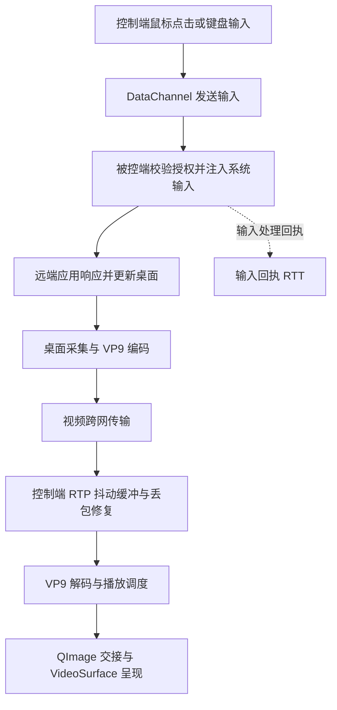

本地光标可以即时移动，输入处理回执也可以先到；两者都不能证明操作结果已呈现。`frameSwapped` 表示应用图形交换阶段，仍不等于物理屏幕像素已经亮起。

#### 5.8.2 400 ms 从哪里到哪里

**400 ms 是控制端接收桌面视频时的 RTP 抖动缓冲目标，用于为迟到、乱序和丢失的视频包留出处理余量。**它不是被控端采集到控制端显示的总时间，也不是每个包收到后固定等待 400 ms。

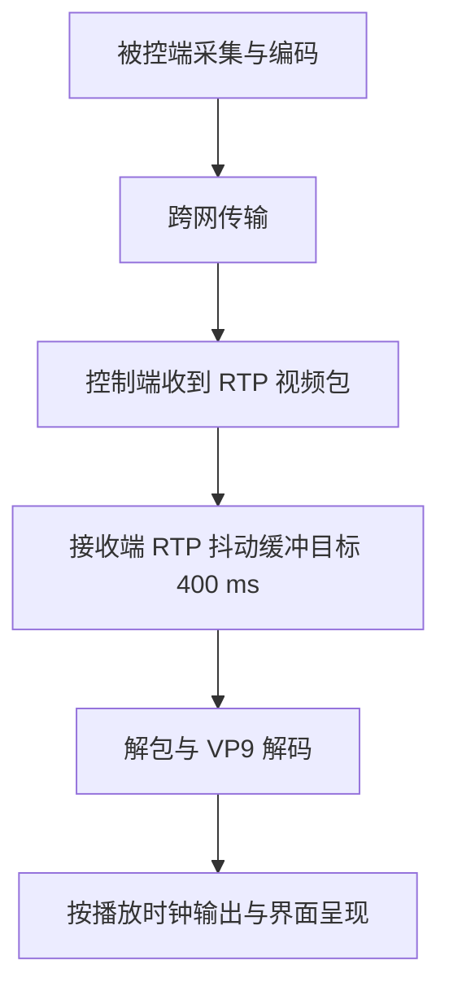

若用一段链路来理解，可以近似对应“进入控制端接收缓冲，到按时间安排放行给后续处理”。实际调度结合 RTP 时间戳、接收端时钟和播放时间线：提前到达的包有更多等待余量；迟到包的剩余余量更少，超过期限可能被判为丢失。断流、缺少完整可解码帧或等待参考帧恢复时，停顿仍可能超过这个目标。

| 时间或参数 | 与 400 ms 的关系 |
| --- | --- |
| 网络传输耗时 | 是另一个环节，400 ms 不表示网络耗时 |
| 接收端容纳抖动的目标缓冲余量 | 这是 `webrtcbin latency=400` 所配置的目标 |
| VP9 解码计算耗时 | 是另一个环节，需要分段测量 |
| `appsink sync=true` | 表示遵循播放时钟，不能再额外叠加一个 400 ms |
| 点击到看到操作结果 | 包含完整闭环，不能直接用这个配置值替代 |

当前 `src/media/screen_share.cpp` 在 WAN 且非保守模式下默认设置 `webrtcbin latency=400`、`appsink sync=true`；其他路径默认 `latency=200`、`sync=false`。所以“跨网固定多等 400 ms”只是粗略描述，不能当作逐帧实测结论。

#### 5.8.3 当前证据支持优先检查什么

持续几百毫秒的滞后，接收缓冲和播放调度是有依据的优先检查项；偶发秒级冻结还需区分网络波动、补包等待、VP9 参考帧恢复及播放积压。目前不能认定某一个环节是全部问题的唯一根因。

以下来自 [2026-11-11 延迟测量记录](validation-wan-latency-20261111.md)，不是当前版本重新测得的数据。测试使用合成 1920×1080 / 30 fps 画面，测量 DataChannel 标记请求到接收端 `frameSwapped`；不包含真实系统输入注入、真实桌面采集和物理显示扫描。路径为同一公网出口下的跨子网 Tailscale direct，不能代表独立公网 NAT 或 DERP 中继。

| 同路径紧邻正向对照 | 缓冲 400 ms | 缓冲 200 ms |
| --- | --- | --- |
| 标记闭环 p50 | 458.34 ms | 278.60 ms |
| 标记闭环 p95 | 520.34 ms | 530.98 ms |
| 标记闭环 p99 | 1152.62 ms | 1014.52 ms |
| 实际新帧呈现 FPS | 29.42 | 29.16 |
| 最大呈现间隔 | 1832.44 ms | 1056.69 ms |

200 ms 档位的中位延迟改善 179.74 ms，但 p95 增加 10.64 ms；该单组对照未达到推广门槛，不能据此把默认缓冲改小并宣称延迟已经解决。

历史分段证据还包括：发送编码最大输出间隔约 67 ms；正向 VP9 解码计算 p95 为 3.0 / 1.9 ms；解码输出最大间隔却为 1157.21 / 833.11 ms，sink 到 pull 最大间隔为 702.90 / 578.44 ms，图像交接到 swap 最大耗时为 26.56 / 10.11 ms（各组均按 400 / 200 ms 排列）。停顿期间 RTP 接收计数仍增长。这支持先细分接收修复和播放等待，尚不足以把真实动态桌面的解码或 UI 性能排除在外。

#### 5.8.4 为什么恢复收包后仍可能落后

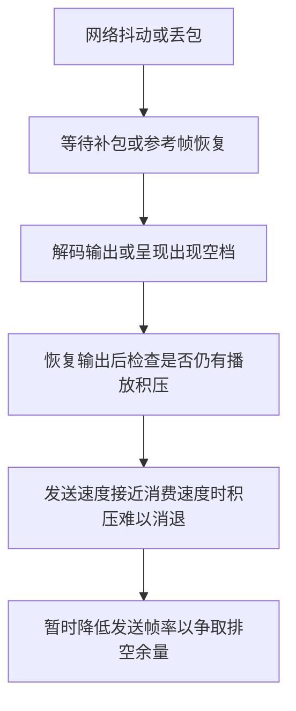

上图是需要检查的可能链路，冻结不必然产生积压。例如队列已有 15 帧、接收每秒消费 30 帧，而发送仍为 30 fps，队列没有净减少；若发送降至 24 fps，理想情况下每秒净排空 6 帧，约 2.5 秒消化 15 帧。该例仅解释速率差，实际仍受播放时钟、网络和参考帧依赖影响。

最新帧邮箱只能覆盖**解码后的旧图像**，不能清除上游压缩帧或播放调度中的全部积压。直接随意丢弃 VP9 压缩参考帧还可能破坏后续解码。

当前 `ShareQuality::observeBacklog()` 在积压达到 250 ms 时进入排空，降至 120 ms 以下退出；约每秒一次的反馈也意味着响应存在等待。`backlogMs` 是本地播放偏移相对最近 60 秒最低偏移的增长量，不是绝对帧龄或点击到显示时间。基线更新可能掩盖持续高偏移，无新帧时也不能仅凭较低读数认定健康。

源码还会在进入排空、且接收帧率至少为 24 fps 时，根据接收帧率的 90% 收紧持久帧率上限，最低为 24 fps；退出排空不会自动解除该上限。因此从 30 fps 恢复到 30 fps 可能受限。这是当前代码推导出的待验证问题，不是本次会话已复现的实机结论，改进方向另见 [交互延迟计划](wan-1080p30-interactive-latency-plan-20261114.md)。

#### 5.8.5 按观测现象定位环节

| 观测现象 | 优先检查 |
| --- | --- |
| 发送编码输出已停顿 | 桌面采集、编码和发送管线调度 |
| 发送持续有输出，接收 RTP 不增长 | 网络路由、直连 / 中继、带宽排队、丢包或传输阻塞 |
| RTP 仍增长，解码无新帧 | 包完整性、重传、解包和 VP9 参考帧 / 关键帧恢复 |
| 解码已有输出，应用取帧很晚 | 播放时钟、appsink 调度及媒体工作线程 |
| 界面已收到新图像，但迟迟无 swap | UI 事件调度、绘制和图形后端 |
| 恢复输出后画面持续落后 | 上游积压、播放时间线及发送 / 消费速率差 |

网络 RTT、输入回执、编码帧率、RTP 收包、解码输出和实际呈现应按同一停顿时间段关联分析。Tailscale 是否直连、是否经过中继，以及 WebRTC 实际使用 UDP 还是 ICE-TCP，都需要读取当前会话证据；不能把历史路径当作当前路径。TCP 队头阻塞、带宽排队等属于候选原因，本次未重测确认。

本节仅补充源码解释与历史证据；没有更改缓冲、帧率策略或任何运行配置，也未重新执行真实双机延迟验收。

### 5.9 【远程控制】鼠标移动流畅，但拖动远端窗口卡顿的差异

本节的“拖动界面”指在远控画面内按住鼠标，拖动**被控端的窗口、滚动条或其他内容**。拖动控制端本机的 ZJdesk 窗口、调整其大小属于本机 UI / 图形呈现场景，需要另行检查，不能直接套用以下判断。本节依据当前源码解释机制，未重新实测用户现场。

#### 5.9.1 看到光标移动与看到窗口移动，走的是不同反馈路径

**光标同步正常时，光标位置由控制端本机操作系统即时更新；远端窗口的位置必须经过完整远控闭环才能显示。**因此可以同时出现“鼠标很跟手”和“窗口明显落后、跳动”的体验。

| 对比项 | 仅移动鼠标时看到的光标 | 拖动远端窗口时看到的窗口内容 |
| --- | --- | --- |
| 谁更新可见位置 | 控制端操作系统移动本地 `QCursor` | 被控端应用更新窗口，控制端显示回传视频 |
| 是否等待远端执行和视频回传 | 本地光标位置更新不需要等待；形状等信息仍来自远端 | 需要等待输入发送、系统注入、应用响应、采集、编码、网络、解码及呈现 |
| 是否受接收端 400 ms 抖动缓冲目标影响 | 本地光标的位置更新不经过视频缓冲 | 窗口画面属于视频链路，受当前接收与播放策略影响 |
| 更新节奏 | 由本机指针显示机制驱动，不由桌面视频帧率决定 | 取决于实际新帧呈现频率及帧间隔；WAN 自动档最高 30 fps |
| 对画面变化的要求 | 分离光标模式下，移动光标本身无需依靠桌面视频更新来显示 | 窗口位置、原位置背景和内容可能持续变化，增加动态画面的传输负担 |
| 可以据此证明什么 | 本地指针反馈流畅 | 只有远端内容持续跟随，才支持完整交互链路流畅的判断 |

两条可见反馈路径可以写成：

```text
光标：本机鼠标移动 → 本机操作系统更新光标位置 → 立即看到指针移动
                  └→ 同时发送远控输入，远端执行另需时间

窗口：本机按下并移动 → DataChannel → 被控端注入键鼠 → 远端窗口移动
     → 桌面采集 → VP9 编码 → 视频跨网 → 接收缓冲 / 修复 / 解码 → 本机呈现
```

当前没有在控制端预先绘制远端窗口新位置的拖动预测机制。分离光标只是让指针反馈及时，并未消除窗口内容回传的耗时。例如本机光标已经到达新位置，而画面仍显示较早的窗口位置，用户就会感觉窗口“拖不动”或“追着鼠标走”。

这一结论有前提：已收到有效远端光标形状，且指针处于可控制的画面区域。`VideoSurface::updatePointerCursor()` 此时设置本地 `QCursor`；不满足条件时可能隐藏本地指针、绘制远端光标，或依赖视频中嵌入的光标。不能把所有光标显示模式都当作即时本地反馈。形状切换、远端悬停效果仍需要远端反馈，也可能落后于本地位置。

#### 5.9.2 输入移动没有单独的“拖动慢通道”

`VideoSurface::mouseMoveEvent()` 无论是否按住鼠标，都使用同一套移动消息路径：保留最新位置，通过约 8 ms 的定时器合并发送。按下和松开时，先 `flushMotion()` 发出待发送位置，再发送按钮事件，尽量保持操作顺序；被控端的按键状态与后续移动共同形成拖动。

`ScreenShare::sendControl()` 还会合并尚未交给媒体工作线程的普通位置消息；按钮、带探针的消息和光标形状等作为顺序边界。该处理减少过期位置排队，不代表每个原始鼠标采样都会抵达远端，也不保证网络没有延迟。

因此，不能仅凭“移动鼠标不卡、拖动卡”就断言按钮按住后输入发送变慢。两者主要差别是**用户观察的结果不同**：前者常看本地光标，后者必须看远端应用的真实画面。8 ms 是移动合并的目标间隔，不是远控闭环延迟，更不代表视频达到 125 fps。

#### 5.9.3 拖动为什么更容易暴露问题

- **持续暴露视频滞后**：静态桌面上的光标可以一直流畅；拖动时，每一帧窗口位置都要跟随输入，接收缓冲和播放延迟会持续表现为窗口落后。400 ms 的含义见 5.8.2。
- **视频更新比本地指针稀疏**：30 fps 的理想新帧间隔约为 33.3 ms，24 fps 约为 41.7 ms；即使间隔均匀，拖动也可能比本地光标粗糙。帧率低、帧间隔不均和延迟大是不同问题，不能相互替代。
- **动态内容可能增加负担**：窗口移动会改变窗口覆盖区域和露出的背景；视频压缩虽可利用运动预测，实际码率、编码成本仍可能随内容上升。拥塞预算不足、丢包、参考帧修复或接收积压都可能让更新更不均匀。是否发生必须看实测，不能认为每次拖动都必然触发这些问题。
- **远端应用自身也可能停顿**：系统输入注入成功，不等于目标应用已经处理并完成窗口重绘。远端应用、桌面合成和采集的停顿也属于待查范围，不能全部归因于网络。

特别要区分：均匀延迟 400 ms 的画面可以连续流畅但不跟手；平均 30 fps 的画面也可能夹杂长时间冻结。评价拖动体验应同时看输入到可见结果延迟、实际新帧率、长帧间隔和恢复后的积压。

#### 5.9.4 按拖动现象区分问题

| 拖动时的现象 | 可以支持的判断与下一步 |
| --- | --- |
| 光标顺滑，窗口连续但始终落后一段距离 | 优先检查完整闭环延迟和播放缓冲；持续拖动时的距离还取决于鼠标速度，不能直接换算为固定时间 |
| 光标顺滑，窗口按明显台阶移动 | 核对实际新帧呈现频率、帧间隔及输入移动到达节奏；区分低帧率与不规则停顿 |
| 光标顺滑，窗口或整幅远端画面间歇冻结 | 按 5.8.5 对齐采集 / 编码、RTP、解码输出、取帧和 swap，定位断点 |
| 鼠标停住后，窗口仍继续追赶 | 提示可能存在输入、远端应用处理或视频播放积压；需关联日志确认，不能只凭视觉确定是哪一段 |
| 按下后窗口完全不移动、松开后仍异常 | 先检查按钮是否被接受、授权、注入错误、焦点及释放事件，不能只调视频缓冲 |
| 本地光标和 ZJdesk 自身操作也同时卡住 | 增加本机 UI 线程、CPU / GPU、图形驱动及系统负载检查；本地反馈也受影响，诊断范围需要扩大 |

建议在同一会话中分别记录“仅移动光标、拖动远端窗口、停止移动后的收敛”三个阶段，关联输入 `probe_ack` 的 `accepted` / `injectUs`、采集与编码输出、收包、解码、积压和新帧呈现间隔。`probe_ack` 只反映注入调用结果，不证明远端应用已消费输入或画面已更新；真实拖动闭环仍需能关联输入与画面变化的测量。

源码入口：`apps/client/video_surface.cpp` 的 `updatePointerCursor()`、`mouseMoveEvent()`、`mousePressEvent()`、`mouseReleaseEvent()`；`src/session/session_coordinator.cpp` 的 `sendCursor()` / `sendRemoteInput()`；`src/media/screen_share.cpp` 的 `ScreenShare::sendControl()`；`src/remote-control/input_receiver.cpp` 的 `InputReceiver::receive()`。

## 6. 构建、运行和交付

### 6.1 平台基线

| 项目 | Windows | Linux |
| --- | --- | --- |
| 目标系统 | Windows 11 x64 | Ubuntu 22.04 x64，X11 |
| 编译器 | MSVC 2022 x64 | GCC 11 |
| Qt | 6.8 基线，现有 SDK 6.8.3 | 6.8 基线，现有 SDK 6.8.3 |
| 媒体 SDK | GStreamer 1.26.11 MSVC x64 | GStreamer 1.26.11 |
| 构建入口 | `build.ps1` | `build.sh` |
| 启动入口 | `run.ps1` / `直接启动.bat` | `run.sh` |
| 交付形式 | 部署目录、便携 ZIP、自解压 EXE | 部署目录、AppImage |

Windows 示例，需先提供本机实际 SDK 路径：

```powershell
# 首次启用媒体并执行 Release 构建、非 GUI 回归及部署
.\build.ps1 -Preset windows-release -GstRoot '实际的 GStreamer SDK 路径' -Deploy

# 已配置媒体依赖后，在真实桌面执行包括 UI 的回归
.\build.ps1 -Preset windows-release -GuiTests

# 启动已构建的客户端
.\run.ps1 -Preset windows-release
```

Linux 示例，需提前配置 Qt / GStreamer SDK：

```bash
bash ./build.sh --preset linux-release --deploy
bash ./run.sh
```

`CMakePresets.json` 提供 Windows / Linux 各自的 Debug、Release 配置。构建位于 `build/<preset>/`，部署位于 `dist/<preset>/`。`start-both.ps1` 负责开发环境中的 SSH 源码同步、双端构建部署和启动；它与应用运行时的自动线路探测属于不同阶段。

打包由 `package-windows.ps1`、`package-linux.sh` 及双端调度 `package-release.ps1` 完成。存在打包脚本或历史产物不代表当前源码已经重新打包，也不代表干净电脑启动验收通过。

## 7. 测试体系与当前边界

| CTest 名称 | 主要覆盖 |
| --- | --- |
| `core` | 协议、会话、授权、画质策略和日志等核心逻辑 |
| `file-clipboard` | 文件清单、路径及传输生命周期 |
| `signaling` | 本机真实 WebSocket、房间隔离和协商路由 |
| `network-setup` | 地址验证、取消及超时 |
| `peer-connection` | 对端配置、探测、线路选择与恢复 |
| `media` | 启用 GStreamer 后的媒体管线、编解码及数据通道回归 |
| `desktop` | 启用 GUI 测试后的 Qt 界面与原生 OpenGL 行为 |
| `windows-runtime-integrity` | Windows 可执行程序运行完整性处理 |

CTest 输出及 JUnit XML 位于构建目录；手动探针另用于跨机远控、会议及延迟测量。GUI 验证需要真实桌面环境，不用 `offscreen` 结果代替实际 OpenGL；合成媒体、同机多进程和真实硬件双机测试应分别记录。

当前应保留的能力边界：

- 协作房间最多两人，会议最多四人；单客户端同时只加入一个房间。
- 主屏幕共享已实现；多显示器切换、单窗口共享和 Wayland 桌面支持尚未交付。
- Windows 普通权限不能注入更高权限应用，UAC 安全桌面不支持。
- 无账号认证、房间密码及已启用的信令 TLS；当前适用于可信局域网或受控 VPN。IP 匹配不能替代身份认证。
- 没有独立公网 NAT 穿透 / TURN 方案；跨网稳定性与低延迟不能仅凭连接成功认定。
- 会议回声消除、纯语音入会、桌面系统声音、文本剪贴板，以及语音转写 / 会议纪要尚未实现或已暂缓。
- 线路切换与重建逻辑已经实现，但真实双机迁网后的音视频、键鼠和共享恢复仍待验收；不能概括为通用故障自动恢复已完成。
- 持续 1080p60、跨网 1080p30 的画面流畅度和交互尾延迟、四台实体机长时间会议、干净系统发布包及完整双平台云端 CI，仍须按专项记录确认。

## 8. 进一步阅读与源码入口

| 内容 | 入口 |
| --- | --- |
| 使用与运行条件 | [README](../README.md) |
| 当前设计及协议细节 | [架构与扩展约定](architecture.md) |
| 近期变更与历史验收 | [项目交接](handoff.md) |
| 已实现与后续工作 | [迭代路线](roadmap.md) |
| 构建与验证约定 | [开发流程](development.md) |
| 启动与连接排查 | [启动网络验证](startup-network.md) |
| 多人会议说明 | [视频会议](video-conference.md) |
| 发布包与打包方式 | [发布包说明](packaging.md) |
| 综合验证记录 | [验证记录](validation.md) |
| WAN 画面与性能 | [跨网 1080p30 验证](validation-wan-1080p30-20261110.md) |
| WAN 闭环延迟 | [延迟测量记录](validation-wan-latency-20261111.md) |
| 交互延迟后续方案 | [跨网 1080p30 交互延迟计划](wan-1080p30-interactive-latency-plan-20261114.md) |

查阅较早交接与发布文档时，应结合日期和当前代码判断；历史版本中的两人会议、校验码主流程和“尚无自动重连”等描述，不能直接当作当前功能的完整结论。


## 9. 当前远控全链路流程图

本节于 2026-11-16 按当前源码补充，描述 Windows 控制 Linux X11 桌面的现有实现。图中的“控制端”为 Windows，“被控端”为 Linux；反向远控替换相应平台的采集器和输入注入器。[交互延迟改善方案](wan-1080p30-interactive-latency-plan-20261114.md)第 4 节的 P0～P5 是后续改进方案，不因绘制流程图而成为已实现或已验证的能力。

图采用 Mermaid，可在支持 Mermaid 的 Markdown 阅读器中渲染。虚线表示辅助反馈或旁路；视频与输入分别承载，不能将一个输入回执或本地光标更新等同于远端操作结果已显示。以下不展开摄像头、语音和多人会议链路。

### 9.1 总览：输入过去，操作结果作为视频回来

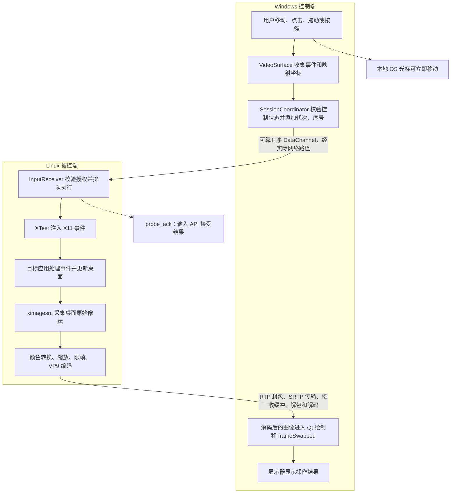

一次点击要等按钮变色，一次拖动要等窗口到达新位置，一次键入要等应用显示对应内容，才形成用户关心的闭环。光标旁路只能改善指针反馈，输入回执只帮助定位控制链路；两者都没有绕过应用响应和返回视频所需的时间。

### 9.2 采集、像素处理与编码：ximagesrc 到 VP9/RTP

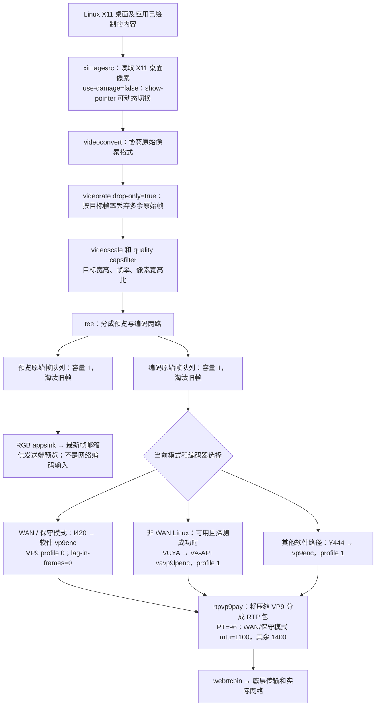

这里有四种不同的“处理”：`ximagesrc` 做采集；`videoconvert` 做像素格式转换；`videoscale` 做尺寸变化；编码器才将原始像素压缩为 VP9。`rtpvp9pay` 负责网络封包，不再次编码。`use-damage=false` 表示不依赖 XDamage 增量变化通知，不是只传桌面变动区域的协议。

普通 WAN 模式最高为 1920×1080 / 30 FPS，显式保守模式最高为 960×540 / 15 FPS；实际档位还受屏幕尺寸、协商和自适应限制。当前 WAN 优先软件 VP9 4:2:0，不能把接收端有 RTX GPU 推断为整条链路已硬件加速。Windows 作为发送端时，采集入口换为 `d3d11screencapturesrc → d3d11download → videoconvert`；测试源则使用 `videotestsrc`，不能拿它代替真实桌面采集证据。

单帧 leaky 队列位于编码前的原始图像分支，目的是优先处理较新的图像。它不能清除已经进入编码器、传输栈、路由器或接收缓冲中的数据。`mtu=1100` 是 RTP payloader 的配置值，不是完整 UDP/IP 包长度。

### 9.3 网络接收、解析、解码与呈现

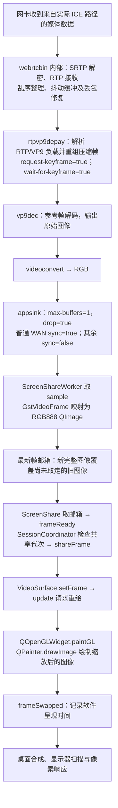

“解析”需要区分两条路径：视频路径由 WebRTC/RTP 层和 `rtpvp9depay` 处理媒体包；控制路径由 `QJsonDocument` 解析输入 JSON。当前视频管线没有另加一个 `vp9parse` 元素。`vp9dec` 才负责从压缩帧恢复像素；解码完成也不等于窗口已画出来。

取帧时的 QImage 引用映射后的 GstBuffer，并在最后一个共享图像释放时解除映射；这避免该处额外整帧深拷贝，不能据此称整个链路实现 GPU 零拷贝。工作线程和 UI 的取帧定时器目标间隔均为 4 ms，这只是调度请求，不保证每次都在 4 ms 内执行。

普通 WAN 默认请求 `webrtcbin latency=400 ms`、接收 appsink `sync=true`；局域网默认 200 ms、`sync=false`；显式保守模式默认 200 ms、`sync=false`。可通过现有环境变量选择其他允许的缓冲值。配置值不是最终测得的输入延迟，实际 jitterbuffer 与播放行为需要读回验证。`frameSwapped` 之后还有物理显示过程，不能据此承诺真实屏幕已经完成显示。

### 9.4 点击、拖动、键盘输入与结果反馈时序

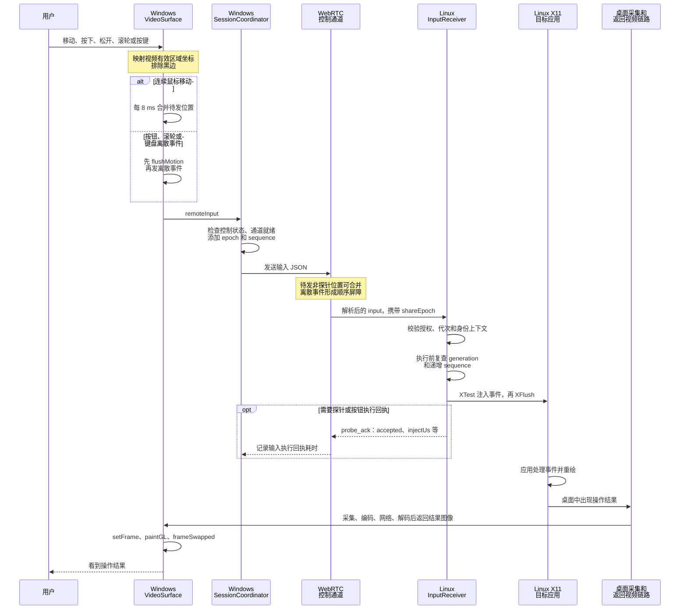

拖动由“按下 → 连续移动 → 松开”组成，按下和松开不能被位置合并丢弃。当前键盘路径发送键事件，字符出现还取决于远端键盘布局、输入法和应用处理。Windows 作为被控端时改用 `SendInput`，其 API 接受结果同样不代表目标应用已经完成响应。

从 Windows 同一单调时钟记录事件发出 `t0` 与“确认包含该操作结果的图像”实际交换 `t1`，才可计算 `t1-t0`；关联真实 OS 输入与结果图像的自动验收仍是交互延迟改善方案中 P0 待实现的工作。当前注入回执与合成帧标记各有诊断用途，不能冒充该验收已完成。

### 9.5 光标同步：为何鼠标跟手，拖动窗口仍可能滞后

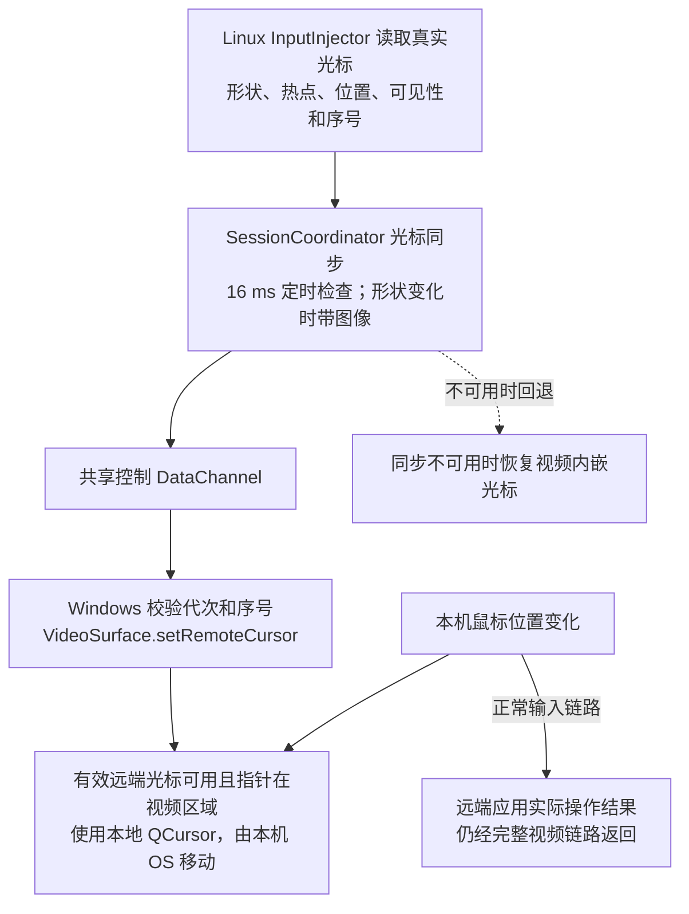

`cursor_ready` 协商成功且光标数据可用后，发送端可关闭采集图像中的内嵌光标，避免双光标；同步不可用时有恢复内嵌光标的路径。远端消息提供形状和状态，本地位置反馈无需等待网络往返。这个优化没有预测远端窗口或文字，也没有减少返回视频积压。

### 9.6 建连、信令与授权：业务服务器和媒体路径的区别

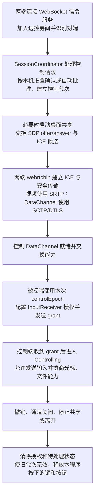

这是从尚未共享到可控制的典型流程；若共享已建立，则复用已有连接。UI 发出意图，会话状态由 `SessionCoordinator` 维护，UI 不直接操作 GStreamer 或系统输入。普通远控输入通过控制 DataChannel 分发到独立输入线程，不要求先经过 UI 线程处理每一条输入。

信令服务负责房间、请求及协商消息，不因此承担视频中继。ICE 实际候选路径与 Tailscale direct/DERP 是两个观察层次：即使 WebRTC 看到对端 Tailscale 地址，底层隧道也可能走 DERP。当前网络要实测，不能从“已连接服务”或两端地址看起来接近就推断媒体直连、RTT 或低延迟。

### 9.7 反馈、自适应、排队与帧率恢复

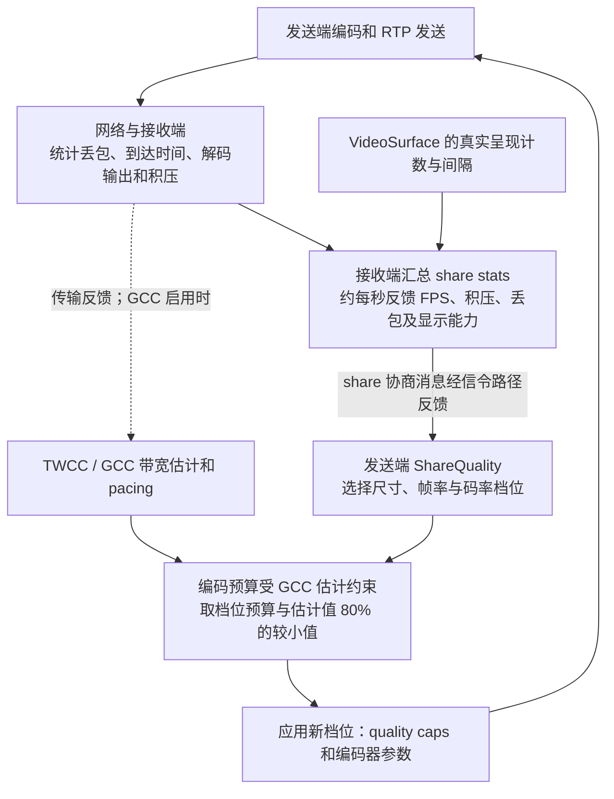

两类反馈作用不同：GCC 调整可用发送预算和发送节奏；`ShareQuality` 结合编码、接收和呈现统计选择质量档位。真实接收 FPS、真实呈现 FPS、目标 FPS 分别统计，目标 30 FPS 不证明用户已经看到每秒 30 张新图像。

当前积压排空逻辑在相对积压达到 250 ms 时进入、低于 120 ms 时退出，通过降低发送帧率给接收端留出追赶空间。相对积压并非绝对画面年龄；临时能力估计与长期上限混用的风险见交互延迟改善方案第 2.3 节。该方案 P1 所要求的可靠恢复到 30 FPS 尚不能由本图判为已完成。GCC pacing 无积压也不代表路由器、内核或播放缓冲没有排队。

### 9.8 卡顿定位与现有修复边界

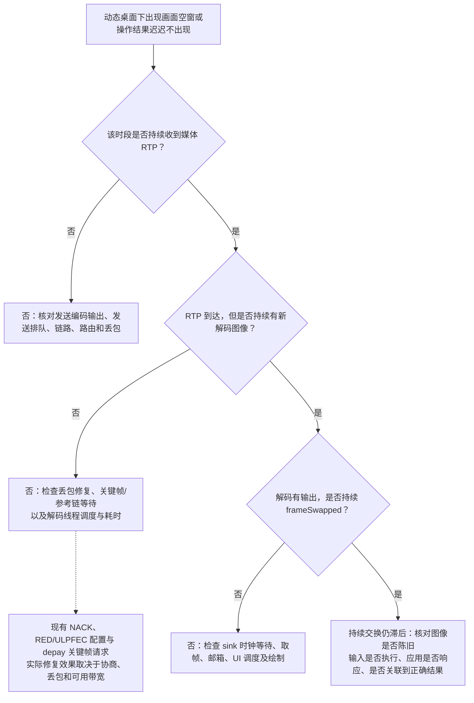

丢失参考帧可能导致后续 VP9 图像无法正常解码，直到修复成功或获得新的可解码关键帧。`appsink drop=true` 只能处理该位置的完整图像，不能消除上游参考链等待。不能在压缩 VP9/RTP 上随意丢旧包来“追最新帧”。交互延迟改善方案 P3 提到的限频关键帧请求、受控刷新和恢复时限属于需要原型验证的改进，并不是本图宣称已有的完整恢复状态机。

### 9.9 文件传输与交互共用链路

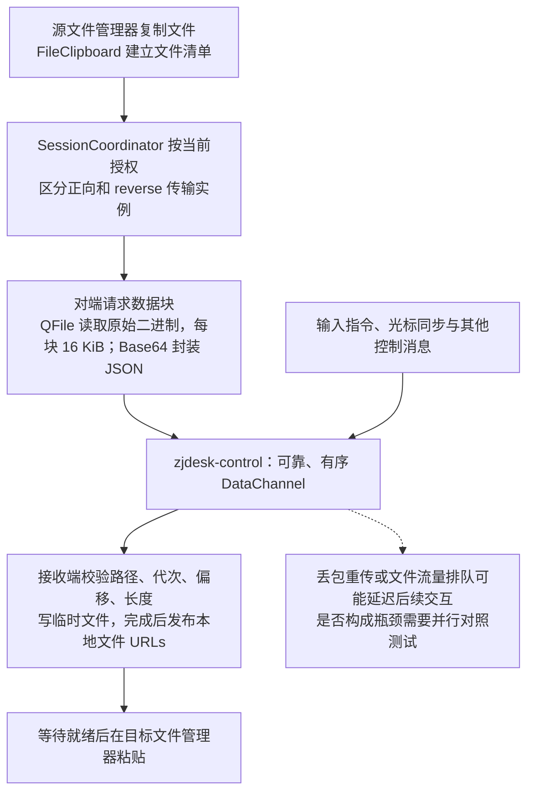

文件内容按原始字节传输，不按扩展名做媒体解析或转换。正反向是独立 `FileClipboard` 实例，底层仍共享现有控制通道和网络资源。协议已有请求/响应节奏，不能画成不受限的持续灌入；当前也不能写成已实现独立文件通道或交互优先背压。交互延迟改善方案 P4 需要先证明并发影响，再决定是否改变调度。

### 9.10 延迟读法与源码定位

可见交互延迟包含：本机事件处理与合并等待 + 正向输入传输/排队 + 远端注入及应用处理 + 等待桌面采样 + 颜色转换/编码 + 反向媒体传输/修复 + 接收播放等待/解码 + UI 调度/绘制 + 物理显示。以上阶段可能并行或重叠，需以关联到正确操作结果的闭环实测为准，不能直接把各阶段 p95 相加。

30 FPS 的采样周期约 33.3 ms，60 FPS 约 16.7 ms，二者都不是整体交互延迟。局域网通常减少网络往返和抖动；跨网还可能引入中继绕路、上行排队和更大的接收缓冲。提高带宽、降低分辨率、启用硬件编解码各自只影响部分环节，应按阶段耗时选择改动。

| 过程 | 当前源码入口 | 阅读重点 |
| --- | --- | --- |
| 采集、编码、RTP、接收解码 | [screen_share.cpp](../src/media/screen_share.cpp) | `ScreenShareWorker::start`、`encoderPipeline`、`selectEncoder`、`poll` |
| 网络控制消息解析和位置合并 | [screen_share.cpp](../src/media/screen_share.cpp) | `channelMessage`、`sendControl`、`ScreenShare::sendControl` |
| 会话授权、输入发送、光标和呈现反馈 | [session_coordinator.cpp](../src/session/session_coordinator.cpp) | `sendRemoteInput`、`receiveControl`、`sendCursor`、`reportSharePresentation` |
| 独立输入线程和撤销校验 | [input_receiver.cpp](../src/remote-control/input_receiver.cpp) | `authorize`、`receive`、`revoke` |
| Linux XTest / Windows SendInput | [input_injector.cpp](../src/remote-control/input_injector.cpp) | `inject`、`cursor`、`releaseAll` |
| 最新帧、Qt 绘制、鼠标与键盘 | [video_surface.cpp](../apps/client/video_surface.cpp) | `setFrame`、`paintGL`、`frameSwapped` 连接、`flushMotion`、输入事件处理 |
| 档位选择与积压排空 | [share_quality.cpp](../src/media/share_quality.cpp) | `observe`、`observeBacklog`、`limitMaximumFps` |
| 二进制文件与块校验 | [file_clipboard.cpp](../src/remote-control/file_clipboard.cpp) | 文件清单、读取响应、接收校验、完成与撤销清理 |

这些图是源码结构说明，不增加任何实机、跨网、原生粘贴或物理屏幕测试结论。性能验收参照[交互延迟改善方案](wan-1080p30-interactive-latency-plan-20261114.md)第 3～5 节。

## 10. 技术术语与概念速查

本章分为两层：每节开头的表格用于查缩写，表格后的小节解释“为什么需要它、实际怎样工作、可以怎样理解、与本项目有什么关系”。第一次阅读时建议先看详细小节，再回查表格。比喻用于解释职责和因果关系，不能代替协议的实际规则；举例中的假设数字也不是项目实测结果。**解释一种技术不等于宣称已经采用、启用或通过验收**。

### 10.1 语言、应用框架与工程工具

| 术语 | 概念与含义 | 在本项目中的作用或边界 |
| --- | --- | --- |
| C++17 | C++ 语言的 2017 年标准，规定语法、类型和标准库能力 | 客户端、信令和核心模块的语言基线 |
| Qt / Qt Widgets | Qt 是跨平台应用框架；Widgets 是其中以窗口、按钮等控件构建原生桌面界面的模块 | 工作台和设置界面的基础；不是浏览器网页框架 |
| QObject / 信号槽 | Qt 对象模型及对象之间传递事件的机制；发送信号，由连接的槽或函数处理 | 连接 UI、会话和工作线程；跨线程调用方式影响代码实际在哪个线程执行 |
| QThread / 事件循环 | QThread 管理线程；事件循环持续处理事件、定时器和排队调用 | 媒体、线路探测及输入处理等使用专用线程；独立线程也可能因阻塞而延迟 |
| QOpenGLWidget / OpenGL | OpenGL 是图形接口；QOpenGLWidget 将相关绘制集成进 Qt 控件 | `VideoSurface` 的显示基础；使用它不代表视频解码已经使用 GPU |
| QPainter / QImage / QCursor | 分别是 Qt 的绘图接口、像素图像容器和系统指针对象 | 绘制视频、交接图像和显示本地光标，三者职责不同 |
| QSS | Qt Style Sheets，Qt 控件的样式描述方式 | 配置控件颜色、间距等外观，不负责媒体和网络逻辑 |
| QSettings / INI | QSettings 是配置读写接口；INI 是按节与键值组织的文本配置格式 | 保存设备、地址和用户偏好，不是服务端数据库 |
| JSON / JSONL / Base64 | JSON 表达结构化数据；JSONL 每行一个 JSON 对象；Base64 将二进制编码为文本 | 分别用于消息、诊断日志和图像 / 文件块的文本封装；Base64 不是压缩或加密 |
| CMake / Preset / Ninja | CMake 描述并生成构建系统；Preset 保存配置组合；Ninja 执行编译构建任务 | 组织目标和平台配置；三者均不是 C++ 编译器 |
| MSVC / GCC | 分别是微软和 GNU 的编译工具链名称 | Windows 使用 MSVC 2022，Ubuntu 基线使用 GCC 11；此处 GCC 与拥塞控制 GCC 同名但含义不同 |
| 静态库 / 可执行程序 | 静态库的目标代码在链接时并入程序；可执行程序是可启动的进程入口 | `zjdesk_client_core` 等是模块组织方式，不等于独立后台服务 |
| Qt Test / CTest / CI | 分别是测试框架、测试调度工具和持续集成流程 | 测试通过只证明对应场景；本地 CTest 通过不等于云端 CI 或真实双机验收通过 |
| Debug / Release / Deploy | 分别表示调试构建、优化构建和部署运行依赖的过程 | 编译完成、依赖部署完成和干净电脑可运行是不同验证结果 |

#### 10.1.1 C++、Qt、编译器和构建工具分别做什么

把开发桌面程序比作建造一台机器：**C++ 是设计图使用的语言，Qt 是现成的零件和配套规范，编译器把设计图加工成机器指令，CMake 组织加工工序，Ninja 执行工序，Deploy 则把运行所需的配件一起装箱。**这些东西处于不同层次，不能互相替代。

具体到项目：开发者用 C++ 写 `MainWindow`、会话和媒体逻辑；Qt 提供窗口、按钮、网络接口和事件处理。MSVC / GCC 编译各个 `.cpp`，链接器再将目标文件与库组成程序。`CMakeLists.txt` 描述谁依赖谁、哪些源文件属于哪个目标；Preset 保存 Windows / Linux、Debug / Release 等配置；Ninja 根据生成的规则执行构建。Debug 通常保留更多调试能力，Release 通常启用优化，但 Release 不是“所有功能验收通过”的标志。

静态库可以理解为“构建时装入机器的零件包”：`zjdesk_client_core` 的代码链接进客户端，不会因为它叫一个库就多出一个进程。独立信令程序则是另一台能自行启动的机器。Qt Test 编写和运行测试逻辑，CTest 统一调度测试，CI 在自动化环境执行检查；它们也不是同一个工具。

#### 10.1.2 事件循环、信号槽与线程：为什么界面可能等不到处理

事件循环像一个持续工作的接待员：鼠标事件、重绘请求、定时器和排队任务不断进入待办列表，接待员逐项处理。如果其中一项占用很久，后面的事项就必须等待。因此“每 4 ms 触发定时器”是调度目标，不能保证任意负载下都准时执行。

信号槽像“发布通知并指定接收者”，但通知的执行方式有区别：直接连接通常在发出信号的调用线程立即执行；排队连接则把任务放入接收对象所在线程的事件循环，等待它处理。自动连接会结合发出信号时的线程与接收对象所属线程决定方式。不能仅凭对象用了 `QObject` 或信号槽就认为调用已经异步化。

`QThread` 为工作提供另一个执行线程，相当于增加一个工作人员；仍需把对象和任务正确安排到该线程。把耗时工作放入独立线程可减少 UI 阻塞，但若工作线程自身任务过多，它也会排队。项目分别处理媒体、输入和线路探测，就是为了避免这些工作全部挤在界面线程中；这并不能自动消除网络或播放缓冲的等待。

#### 10.1.3 QImage、QPainter、OpenGL 与 QCursor：有图不等于已经显示

可以把 `QImage` 理解为一张存放在内存中的照片，`QPainter` 是把照片画到指定位置的画笔，`QOpenGLWidget` 是承载图形绘制的窗口区域。拿到照片、提交绘制、交换图形缓冲和显示器真正显示，是连续但不同的步骤。

项目先把解码后的图像交给 `VideoSurface::setFrame()`，再请求更新，由绘制阶段把图像按比例画出。`frameSwapped` 可用来统计软件呈现阶段，但后面仍有桌面合成、显示器扫描等过程。因此“收到图像用了 2 ms”不能代替“用户在 2 ms 后看见了图像”。

`QCursor` 是另一条路径：它让操作系统显示并移动指针，类似在照片上方放置一枚由本机控制的指示标。指示标跟手，不代表照片里的远端窗口已经移动。OpenGL 能参与绘制，也不代表 VP9 解码已使用 GPU；绘制加速与视频编解码加速是不同工作。

#### 10.1.4 JSON、Base64、配置和日志：数据怎样装进消息

JSON 像一张带字段名的表单，例如 `{"kind":"move","x":0.5,"y":0.3}` 表达消息类别和位置；它让双方按约定读取数据，不负责理解“移动鼠标”应该怎样执行。JSONL 则像逐行记账，每行一个 JSON 对象，便于追加和分析日志。

图片和文件是二进制字节，若要放进 JSON 文本字段，项目会使用 Base64 将其变成可安全表达的字符。例如原始 3 个字节通常编码成 4 个字符，因此长度约增加三分之一，另有填充和 JSON 开销。**Base64 相当于换包装，不会让内容变小，也不能防止别人读取。**

QSettings / INI 负责保存用户偏好，如“下次仍使用这个设备”；JSONL 记录发生过的事件，如“这次连接失败”。配置和诊断记录用途不同。QSS 则只描述控件外观，类似机器外壳的颜色和布局，不参与输入注入与视频传输。

### 10.2 网络、信令与 WebRTC

| 术语 | 概念与含义 | 在本项目中的作用或边界 |
| --- | --- | --- |
| LAN / WAN | Local Area Network 为局域网；Wide Area Network 为广域网 | 对应不同桌面画质和缓冲策略；项目识别为 WAN 不代表已确认经过公网中继 |
| IPv4 / 子网 / 路由 | IPv4 是网络地址体系；子网按前缀划分地址范围；路由决定数据下一跳 | 地址可填写不等于可达，信令可达也不等于动态媒体端口可达 |
| VPN / Tailscale / Tailnet | VPN 构建受控虚拟网络；Tailscale 提供基于 WireGuard 的组网；Tailnet 是其设备网络 | 让两端使用可路由的虚拟地址通信；虚拟地址不直接说明底层路径 |
| direct / DERP | direct 表示 Tailscale 对等直连；DERP 是直连不可用时可使用的加密流量中继服务 | 中继可能改变 RTT 和吞吐，需要读取当前路径；它不是 WebRTC TURN 服务 |
| UDP / TCP | UDP 以数据报传输，不内置可靠有序交付；TCP 提供可靠有序字节流 | ICE 可选择不同传输；UDP 上层也可实施修复，不能简单理解为 UDP 必然丢数据、TCP 必然低延迟 |
| 队头阻塞 | 为保持顺序，较后的数据可能必须等待较早丢失数据恢复的现象 | TCP 或可靠有序数据通道可能因此增加交互等待，是否成为瓶颈需实测 |
| WebSocket / ws / wss | WebSocket 是双向持续消息连接；`ws` 为普通连接，`wss` 使用 TLS 保护 | 承载信令；代码接受 URL 类型不代表部署已启用 TLS |
| 信令 / 房间 | 信令是交换连接意图、成员和协商信息的应用层消息；房间是应用组织成员的逻辑范围 | `RoomServer` 路由消息，不因此成为视频或文件中继 |
| WebRTC / P2P | WebRTC 是实时媒体和数据通信技术体系；P2P 表示对等端之间的通信模型 | 由原生 GStreamer 实现；P2P 并不保证底层没有网络中继 |
| SDP / offer / answer | Session Description Protocol 描述媒体、编解码和连接参数；offer / answer 是双方协商过程 | 经信令交换，不承载实际桌面像素 |
| ICE / candidate / selected pair | Interactive Connectivity Establishment 探测候选地址组合并选择可用路径；candidate 是候选，selected pair 是选中的两端组合 | libnice 参与实现；选中 Tailscale 地址后，隧道内部仍可能走 DERP |
| STUN / TURN / NAT | NAT 在网络边界转换地址；STUN 帮助发现映射地址等信息；TURN 为媒体或数据提供中继路径 | 当前未配置 STUN / TURN，主要依赖 LAN 或已有 VPN 路由 |
| libnice / ICE-TCP | libnice 是 ICE 实现库；ICE-TCP 表示通过 ICE 协商 TCP 候选传输 | 不等于自动发生 UDP → TCP 回退，也不等于 Tailscale 的 direct / DERP 状态 |
| RTP / RTCP | Real-time Transport Protocol 传媒体包和时间戳；RTP Control Protocol 传质量报告与反馈 | RTP 包不必对应完整一帧；RTCP 可参与丢包与拥塞反馈 |
| SRTP / DTLS | Secure RTP 保护媒体机密性与完整性；DTLS 是面向数据报的安全协议，参与 WebRTC 密钥建立等过程 | 媒体加密不等于信令已加密，也不等于应用已建立账号身份认证 |
| SCTP / DataChannel | SCTP 是传输协议；WebRTC DataChannel 是基于 SCTP / DTLS 的应用数据通道 | 现有控制通道可靠有序，传输入、光标和文件消息；不是视频帧通道 |
| Mesh / SFU | Mesh 为各成员互连；SFU 为选择性转发媒体的服务器 | 会议采用最多四人 mesh；当前没有 SFU，成员增多会增加端侧连接和资源开销 |
| MTU / payload type（PT） | MTU 描述一层网络或封包的大小约束；RTP PT 标识协商的负载格式 | payloader 的 `mtu` 不等于完整 UDP/IP 包长度；动态 PT=96 需结合 SDP 才知道代表 VP9 |
| GCC / TWCC / pacing | 此处 GCC 指 Google Congestion Control；TWCC 是传输级到达反馈；pacing 是按节奏发送数据包 | 用于估计和约束发送速率；pacing 正常不代表其他层没有排队 |
| NACK / RTX | NACK 是接收端对缺失包的否定确认反馈；RTX 是重传相关机制 | 重传需消耗带宽和等待时间，超过播放期限可能已无法改善当前画面 |
| RED / ULPFEC | RED 是冗余负载封装；ULPFEC 是一种前向纠错机制，利用额外校验数据恢复部分丢包 | 不等于所有包都能恢复；实际生效和收益取决于协商、冗余量及丢包形态 |

#### 10.2.1 地址、子网、端口与路由：知道门牌不等于能进门

IP 地址可以比作设备的网络门牌，端口像同一门牌下不同服务的窗口；子网描述一组地址的网络范围；路由是数据从当前设备到目标应经过哪一个出口的规则。门牌正确，还需要有通路、服务正在监听、相关策略允许访问，才能真正连通。

例如信令服务的 `8765` 端口可达，只能说明该服务这条通路可用。WebRTC 可能使用另外协商出的地址和动态端口，所以不能用“能加入房间”推导“画面一定能传”。LAN / WAN 描述网络范围，项目还用地址关系等条件选择相应媒体策略；这个模式标签并不是一次完整的公网拓扑鉴定。

NAT 像一个小区共用对外收发地址，门卫记录内部住户与外部通信之间的映射。对方看到的外部地址和端口可能不是设备自己的内部地址，而且不同 NAT 的映射与放行规则不同，所以两台设备都能上网，不代表它们能直接互相接收连接。

#### 10.2.2 信令、SDP、WebRTC：先约定怎样通话，再真正传内容

用打电话作比喻：**信令服务像帮助双方接通的总机，SDP 像双方交换的通话能力与参数清单，WebRTC 则提供实时传输、安全和反馈等成套能力。**总机帮助建立联系，不意味着通话声音必须一直经过总机。

在项目里，WebSocket 让客户端与 `RoomServer` 持续交换成员、授权请求、SDP 和 ICE 消息。offer 相当于“我想用这些格式和参数通信”，answer 相当于“我接受这些兼容选项”；不是把一张桌面截图装进 SDP。WebRTC 不是业务房间协议，也没有替本项目决定如何批准远控。

`webrtcbin` 是 GStreamer 中提供这些 WebRTC 能力的组件，libnice 负责其中的 ICE 工作。WebSocket 和 DataChannel 都能传消息，但连接对象和职责不同：前者连接业务信令服务，后者建立在对等端之间的 WebRTC 连接之上。本项目的视频由媒体路径传送，不是把所有内容塞进 WebSocket。

#### 10.2.3 ICE、STUN、TURN 与 Tailscale：找路和中继发生在哪一层

ICE 可以理解为“列出几条可能的送达路线，再实际试路”：双方收集本地网卡等候选地址（candidate），经信令交换，再执行连通性检查，最终选择一对可用端点（selected pair）。它需要验证真实可达性，并非把地址交给对方就算完成。

STUN 像外部观察员，帮助设备知道自己对外呈现的映射地址等信息；**它本身不负责持续转发视频**。TURN 像双方都能到达的转运站，在直连困难时转发媒体或数据，但要承担流量与资源成本。当前项目没有配置这两类服务，主要依靠 LAN 或已有 Tailscale 路由。

Tailscale 是下方另一层组网。可以理解为项目给一条“虚拟道路”寄包裹：项目看到目的地是对端 Tailscale 地址，但这条虚拟道路内部可以是 direct，也可以借 DERP 中转。因此要分别看 **WebRTC 选中了什么候选地址**和 **Tailscale 如何承载这些数据**。DERP 与 TURN 都有中继作用，但所属体系、转发位置与配置方式不同，不能互换名称。

VPN 也不是“网络没有延迟”的保证。加密、封装、绕路和底层网络状况都可能影响体验；实际路径需在当前会话读取，不能从一个 `100.x` 地址直接推断。

#### 10.2.4 UDP、TCP、SCTP 和队头阻塞：可靠为什么也可能需要等待

UDP 像发送一批有边界的包裹：每个数据报独立提交，协议本身不保证必到、按序到达或自动重传。实时媒体可以在其上按播放期限选择重传、纠错或放弃太迟的数据。**UDP 没有内置可靠性，不等于上层完全不修复。**

TCP 像一份必须按顺序交付的长文档：若中间一段缺失，后面即使已经到达，也不能越过缺口直接交给应用。这就是一种队头阻塞。网络状态良好时 TCP 并非天然慢；丢包时，等待重传可能与实时画面的时限发生冲突。

SCTP 是 WebRTC DataChannel 所用的消息传输协议，支持多种可靠性与有序策略。本项目现有控制通道采用可靠有序交付，按钮事件和文件消息不能被随意跳过；同一有序流中，后续消息可能等待之前的数据恢复。文件与输入共用该通道时，还要考虑排队和共享带宽。不能把 SCTP 等同于 TCP，也不能因为它通常承载在 UDP 上就认定不会等待重传。

#### 10.2.5 RTP、RTCP、MTU 与安全：包上写什么，谁来保护它

一张压缩视频帧可能装不进一个合适大小的网络包，就像一本书要分装成多个小包。RTP 提供序号、时间戳和负载类型等信息，帮助接收端识别次序与媒体时间关系；同一帧可对应多个 RTP 包。RTCP 则像收货方反馈的“哪些到了、哪些没到、到达情况如何”的报告。

MTU 是大小约束，需要说明所处层次。`rtpvp9pay mtu=1100` 约束的是该封包器输出的 RTP 包大小，外面还可能加 UDP/IP、隧道等头部，不能把它当最终链路包长。负载类型 PT 像包裹上的格式编号；动态编号 96 的含义需通过 SDP 约定，编号本身并不天然等于 VP9。

SRTP 保护媒体内容及完整性；DTLS 参与 WebRTC 安全握手，DataChannel 使用 SCTP / DTLS。可以把它们理解为“锁住运输箱并检测是否被篡改”，但箱子有锁不等于已经核实操作者属于哪个账号。`wss` 用 TLS 保护 WebSocket，属于信令连接的另一层安全；当前项目没有因此自动获得已启用的信令 TLS 或账号认证。

#### 10.2.6 GCC、TWCC、pacing、重传和纠错：控制发多少与修复丢什么

此处 GCC 是拥塞控制，不是 GNU 编译器。它像根据道路反馈调节出车数量的调度员：发送太多导致排队和丢包，就需要收紧预算；有余量时再谨慎增加。TWCC 提供传输序号和到达情况反馈，为估计网络承载能力提供依据。pacing 则把一批数据包分散发送，避免瞬间全部挤进网络。

这三者不是同一个操作：**估计带宽是判断道路容量，调整编码码率是控制货物总量，pacing 是安排发车间距。**即使包在发送端间隔均匀，路由器、Tailscale 路径或接收播放端仍可能排队。项目还由 `ShareQuality` 调整尺寸和帧率，它与 GCC 的带宽预算相互配合。

丢包修复有两类思路。NACK 像“发现第 7 包没到，请补寄”，RTX 是相关重传机制；补寄需要往返时间和额外带宽，若到达时已错过播放期限，价值可能有限。FEC 像“事先附带部分校验信息”，使接收端不必等补寄也能恢复某些丢失；ULPFEC 是一种机制，RED 是冗余负载封装。冗余会消耗带宽，能修复的丢失形态也有限，不能理解成启用后必然不卡。

#### 10.2.7 Mesh 与 SFU：为什么四人会议比双人更费资源

Mesh 像四个人各自向另外三个人寄送自己的音视频。四个成员之间有 6 对连接；每台设备面向另外三台发送，因而连接、编码与上行负担随人数增长。本项目摄像头和麦克风各采集一次，再面向各成员分别编码发送；“采集一次”不等于“只编码和上传一次”。

SFU 像一个专门的分发站，接收成员媒体后按需要转发给其他成员，能改变端侧与服务器的负担分配，但也引入服务器部署、带宽和转发策略。当前没有 SFU，不能把信令服务器画成这样的媒体分发站。会议桌面共享还为每位观看者建立独立 `ScreenShare`，负载方式与摄像头链路并不完全相同。

### 10.3 视频、音频与平台接口

| 术语 | 概念与含义 | 在本项目中的作用或边界 |
| --- | --- | --- |
| 采集 / 编码 / 封包 / 解码 / 呈现 | 分别是取得原始数据、压缩数据、组织传输包、恢复原始内容和将图像交给显示过程 | 五个不同环节；采集成功或解码成功都不能证明最终呈现正常 |
| VP8 / VP9 / HEVC | 三种视频压缩格式；HEVC 也称 H.265 | 摄像头使用 VP8，桌面使用 VP9；HEVC 仅有独立实验，不是当前产品桌面链路 |
| Opus / audiomixer | Opus 是音频编解码格式；audiomixer 是混合多路音频的 GStreamer 元素 | 会议语音使用 Opus，远端音频混合播放；混音不等于回声消除 |
| AEC（回声消除） | Acoustic Echo Cancellation，抑制扬声器声音再次被麦克风采入造成的回声 | 与混音、降噪不同，当前没有已交付的会议回声消除能力 |
| RGB / YUV | RGB 用红绿蓝分量表示像素；视频常说的 YUV 通常指亮度与色度分量表示 | 图像显示和视频编码可能使用不同格式，转换本身有成本 |
| 4:4:4 / 4:2:0 | 色度采样比例；4:4:4 保留每个像素的色度，4:2:0 通常每个 2×2 亮度区域共享一组色度样本 | 4:4:4 通常更利于彩色细字边缘；4:2:0 可降低数据量，但不是分辨率名称 |
| Y444 / I420 / VUYA | 原始像素内存格式；Y444 是平面 4:4:4，I420 是平面 4:2:0，VUYA 为打包的含透明度分量格式 | 与编码器输入兼容性相关；它们不是 VP9 这样的压缩格式 |
| profile / 分辨率 / FPS | profile 限定编码格式能力；分辨率描述像素宽高；FPS 是每秒帧数 | VP9 profile 0 / 1 与当前像素格式关联；不能把 profile 当清晰度百分比 |
| 码率 / CBR / CQP | 码率是每秒数据量；CBR 为恒定码率控制目标；CQP 为恒定量化参数策略 | 目标码率不保证每个时间窗口流量完全恒定，关键帧和协议开销仍会产生波动 |
| 关键帧 / 参考帧 / 帧间预测 | 关键帧可作为新的独立解码起点；其他帧可依赖已解码参考图像，通过预测减少数据 | 参考链受损可能让后续包虽到达却无法产出可用画面；不能随意丢弃压缩参考帧 |
| 硬件编解码 / VA-API | 硬件编解码借助专用硬件；VA-API 是 Linux 上的一类视频加速接口 | 是否可用受格式、驱动和插件影响；Linux 可选编码路径不等于整条链路 GPU 加速 |
| 软件编解码 / 零拷贝 | 软件编解码主要由 CPU 执行；零拷贝指特定交接路径避免数据复制 | 默认软件 VP9；某处共享 GstBuffer 并不证明采集到显示全程零拷贝 |
| D3D11 / d3d11download | D3D11 为 Windows 图形接口；d3d11download 将相关 GPU 数据下载到系统内存 | Windows 桌面采集路径的一部分；存在下载步骤，不能宣称全程 GPU 零拷贝 |
| X11 / XTest / XFixes | X11 是 Linux 窗口系统协议；XTest 可生成输入事件；XFixes 提供光标等扩展能力 | Linux 桌面采集、输入注入和光标同步依赖相应环境 |
| Wayland / Xvfb / llvmpipe | 分别是另一套显示协议体系、虚拟 X 服务器和 Mesa 软件图形渲染器 | Wayland 未交付；Xvfb / llvmpipe 结果不能代表真实桌面、硬件 GPU 和物理显示性能 |
| SendInput / UAC 安全桌面 | SendInput 是 Windows 合成输入 API；UAC 安全桌面是系统隔离的授权提示界面 | API 接受事件不等于应用已响应；普通权限输入及 UAC 存在明确边界 |
| 光标热点 / 内嵌光标 | 热点是光标图像中实际点击位置；内嵌光标是把指针画进采集视频 | 分离光标以本地指针改善反馈；不会预测或提前移动远端窗口 |
| CF_HDROP / MIME | CF_HDROP 是 Windows 文件列表剪贴板格式；MIME 类型标识内容格式 | 用于跨平台文件剪贴板适配，发布文件列表不等于同步了文本剪贴板 |

#### 10.3.1 从像素到视频包：为什么需要编码，封包为什么不是编码

1920×1080 的一张 RGB 图像，若每个像素占 3 字节，仅像素数据约为 6.22 MB；每秒 30 张约为 186.6 MB/s，即 1.49 Gbit/s，尚未计算协议等开销。普通远控链路很难直接持续传输这么多原始数据，因此需要压缩。

可以把链路比作寄送连续的画作：**采集是取得画作，编码是用更少信息描述画作，封包是把描述分装并编号，解包是收齐重组，解码是恢复可显示的画面，呈现是把画面展示出来。**VP8、VP9、HEVC 规定不同的压缩表达方式；`vp9enc` 等是执行这种规则的具体软件或插件。

编码后的数据通常有损，不保证恢复每个原始像素。项目桌面使用 VP9、摄像头使用 VP8；二者不因为最后都显示在 `VideoSurface` 就成了同一条媒体链路。`rtpvp9pay` 只分装已经压缩的数据，不再决定画面清晰度；接收端 `rtpvp9depay` 重组后，仍需 `vp9dec` 恢复像素。

#### 10.3.2 RGB、4:4:4、4:2:0、I420 与 profile：颜色到底少了什么

RGB 为每个像素记录红、绿、蓝分量。视频通常采用分离亮度与色度的表示，正文常统称 YUV，数字视频中更准确地常指 Y′CbCr 一类表示。利用人眼对亮度细节与颜色细节敏感程度的差异，可以保留亮度采样而减少色度采样。

比喻成给一张素描上色：4:4:4 为每个像素保留独立颜色信息；常见 4:2:0 在一个 2×2 像素区域里保留 4 个亮度样本，但各只有 1 个蓝差和红差色度样本。它不是把 1920×1080 画面缩成 960×540，而是降低了颜色分量的采样密度。同样是 1080p，彩色小字边缘因此可能有不同表现。

以 8 bit、无填充存储为例，4:4:4 每个 2×2 区域是 12 个分量样本，4:2:0 是 6 个；这只说明原始采样量差异，不能保证压缩码率正好减半。I420 是把 4:2:0 的 Y、U、V 分别存成平面的内存布局；Y444 表示平面 4:4:4；VUYA 则按另一种顺序打包分量。它们说明“原始像素怎么放”，不是压缩算法名称。

profile 像一种编码格式允许使用的“功能规格”：接收端必须支持相应规格才能解码。项目当前 VP9 profile 0 / 1 与相应像素格式选择有关，不能把 profile 1 简化为“质量比 profile 0 高一档”；最终清晰度还受码率、尺寸、量化与内容影响。

#### 10.3.3 分辨率、帧率和码率：清晰、顺滑、数据量不是一回事

分辨率像每张画的格子数量；帧率像每秒更换多少张画；码率像每秒允许运送多少数据。三者互相制约，但不能互换。静止文档可能很省码率，快速拖动窗口、播放视频或复杂纹理则可能产生更多变化。

在固定码率预算下提高帧率，会让平均每帧可分配的数据减少；例如 6 Mbit/s、30 fps 的平均预算约为 200 kbit/帧，但实际编码并不会让每帧恰好等长。提高分辨率则增加需要表达的细节；编码器可能用更强量化减少数据，使细节变糊。因而“帧率保持 30”不能证明文字清楚，“码率达到 12 Mbps”也不能证明操作延迟小。

量化可比作把精确数值四舍五入以简化描述：舍弃更多细节，数据通常更少，误差也可能更大。CBR 试图维持一个码率目标，允许画质随内容变化；CQP 固定量化相关设置，允许码率随内容变化。两者都不是“每个网络包恒定大小”。

#### 10.3.4 关键帧与参考帧：为什么包一直到，画面仍可能不动

可以把压缩视频想成“第一天存完整照片，随后主要记录变化”。关键帧可为当前流提供新的独立解码起点；帧间预测则利用已解码画面中的相似区域和差值，避免每次重新描述全部内容。实际 VP9 的参考关系比“只依赖上一帧”复杂，一帧可以使用不同参考图像。

如果某张重要参考图像丢失或损坏，后续变化描述即使继续到达，接收端也可能缺少正确的基础，不能正常恢复画面。像收到“把上次照片里的桌子向右移一点”，却没有那张基础照片。接收端可能等待修复或新的关键帧，这解释了“RTP 计数仍增长但解码没有新画面”的一种可能性，不是该现象的唯一原因。

因此，丢弃已经解码的旧完整图像和随意丢弃压缩参考帧完全不同：前者只是选择显示哪张照片，后者可能毁掉后面照片的重建依据。请求关键帧也有成本：编码和发送可能出现突发，弱网时无节制地请求反而增加压力。

#### 10.3.5 硬件编码与软件编码：原理、执行时机和当前项目实现

**两者做的是同一类工作：把原始画面压缩成 VP9、H.264 等格式的数据。主要区别在于压缩计算交给 CPU 上的软件，还是交给芯片中的专用视频编码单元。编码发生在发送端取得画面之后、视频封包发送之前，并在共享期间持续进行。**

##### 10.3.5.1 先分清“编码格式”和“由谁编码”

VP9、H.264、H.265 是视频压缩格式；软件编码、硬件编码是实现压缩的方式。它们不是互斥的一组格式名称。

例如，CPU 上的 `vp9enc` 和 Linux VA-API 的 `vavp9lpenc` 都可以产生 VP9 数据，只是执行压缩的实现不同。在 profile、位深、色度等规格匹配时，接收端不必使用同厂商硬件，也不必采用同样的软硬件方式；软件编码的视频可以用硬件解码，反之亦然。

可以比作同一种文件格式：由人手整理还是由专用机器整理，最终都要遵守接收方能读懂的格式规则。两者产生的数据不要求逐字节相同，压缩效率、质量和耗时也可能不同。

##### 10.3.5.2 一张原始画面是怎样被压缩的

以下是常见混合视频编码的概念流程，具体算法和顺序会因格式与实现不同而变化：

| 环节 | 实际在做什么 | 可以怎样理解 |
| --- | --- | --- |
| 像素准备 | 将采集图像转换成编码器接受的尺寸、色彩表示和内存布局 | 先把原料整理成机器能吃进去的规格；它属于编码前处理 |
| 分块与预测 | 将画面划分为区域，利用同帧邻近内容或之前重建的参考画面预测当前内容 | 不重写整张图，先说“这块与原来哪里相似” |
| 运动估计 | 在参考画面中搜索相似区域，选择位移和参考关系 | 拖动窗口时，尝试描述“这一块移到了哪里” |
| 残差与变换 | 计算预测与实际画面的差异，并换成更利于压缩的表示 | 只补充预测没有解释的部分，再整理成简洁表达 |
| 量化 | 降低部分数值的精度，控制需要保留多少细节 | 用近似值换取更少数据，是常见有损来源 |
| 熵编码与码流组织 | 根据符号出现规律压缩，并写入预测方式、参考信息和图像数据 | 把描述整理成符合 VP9 等规则的紧凑数据 |
| 本地重建与参考保存 | 编码器根据实际编码结果重建画面，供后续预测使用 | 下一次双方尽量基于相同的“已还原画面”，避免理解越来越偏 |

编码器还要在这些选择之间分配码率，决定关键帧、量化强度和计算投入。运动搜索与模式选择可能有大量候选组合，是软件编码中常见的计算负担。

这里的“运动估计”是在压缩已经采集到的画面，不是预先猜测用户下一次要拖到哪里，也不会让控制端提前看到尚未发生的远端窗口变化。

##### 10.3.5.3 软件编码怎样工作

软件编码器是运行在 CPU 上的程序或库。它读取原始帧及参考画面，执行上述压缩计算，再输出码流。通常会使用 CPU 的 SIMD 指令、多线程、分块并行等能力，并不意味着只能由一个 CPU 核串行计算。

```text
系统内存中的原始帧
  → CPU 执行软件编码器：预测、搜索、变换、量化、码率控制等
  → VP9 等压缩数据
  → RTP 封包与发送
```

像一组通用工人按图纸完成加工：可调整步骤和搜索精度，支持什么格式主要取决于软件实现，但更多计算通常要占用更多 CPU 时间。实现里常见的“更快”预设，会减少某些复杂搜索；在相同码率下可能牺牲压缩效率或画质。

ZJdesk 当前软件路径的 `vp9enc` 配置包含 `threads=4`、`cpu-used=8`、`row-mt=true` 和 `lag-in-frames=0`。其中 `threads=4` 是编码器线程配置，不代表程序总共只有四个线程；`lag-in-frames=0` 用于避免等待后续帧做前瞻，不代表整个管线没有排队或等待。

##### 10.3.5.4 硬件编码怎样工作

硬件编码通常通过 GPU、核显或 SoC 中的**专用视频编码单元**完成。它与用于 3D 绘制的通用着色器计算不完全相同；某些实现也会结合固件或其他计算单元，所以不能理解成“CPU 的所有工作都搬到 GPU 上”。

```text
CPU 配置编码器，并准备输入帧/图像表面
  → 通过驱动和接口提交编码任务
  → 专用视频编码单元执行受支持的压缩计算
  → 异步取得压缩数据
  → 封包与发送
```

像把加工任务交给专用机器：机器内部针对特定操作设计，通常更省通用 CPU 算力，吞吐和功耗也可能更合适。但它支持的编码格式、profile、位深、色度、尺寸、并发会话和控制选项都有边界。

常见调用体系包括 NVIDIA NVENC、Intel Quick Sync、AMD AMF，以及 Linux 的 VA-API。VA-API 是调用加速能力的接口，不是编码格式，也不是某一种 GPU。具体能否编码 VP9 或 4:4:4，要看硬件、驱动和所用插件；“有独立显卡”不足以证明当前任务能使用硬件编码。

CPU 仍需处理会话、驱动调用、帧调度、可能的像素转换与数据复制、封包和网络等工作。**低 CPU 占用是可能的收益，不是 CPU 占用必定归零。**

##### 10.3.5.5 什么时候执行：初始化一次，随后按帧持续工作

编码不是编译项目时发生的工作，也不是连接建立时把整段未来视频预先生成。它主要发生在程序运行期间：

1. **开始共享时选实现、分配资源**：创建软件或硬件编码器，配置尺寸、帧率、码率等；硬件路径可能先做可用性探测。
2. **取得新帧后处理该帧**：完成必要的缩放、像素转换，把帧送入编码器；编码器可能使用前面已重建的参考帧。
3. **有压缩输出后交给下游**：封装 RTP、保护和发送；输入一帧与取得输出不保证同步完成，也不保证每帧只形成一个网络包。
4. **共享过程中继续循环**：画质调节可能改变码率或尺寸；关键帧请求会影响后续编码。停止共享时停止管线并释放资源。

同一时刻，发送端可能正在采集第 N+1 帧、编码第 N 帧，同时网络在传更早的帧。实际并行程度取决于管线和实现，不能把它理解成整个应用每完成全部步骤才开始下一帧。

对一次远端拖动，先后关系是：

```text
控制端发送鼠标事件 → 被控端注入 → 目标应用更新窗口
  → 后续采集帧包含这个变化 → 编码 → 发送
  → 控制端解码 → 绘制并呈现变化
```

**每次鼠标事件不会直接调用一次 VP9 编码。** 共享管线按采集和媒体调度持续运行，事件引起的变化由后续画面带入；多个事件可能合在一帧里，一次事件也可能引起跨多帧的动画。当前直播式管线在桌面静止时也不等于停止编码，只是静态内容通常更容易压缩。

目标 30fps 时帧周期约 33.3ms，但这不是每次操作固定增加的等待；还要看事件发生时机、应用更新与采集调度。ZJdesk 中，管线进入 `PLAYING` 后即可开始处理帧，建连期会在编码输出处丢弃尚未允许发送的数据；因此“已经开始编码”与“已经成功发给对端”是两件事。

##### 10.3.5.6 ZJdesk 当前实际选择什么

以下依据当前 `screen_share.cpp` 的桌面共享实现，不能套用成所有软件或所有视频会议的默认行为：

| 当前条件 | 编码选择与处理方式 |
| --- | --- |
| Windows 桌面共享 | `d3d11screencapturesrc` 采集，经 `d3d11download` 等处理后使用软件 `vp9enc`；当前选择函数没有 Windows 硬件编码分支 |
| Linux X11，普通 LAN 且非保守模式 | 查找 `vavp9lpenc`，执行短探测；自动画质模式还探测尺寸切换，通过后使用 VA-API VP9 硬件编码 |
| Linux 插件缺失或上述探测失败 | 在启动选择阶段回退到软件 VP9，并记录原因；这不等于保证运行中的所有硬件错误都能无缝回退 |
| 跨网或保守模式 | `lowBandwidth_` 为真，选择函数提前返回软件路径，使用 I420/profile 0 与相应码率策略，不尝试上述硬件路径 |
| 桌面接收端 | `rtpvp9depay → vp9dec → videoconvert → RGB/appsink`；当前明确使用软件 VP9 解码 |
| 摄像头会议 | 当前为另外的 VP8 管线；不能因桌面可选 VA-API，就认为会议摄像头也自动启用硬件编码 |

Linux 硬件探测会用测试图短暂执行真实编码，并把结果送到 `fakesink`，不会把测试图当作共享桌面发给对端。探测通过只说明该组合满足这次启动条件，不等于完成真实桌面长时间性能验收。

共享的媒体工作对象位于专用线程；软件编码器还可以有自己的工作线程，GStreamer 也有流处理线程。UI 发起共享并接收图像，不是在 Qt 绘制函数中逐帧执行 VP9 压缩。

##### 10.3.5.7 硬件采集、编码、解码、绘制和零拷贝不是同一件事

| 名称 | 加速或优化的环节 | 不能据此推出什么 |
| --- | --- | --- |
| GPU/硬件采集 | 从桌面或图形系统取得原始画面 | 不证明后续采用硬件编码 |
| 硬件编码 | 将原始画面压缩成码流 | 不证明采集、转换或传输没有 CPU 工作 |
| 硬件解码 | 在接收端把码流恢复成图像 | 不证明发送端也用了硬件编码 |
| GPU 绘制 | 把图像缩放、合成并显示到窗口 | 不证明前面的解码已由硬件完成 |
| 零拷贝 | 某段交接共享内存或图像表面，避免额外复制 | 不证明整个链路所有阶段都没有复制 |

零拷贝像多个工位共用同一个料盘，避免反复搬运原料。项目 QImage 可以共享映射后的 GstBuffer，减少该处整帧深拷贝；Windows 的 `d3d11download` 则把采集数据从 GPU 侧下载到系统内存。接收端用 OpenGL 绘制、同时用 `vp9dec` 软件解码，也完全可以成立。

如果原始帧在系统内存里，而硬件编码需要 GPU 图像表面，还可能发生上传；反向下载、像素转换和同步等待同样可能产生开销。**硬件编码与零拷贝是两个需要分别验证的条件。**

##### 10.3.5.8 硬件编码是不是一定更快、更清晰

不一定。专用编码单元通常能降低 CPU 压力，但最终效果还取决于设备代际、码率控制、前瞻与内部排队、并发负载、复制成本及所需格式。软件编码也可以选择低延迟参数；硬件编码也可能因配置或负载产生等待。

画质要在相同分辨率、帧率和可比较的码率下检查文字、色彩与动态内容。不能笼统判断“硬件画质更好”或“软件一定更清晰”；支持的 4:4:4/profile 与实际启用条件也要一致。

以下仅为解释机制的假设数字，不是项目实测：如果一个无法充分并行的编码阶段平均每帧需要 40ms，其处理能力约为 25fps，持续输入 30fps 会造成排队或丢帧压力。若编码只需 5ms，主要等待却在网络与接收播放，那么继续加速编码对完整闭环的收益就有限。

33.3ms 是 30fps 的帧间隔，不是完整闭环的总预算；编码吞吐跟得上，也不保证编码输出没有延迟。验证时应同时看实际编码器、逐帧耗时、输出间隔、CPU/GPU 占用和输入到呈现尾延迟，不只看任务管理器有没有 GPU 曲线。

##### 10.3.5.9 对应源码入口

- [屏幕共享实现](../src/media/screen_share.cpp)：`selectEncoder()` 约 1067 行起，决定软件/硬件及探测回退；`encoderPipeline()` 约 1050 行起，组装编码插件和参数。
- [屏幕共享实现](../src/media/screen_share.cpp)：约 203—253 行组装采集、编码、RTP 与接收解码管线；约 487—498 行为编码输出发送门控，约 556 行进入 `PLAYING`。
- [屏幕共享实现](../src/media/screen_share.cpp)：`ScreenShare::start()` 约 1842 行起，向工作线程提交启动请求；`selectEncoder()` 内的测试管线用于硬件启动探测。
- [摄像头会议实现](../src/media/conference_media.cpp)：`vp8enc` 与 `vp8dec` 所在管线，独立于桌面 VP9 路径。

行号为本次文档更新时的定位参考；后续代码变更时应按函数和插件名称重新核对。本次仅补充说明，未切换编码器、修改参数或执行硬件实测。

#### 10.3.6 音频、平台输入和剪贴板各自解决什么问题

Opus 把麦克风采到的声音压缩成适合实时通信的数据；audiomixer 将多位远端成员的声音合成一路供扬声器播放。混音像把几条音轨叠加，AEC 则像识别并抵消扬声器播出后又被麦克风收回的那一份声音；二者不同，混音不会自动消除回声。

X11 / Wayland 决定应用与显示系统怎样协作；XTest 在 X11 中生成输入，XFixes 提供光标等扩展能力。Windows 的 SendInput 也是把输入交给系统的接口。可以把它们看作“把操作单投递给系统”，投递成功并不保证目标应用已处理或完成重绘。UAC 安全桌面和权限等级还会限制输入范围。Xvfb 提供虚拟 X 环境，llvmpipe 用 CPU 做图形渲染，不能拿它们的结果直接当作物理显示和硬件 GPU 的性能。

文件剪贴板也不是把整个文件直接塞进剪贴板：CF_HDROP 等格式主要表达本地文件列表，项目先传输文件，在接收端准备本地文件，再发布相应剪贴板内容。MIME 类型像内容格式标签，告诉接收方如何解释数据；它不是文件内容本身，也不是“所有剪贴板格式都能同步”的保证。

### 10.4 GStreamer 管线中的专业名称

| 术语 / 元素 | 概念与含义 | 对照本项目阅读方式 |
| --- | --- | --- |
| GStreamer / pipeline / element | GStreamer 是流媒体框架；pipeline 为管线；element 为有特定处理职责的元素 | 管线描述中的 `!` 连接相邻元素，不表示它们都运行在同一线程 |
| pad / pad probe | pad 是元素的数据连接端点；probe 是在端点观察或拦截数据与事件的钩子 | 可用于计数、耗时或门控；其本身不是编码器 |
| caps / capsfilter / 协商 | caps 描述媒体类型、格式、宽高和帧率等约束；capsfilter 限制允许的格式；协商选择兼容配置 | 约束成功不证明设备能持续达到所设帧率 |
| ximagesrc / d3d11screencapturesrc / videotestsrc | 分别是 X11 桌面采集、Windows D3D11 桌面采集和合成视频源 | 测试源不经过真实桌面更新，不能替代拖动窗口的闭环验收 |
| XDamage / use-damage | XDamage 提供 X11 图像变化区域通知；`use-damage` 控制是否利用它 | `use-damage=false` 不表示项目采用只传变化区域的专用远控协议 |
| videoconvert / videoscale / videorate | 分别转换像素格式、缩放图像和调整帧率 | 都不是压缩编码；`drop-only=true` 表示只通过丢帧降频，不复制帧补足目标帧率 |
| tee / queue / leaky | tee 分流；queue 缓存并形成线程解耦；leaky 表示满时允许丢数据 | `leaky=downstream` 淘汰较旧数据；编码前原始帧队列不能清理接收端积压 |
| vp9enc / vavp9lpenc / vp9dec | 分别是软件 VP9 编码、VA-API VP9 编码和 VP9 解码元素 | 元素名称说明职责，具体可用能力还需插件与驱动检查 |
| rtpvp9pay / rtpvp9depay | payloader 将压缩 VP9 封成 RTP 包；depayloader 从 RTP 重组 VP9 数据 | 封包和解包都不是再次编码或恢复原始像素 |
| webrtcbin | GStreamer 封装 WebRTC 连接与媒体传输能力的元素 | 协调 SDP、ICE 和安全传输等；不是业务信令服务器 |
| jitterbuffer / latency | jitterbuffer 按序号和时间组织到达不均的 RTP；`latency` 为目标缓冲参数 | 400 ms 的具体含义见 5.8.2，不是总输入延迟或逐包固定睡眠 |
| appsink / sample / GstBuffer | appsink 把管线数据交给应用；sample 包含 buffer 及格式等信息；buffer 承载数据与元信息 | `max-buffers=1 drop=true` 限制该位置队列，不能清除所有上游数据 |
| PTS / segment / running-time / sync | PTS 为呈现时间戳；segment 定义流时间区间及映射；running-time 为管线运行时间；sync 决定是否按时钟调度 | 播放等待需结合时间映射分析；跨机器直接相减 PTS 与系统时间可能没有意义 |
| EOS / lag-in-frames | EOS 表示流结束；`lag-in-frames` 控制编码器可保留的前瞻帧数量 | `lag-in-frames=0` 减少前瞻缓存，不等于编码和传输没有延迟 |

#### 10.4.1 pipeline、element、pad 与 caps：一条可协作的加工线

GStreamer pipeline 可以理解为一条处理媒体的加工线，每个 element 是一个工位，pad 是工位连接数据的接口。发送管线中的采集器产出像素，转换工位调整格式，编码工位输出 VP9，封包工位产出 RTP。元素间的 `!` 表示连接，并不承诺每个工位各有一个线程，也不代表同一时刻只处理一张图。

caps 是工位之间对物料规格的约定，例如“RGB、1920×1080、每秒 30 帧”。capsfilter 像检查规格的卡口，限制允许通过的格式；它本身不会把 4K 缩成 1080p，这个转换要由 `videoscale` 等合适元素完成。协商只解决上下游能否就格式达成一致，不保证机器能长期处理到设定速度。

pad probe 像装在接口处的计数器或闸门，可观察包经过的时间，也可有条件拦截数据。项目建连期的发送门控可用此类机制实现，但 probe 自身不会执行 VP9 编码或建立 ICE。`webrtcbin` 则把许多 WebRTC 内部步骤封装起来，外部不必为每个安全和传输细节单独搭一条业务逻辑。

#### 10.4.2 tee、queue、leaky 与最新帧邮箱：哪里可以丢，哪里不能丢

tee 像分岔口，把同一份媒体送到预览和编码两条分支。queue 像工位前的货架，用于缓冲和解耦处理节奏；货架空间有限，满后可以等待，也可以按 leaky 策略丢弃。`leaky=downstream` 在这里表示淘汰较旧的数据，让较新的继续进入。

原始帧 A、B、C 都是完整图像，如果编码器来不及处理，优先处理 C、跳过尚未编码的 A 或 B，通常有利于追近当前桌面；代价是时间采样变稀。接收端的最新帧邮箱也只保留尚未取走的最新完整图像。这像看监控时优先看最新照片，而不是把积压的旧照片全部翻一遍。

但编码后的 VP9 帧可能相互依赖，不能把同样的丢弃规则直接套上去。更不能因为接收邮箱只存一帧就认为链路没有延迟：旧数据可能还在编码器、发送栈、网络或接收播放层中。**每一处队列只管理自己的位置，不会自动清空整条加工线。**

#### 10.4.3 appsink、GstBuffer 与 sample：数据怎样交给 Qt

appsink 是管线把结果交给应用的出口，像加工线末尾的取货窗口。GstBuffer 承载数据及时间戳等元信息，sample 将 buffer 与格式等上下文组合起来，应用才知道这块数据应按什么尺寸和像素格式解释。

本项目取出 sample，映射像素并交成 QImage，再由 Qt 绘制。`max-buffers=1 drop=true` 可以避免这个出口积累太多尚未取走的图像，但出口前如果在等待播放时钟、补包或解码参考，它并不能直接消除那些等待。

`videorate drop-only=true` 则是在原始视频阶段通过少取一些帧来降频，不生成新内容补足缺失帧。`lag-in-frames=0` 限制编码器前瞻缓存，减少为观察后续画面而等待的空间；编码计算本身、线程调度和网络耗时仍存在。EOS 是“流已结束”的通知，与一段时间没有新帧的临时冻结不同。

#### 10.4.4 PTS、播放时钟、jitterbuffer 与 sync：为什么已经收到还要等

PTS 可以理解为画面在播放时间线上的“应当上场时间”，不是任意机器上的墙上时钟。segment 负责把流中的时间关系映射到管线运行时间，running-time 则可理解为管线自己的播放秒表。`sync=true` 时，接收出口根据播放时钟安排数据交付；`sync=false` 时，该出口不主动为了这一时钟时刻等待，但其他环节仍可能等待。

比喻为演出：演员（媒体包）可能早到、晚到或顺序颠倒；jitterbuffer 是候场区，帮助排序并给迟到者留一定余量，播放时钟是节目表。候场区目标较大，通常更能容纳到达波动，但操作结果可能更晚出现；目标很小，等待余量少，迟到和修复来不及的问题可能更明显。缓冲不是越小就一定越流畅。

项目普通 WAN 默认 `latency=400` 并让 appsink 同步播放时钟。这两个配置参与同一条播放时间线，不能算成“抖动缓冲 400 ms，再额外等 400 ms”。也不能把 400 ms 理解成每包收到后单独启动一个倒计时；实际放行与时间戳、已建立的播放时间线及到达情况有关。异常断流或参考帧缺失时，停顿可以远超过 400 ms。

不同设备的 PTS、运行时钟或系统时间可能起点不同，像两只未对表的秒表。直接相减可能把时钟偏移误当网络延迟。测量必须使用清楚的时钟映射，或采用在同一接收端计时的闭环方法，并说明该闭环包含和遗漏的步骤。

### 10.5 性能、延迟与测量指标

| 术语 | 概念与含义 | 判断时应注意什么 |
| --- | --- | --- |
| RTT / 单向延迟 | RTT 为请求到回复的往返耗时；单向延迟为一个方向的传递耗时 | 两方向和处理时间可能不同，RTT 除以二只能是带假设的估计 |
| 输入回执 / probe_ack / injectUs | 回执报告输入处理结果；`injectUs` 记录注入调用耗时，单位微秒 | `accepted` 不证明应用已经消费事件，回执不证明画面已经显示 |
| 输入到显示延迟 / 闭环 | 从用户输入到看到对应操作结果的完整耗时 | 必须关联到正确画面；当前合成标记探针与真实输入闭环的覆盖范围不同 |
| 抖动 / 丢包 / 修复等待 | 抖动为到达时间变化；丢包为数据未按期收到；修复等待为补齐或重新建立可解码状态的时间 | 网络 RTT 低仍可能存在丢包或长帧间隔 |
| backlog / 帧龄 | backlog 通常表示积压；帧龄表示一张画面距其生成已过去多久 | 当前 `backlogMs` 是相对播放偏移增长，不等于绝对帧龄或完整交互延迟 |
| 目标 / 编码 / 接收 / 呈现 FPS | 分别统计计划、编码输出、接收图像和实际新帧显示阶段的帧率 | 目标 30 fps 不代表每秒实际看见 30 张新图像；重复绘制也不能冒充新帧 |
| 帧间隔 / 冻结 / 尾延迟 | 帧间隔是相邻新帧的时间差；冻结为较长无新画面；尾延迟描述分布中较慢部分 | 平均 FPS 可以掩盖冻结，应同时观察最大间隔与高分位数 |
| p50 / p95 / p99 | 延迟样本的第 50、95、99 百分位数，例如 p95 为约 95% 样本不超过的值 | 不同统计定义会影响结果；不能把各阶段 p95 直接相加当作闭环 p95 |
| 单调时钟 | 不随日历校时前后跳变的计时来源 | 适合测持续时间；两台机器各自的单调时钟仍不能未经对齐就直接相减 |
| frameSwapped / 物理显示 | frameSwapped 为 Qt 图形缓冲交换相关通知；物理显示还涉及桌面合成、扫描和像素响应 | 软件呈现时间不是像素实际亮起时间 |
| 降档 / 排空 / 滞回 | 降档降低质量或速率；排空使输入速率低于消费速率；滞回使用不同进入 / 退出阈值避免反复切换 | 当前 250 / 120 ms 是排空进入 / 退出阈值，不是保证的端到端延迟上限 |
| 预热 / 配对对照 / 长测 | 预热排除启动阶段；配对对照尽量只改变一个因素；长测检查持续稳定性 | 网络、源、版本和负载变化会影响对照有效性；短测通过不等于长测或现场验收通过 |
| bit/s / Mbps / ms / μs | 分别为比特每秒、百万比特每秒、毫秒和微秒 | 8 bit = 1 byte；1 ms = 1000 μs；码率 Mbps 与文件速度 MB/s 的单位不同 |

#### 10.5.1 带宽、吞吐、码率与延迟：路宽不等于路近

带宽可比作道路的承载能力，实际吞吐是单位时间真正运到的数量，编码码率是视频产生数据的速度，延迟则是一次操作或一份数据走完指定路径所花的时间。宽路仍可能很远，窄路也可能很近；所以升级带宽并不自动降低传播、应用处理或播放等待。

若某个瓶颈只允许持续通过 8 Mbit/s，却不断灌入 12 Mbit/s，理想化地每秒多积累 4 Mbit；积累 1 秒后的这些额外数据，仅按 8 Mbit/s 排出就需约 0.5 秒。真实网络会受到拥塞控制、丢包和其他流量影响，不会无限按此增长，但这个例子解释了为什么“拼命提高码率”可能增加等待。

12 Mbps 表示每秒约 1200 万 bit，除以 8 才是约 1.5 MB/s；它不是 12 MB/s。实际文件有效速度还要扣除协议和编码封装等开销。帧率、码率、网络 RTT 应分别观察，不应把“带宽够”当作整条远控链路健康的结论。

#### 10.5.2 RTT、输入回执与输入到显示：量的是哪两个时刻

RTT 像从发出一封问候到收到回复的往返计时，包含去程、对端处理和回程。只有假设两方向接近对称且处理时间足够小，除以二才可能近似单向网络时间；移动网络、排队或中继都可能破坏这个假设。

项目的 `probe_ack` 像远端系统输入接口给出的“操作单已接收”回条。`injectUs` 记录注入调用花了多久，`accepted` 描述该次调用结果；它们没有等待应用移动窗口、采集更新后的视频或本机显示。即使回执只用了 30 ms，实际窗口画面仍可能几百毫秒后才出现。

输入到显示则要从本机发出输入，一直计到看到与该次输入对应的结果。比喻成网购：支付请求成功、仓库接单和包裹送到手是不同里程碑。必须证明显示的图像包含这一次操作，不能拿任意一张后到的帧作为终点。现有合成标记探针省去了部分真实输入与桌面步骤，适合对照媒体链路，不等于真实拖动验收已完成。

单调时钟像只往前走的秒表，适合计算持续时间，不受手动调日期等影响。但两台设备各自的秒表起点仍不同；同机闭环可避免直接跨机相减的问题，同时必须清楚注明它到底计入了哪些步骤。

#### 10.5.3 帧率、帧间隔、抖动和尾延迟：平均不错为何仍感觉卡

如果 30 张新图像均匀分布在 1 秒内，相邻间隔约为 33.3 ms；若同样数量的图像挤在一部分时间里，另一些时间没有更新，平均 FPS 可能相近，体验却明显不同。像公交车“每小时 6 辆”可能是每 10 分钟一辆，也可能是等待很久后同时来几辆。

网络抖动指包到达节奏变化，不等于网络平均延迟大；帧间隔不均还可能来自采集、编码、线程调度或显示。尾延迟关注最慢那部分事件，冻结则突出一段时间完全没有新画面。因此检查拖动应同时看新帧率、间隔分布、最长空档和操作闭环，不能只读一个平均值。

“一直落后但匀速移动”更像较大的固定延迟；“时动时停”更像交付不均；“停手后还在追赶”提示可能有排队。三者可能叠加，但不能仅凭名称定位到某个单独模块。

#### 10.5.4 p50、p95、p99：它们描述一批样本，不是一次操作的概率承诺

假设收集 100 次操作的延迟，从小到大排序。采用 nearest-rank 定义时，第 50 个是 p50，第 95 个是 p95，第 99 个是 p99。p95=500 ms 表示这批样本中至少 95% 不超过 500 ms；剩余部分可能是 510 ms，也可能是数秒，所以还应看 p99、最大值和样本量。

例如 100 次操作中，94 次为 100 ms、5 次为 500 ms、1 次为 2000 ms，则 p50=100 ms、p95=500 ms、p99=500 ms，平均值为 139 ms。只说“平均 139 ms”会掩盖那次 2 秒停顿；只说“p99=500 ms”同样没有描述最大值。

可以把百分位理解为“把全班到校时间排序，看看排在第 95% 位置的人何时到达”，而不是“保证以后每 100 人恰好只有 5 人迟到”。样本少、网络条件变化或测试时长不足，都可能让后续体验与本批统计不同。超时、丢失结果如果被直接删掉，统计还可能过于乐观，因此验收要同时说明覆盖率和超时处理。

不同阶段最慢的 5% 未必发生在同一次操作上，阶段之间也可能并行，因此不能把“编码 p95 + 网络 p95 + 解码 p95”当作完整闭环的 p95。应先为每次操作关联完整起止事件，再对闭环样本排序。

丢包率也不能直接理解为冻结概率。仅作数学示例：假设一帧需 100 个包、每包独立有 1% 概率丢失，至少丢 1 包的概率为 `1 - 0.99^100 ≈ 63.4%`。但网络丢失常会成串，帧的包数不固定，且存在重传、纠错和解码容错；所以这不是“1% 丢包会导致 63.4% 画面冻结”的预测，更不是本项目实测。它只说明包级百分比和帧级结果属于不同统计对象。

#### 10.5.5 backlog、帧龄、排空与滞回：队列缩小不等于画面已经新鲜

帧龄像一份报纸距出版已经过去多久；积压像快递站还没处理完的货量。项目 `backlogMs` 还有更具体的定义：当前本地播放偏移，减去最近 60 秒内最低播放偏移。它测的是“比近期最好状态又落后多少”，不是从真实采集时刻到现在的绝对年龄。

假设近期最低偏移为 350 ms，现在为 600 ms，则上报相对积压约 250 ms；不能因此说画面总共只旧了 250 ms。如果较高偏移持续到旧基线离开统计窗口，新最低值也可能升高，上报积压变小，但画面仍可能保持较大的固定延迟。没有新帧时，也不能仅凭旧读数认为已恢复。

排空像水池“出水比进水快”：已有 15 帧等待，接收消费 30 fps、发送仍是 30 fps，理想情况下队列不减少；发送降到 24 fps，每秒才净减少 6 帧，约 2.5 秒排完。若接收端按固定播放时间线运行，这种理想速率差还不一定直接转化为同样快的追赶，必须测量实际效果。

滞回像空调设置“高于 28℃ 开、低于 26℃ 关”，避免在一个临界值附近反复开关。当前排空在相对积压达到 250 ms 时进入、低于 120 ms 时退出，就是不同进入和退出阈值；这不表示系统保证最大输入延迟为 250 ms。临时排空与长期帧率上限的区别见 5.8.4。

#### 10.5.6 预热、配对测试与长测：怎样让数字有解释力

预热像机器刚开机时先等待初始化与缓存稳定，避免把启动过程混入稳态；但稳态测试排除启动不代表启动耗时不重要，二者应分别记录。配对对照像使用同一台秤比较两件物品，尽量让网络、源内容、版本和负载一致，只改一个因素，才有依据讨论这个因素的影响。

若一轮测试直连，另一轮走中继，即使同时把缓冲从 400 改为 200 ms，也无法把差异全部归给缓冲。长测则观察短测不容易遇到的偶发冻结、资源增长和恢复问题；同时要保留零帧时间窗口、失败与超时，而不是只统计成功结果。

因此，文档中的历史百分位和 FPS 必须连同测试日期、代码、网络、合成或真实源、呈现后端一起读。后台虚拟桌面和合成画面能验证部分链路，不能据此宣称用户物理显示器上的真实拖动已经流畅。

### 10.6 线程、会话和授权中的术语

| 术语 | 概念与含义 | 在本项目中的作用或边界 |
| --- | --- | --- |
| SessionCoordinator / 状态机 | 前者为本项目会话协调类；状态机用有限状态及合法迁移管理行为 | 统一会话业务状态；“对端已连接”“媒体可用”“可以控制”是不同条件 |
| streamId / epoch / sequence | 分别为流标识、当前代次和有序消息序号 | 区分不同共享流和授权，拒绝过期或重复事件；本地共享 epoch 不要求两端取值相同 |
| generation / 撤权 | generation 为本地任务有效期标记；撤权使原授权立即失效 | 排队任务执行前重新核验，避免旧输入在撤销后继续生效 |
| 互斥锁 / 排队调用 | 互斥锁保护并发共享数据；排队调用将任务交给目标对象所在线程的事件循环执行 | 跨线程安全不等于零等待；事件循环繁忙时任务仍会排队 |
| 最新帧邮箱 / 位置合并 | 前者只保留尚未消费的最新完整图像；后者保留尚未发送的最新连续位置 | 有界地交接数据；不是随意丢弃按钮事件或压缩参考帧 |
| 背压 / 顺序屏障 | 背压让生产者根据下游承载能力减速；顺序屏障阻止合并跨越必须保序的事件 | 文件请求节奏、输入位置合并与真正的交互优先调度不是同一机制 |
| 认证 / 授权 / 加密 | 分别解决“是谁”“允许做什么”“数据如何受到保护” | IP 配对、远控批准和 SRTP 各有职责，不能互相替代 |
| releaseAll / 失焦 | releaseAll 释放本程序记录的已按下键鼠；失焦表示控件不再接收当前键盘焦点 | 用于减少断线、撤权或切换窗口后出现按键持续按住的情况 |

#### 10.6.1 状态机：不是有一条连接就能执行所有操作

状态机像办事流程：进入大厅、提交申请、审核通过、开始办理分别是不同状态，每个状态只允许某些操作。把过程明确写成状态和迁移条件，可以防止“还没授权就发输入”或“已经离会仍处理旧消息”。

项目由 `SessionCoordinator` 统一协调会话业务，媒体与控制还有各自状态。对端配对成功，只说明找到并关联了成员；媒体通道可能还在协商；通道就绪后，也仍要有本次有效授权才能控制。因此状态管理不是多存几个布尔变量，而是规定哪些条件组合下可以做什么，以及退出时必须清理什么。

#### 10.6.2 streamId、epoch、sequence 与 generation：为什么要有这么多编号

可以把它们比作“项目编号、通行证批次、操作流水号和本地作废标记”，各自回答不同问题：streamId 表明属于哪一条共享流；epoch 表明属于哪一代共享或控制授权；sequence 区分同一授权内的先后与重复；generation 让已经进入本地队列的旧任务也能在执行前发现自己已失效。

例如第一次控制的第 120 号移动消息在网络中迟到，此时已撤权并重新授权。如果只看“120 比 1 大”，可能把旧操作误当最新操作；先核对授权代次，就能拒绝上一轮消息。另一个输入可能撤权前已通过检查但还在队列中，执行前再核对 generation，才能避免它在撤权后继续落到系统输入接口。

编号不等于密码：知道编号不代表取得合法权限，还需要当前会话、身份上下文和授权条件共同匹配。另外，共享 epoch 中有本地生命周期标记，双方并不需要所有计数值恰好相同；不能把它与在通道中交换的控制授权代次混为一谈。

#### 10.6.3 互斥锁、邮箱、背压与顺序屏障：怎样既安全又不过度排队

互斥锁像共用账本上的一把钥匙，同一时刻只允许持钥匙的人改关键数据，避免两个线程互相覆盖。但拿到锁的人处理太久，其他线程就必须等；“加锁正确”不等于延迟一定小。排队调用像投递任务单，让目标线程在自己的工作时间处理，仍需关注它是否堆积。

最新帧邮箱像只保留最新报纸的报箱；位置合并像把“鼠标要到 10、20、30”中尚未发送的旧目标更新成 30。它们适合某些“最新状态更重要”的连续数据，但按钮按下和松开是动作，不能随意覆盖，否则会改变含义。顺序屏障就是在这些动作前后划清合并边界，防止位置合并跨越关键事件；它不是 CPU 内存屏障的同义词。

背压像下游加工不过来时通知上游少送货，而不只是扩大货架。降低发送帧率是某类速率控制；请求式文件块传输也有节奏约束。它们与“输入一定优先于文件、旧网络消息随时可撤回”不同；已交给传输栈的数据通常不能通过本地邮箱直接收回。

#### 10.6.4 认证、授权、加密与释放输入：三个安全问题和一项收尾责任

认证像确认访客是谁，授权像决定访客能进哪些房间，加密像给途中传送的材料加锁。三者处理不同问题：即使材料加密，也可能没有可靠的账号身份；即使知道对方设备地址，也不等于允许它控制鼠标。项目的 IP 配对、远控批准与 WebRTC 加密分别承担部分职责，不能把任意一个说成完整身份安全体系。

`releaseAll` 则是收尾责任：如果系统已收到“按下 Ctrl”却因为断线没收到“松开 Ctrl”，后续操作就可能异常。失焦、撤权或退出时，项目释放本程序记录的已按下键鼠，类似交班时归还仍占用的工具。它不负责模拟远端所有物理键盘状态，也不能消除任意应用自身的问题。

阅读本章时可记住三组区别：**网络已连通 ≠ 媒体已就绪 ≠ 控制已授权；输入已接受 ≠ 应用已响应 ≠ 画面已呈现；本地光标流畅 ≠ 远端窗口拖动低延迟。**
